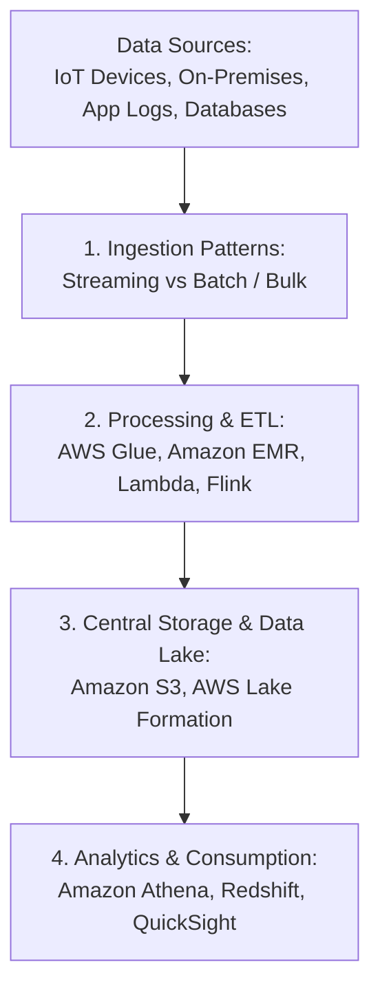
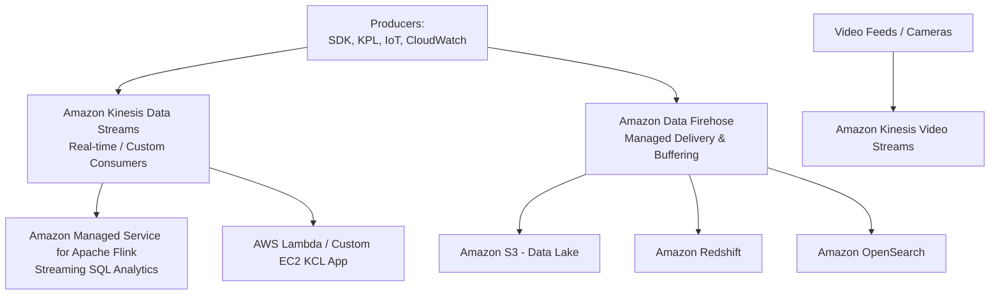
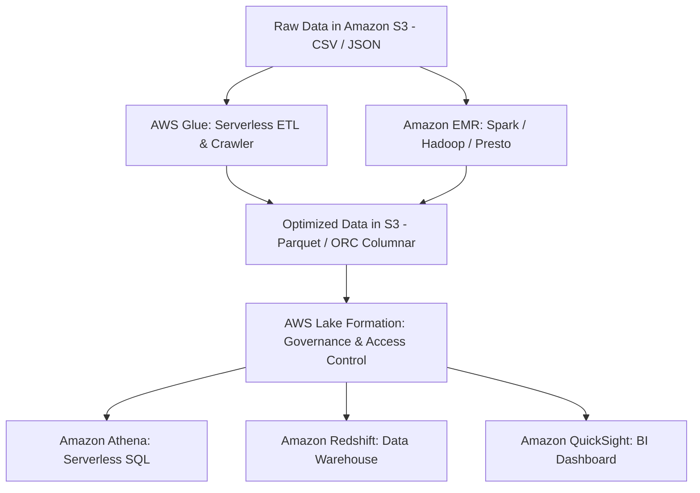
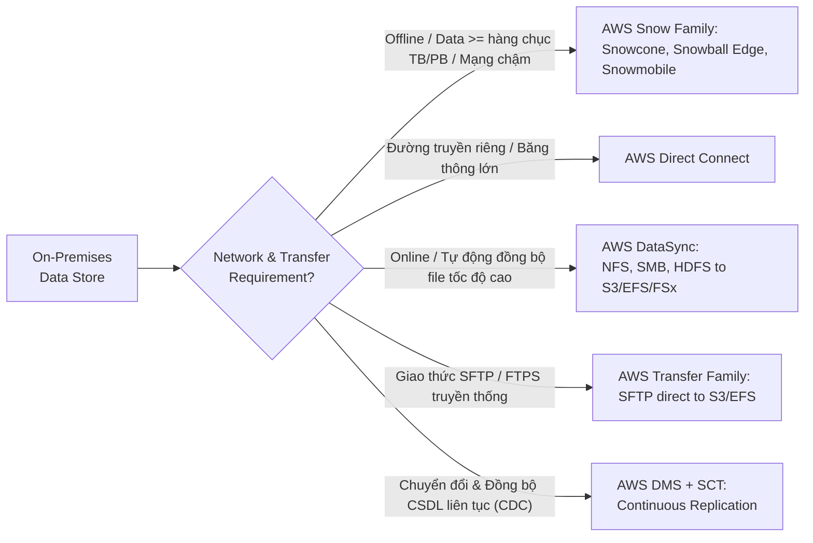
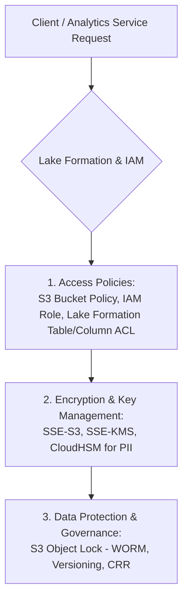

# Determine High-Performing Data Ingestion and Transformation Solutions (Domain 3 - SAA-C03)

## 1. Tổng quan về Data Ingestion & Transformation trên AWS

Quá trình thu nạp dữ liệu (**Data Ingestion**) và chuyển đổi dữ liệu (**Data Transformation**) là bước khởi đầu quan trọng trong việc xây dựng Data Lake, Data Warehouse, Machine Learning (ML) và hệ thống phân tích thời gian thực trên AWS.

### 1.1. Mô hình Thu nạp Dữ liệu (Ingestion Patterns)

* **Homogeneous Ingestion (Thu nạp đồng nhất):**
  * Dữ liệu chuyển đến đích giữ nguyên định dạng hoặc cùng kiểu storage engine với nguồn.
  * **Trọng tâm:** Tốc độ truyền tải (*speed of transfer*), toàn vẹn dữ liệu (*integrity protection*), tự động hóa luồng nạp liên tục.
  * **Công cụ tiêu biểu:** AWS DataSync, Amazon Athena, Amazon EMR, S3 Replication.
* **Heterogeneous Ingestion (Thu nạp không đồng nhất):**
  * Dữ liệu cần được chuẩn hóa, làm sạch, trích xuất thuộc tính (*feature extraction*) hoặc chuyển đổi định dạng (ví dụ: JSON/CSV $\rightarrow$ Parquet/ORC) trước hoặc trong khi lưu vào kho đích.
  * **Trọng tâm:** Tối ưu hóa định dạng cho truy vấn, tích hợp ML pipeline.
  * **Công cụ tiêu biểu:** AWS Glue ETL, Amazon Kinesis + Lambda, EMR Spark jobs.

---

## 2. Xử lý Dữ liệu Luồng Thời gian thực (Streaming Ingestion & Processing)

### 2.1. So sánh Kinesis Data Streams vs Amazon Data Firehose

| Tiêu chí | Amazon Kinesis Data Streams (KDS) | Amazon Data Firehose |
| :--- | :--- | :--- |
| **Bản chất** | Dịch vụ streaming thời gian thực (*real-time*), độ trễ thấp (sub-second, ~70ms). | Dịch vụ tự động load dữ liệu luồng vào kho lưu trữ đích (*near real-time*). |
| **Độ trễ** | Thời gian thực (sub-second / millisecond). | Cận thời gian thực (Buffer interval: 60 - 900s hoặc Buffer size: 1 - 128MB). |
| **Quản lý & Scaling** | Quản lý theo **Shards** (1 MB/s in, 2 MB/s out/shard) hoặc On-Demand Mode. | Serverless hoàn toàn, tự động co giãn không cần cấu hình Shards. |
| **Lưu trữ / Retention** | Lưu trữ từ **1 đến 365 ngày** (mặc định 24h), hỗ trợ replay dữ liệu. | **Không lưu trữ** (dữ liệu đi qua buffer rồi đẩy trực tiếp vào destination/S3 backup). |
| **Transformation** | Yêu cầu viết consumer (Lambda, KCL trên EC2/ECS, Flink). | Hỗ trợ inline transformation tự động thông qua **AWS Lambda blueprint** tích hợp sẵn. |
| **Đích đến (Destinations)** | Đa dạng tùy biến consumer. | Tích hợp sẵn: **S3, Redshift, OpenSearch, HTTP Endpoints, Splunk, Snowflake**. |
| **Use Case điển hình** | Ứng dụng real-time dashboards, custom fraud detection, nhiều consumer cùng đọc một stream. | Đơn giản hóa việc nạp log/events vào Data Lake (S3), Elasticsearch/OpenSearch hoặc Redshift. |

### 2.2. Các dịch vụ Kinesis khác & Managed Streaming

* **Amazon Managed Service for Apache Flink (trước đây là Kinesis Data Analytics):**
  * Thực thi truy vấn SQL và phân tích stream phức tạp theo thời gian thực (sliding windows, aggregations, anomaly detection).
* **Amazon Kinesis Video Streams (KVS):**
  * Thu nạp, mã hóa và lưu trữ luồng video/âm thanh thời gian thực từ camera, drone, thiết bị IoT để phục vụ ML (Amazon Rekognition Video) và analytics.
* **Amazon Managed Streaming for Apache Kafka (Amazon MSK):**
  * Dịch vụ quản lý Apache Kafka tương thích 100% mã nguồn mở. Lựa chọn tối ưu khi doanh nghiệp đã có sẵn hệ sinh thái Kafka on-premises muốn di chuyển lên AWS mà không phải viết lại code consumer/producer.

---

## 3. Chuyển đổi và Tối ưu hóa Dữ liệu Lớn (Big Data ETL & Optimization)

### 3.1. So sánh AWS Glue vs Amazon EMR

| Tiêu chí | AWS Glue | Amazon EMR (Elastic MapReduce) |
| :--- | :--- | :--- |
| **Kiến trúc** | **Serverless ETL** hoàn toàn, tính phí theo Data Processing Units (DPU) trên giây. | Cụm máy chủ EC2 quản lý chạy Hadoop, Spark, Hive, Presto, Trino, HBase. |
| **Tính năng cốt lõi** | **Glue Data Catalog** (Metadata), **Glue Crawlers** (tự động suy luận schema), Glue Studio, Glue DataBrew. | Xử lý Big Data quy mô Petabyte/Exabyte, hỗ trợ tùy biến sâu cấu hình cluster, libraries. |
| **Khả năng kiểm soát** | Managed hoàn toàn, không cần cấu hình hạ tầng máy chủ hay OS. | Kiểm soát toàn quyền cụm EC2, có thể dùng Spot Instances để tối ưu chi phí cực lớn. |
| **Use Case** | Tác vụ ETL định kỳ, lập danh mục metadata tập trung cho Data Lake, schema discovery. | Xử lý dữ liệu lớn chuyên sâu, chạy machine learning workloads lớn, migrate Hadoop/Spark on-premises. |

### 3.2. Best Practices Tối ưu hóa Hiệu năng trên Data Lake (Amazon S3)

1. **Chuyển đổi sang định dạng Columnar (Dạng cột):**
   * Chuyển đổi dữ liệu từ định dạng dòng (CSV, JSON) sang định dạng cột (**Apache Parquet**, **Apache ORC**) kết hợp nén (**Snappy, GZIP**).
   * **Lợi ích:** Giảm đến 80-90% dung lượng lưu trữ trên S3, chỉ đọc các cột cần thiết giúp tăng tốc độ truy vấn trên Athena/Redshift Spectrum và giảm mạnh chi phí quét dữ liệu ($/TB scanned).
2. **Phân vùng Dữ liệu (Data Partitioning):**
   * Phân vùng dữ liệu theo cấu trúc thư mục hợp lý (ví dụ: `s3://my-bucket/logs/year=2026/month=09/day=13/`).
   * Giúp Athena và Glue loại trừ các phân vùng không liên quan (*Partition Pruning*), tránh quét toàn bộ bucket.
3. **Tối ưu hóa Kích thước Đối tượng (Object Sizing):**
   * Tránh vấn đề "nhiều file dung lượng nhỏ" (*Small files problem*) gây nghẽn S3 metadata và I/O.
   * Kích thước file lý tưởng cho truy vấn phân tích: **128 MB – 512 MB/file**.
4. **Mở rộng quy mô Request S3 (S3 Horizontal Scaling):**
   * S3 tự động đạt thông lượng **3,500 PUT/POST/DELETE** và **5,500 GET/HEAD requests/giây** trên mỗi tiền tố (prefix).
   * Phân chia prefix hợp lý để phân tán I/O khi chạy hàng trăm task EMR/Glue đồng thời.

---

## 4. Thu nạp Dữ liệu từ Môi trường On-Premises lên AWS (Hybrid & Data Transfer)

### 4.1. Ma trận Lựa chọn Công cụ Di chuyển Dữ liệu

| Dịch vụ | Giao thức / Nguồn hỗ trợ | Mục đích & Đặc điểm chính |
| :--- | :--- | :--- |
| **AWS Snow Family** | Thiết bị vật lý ngoại tuyến (*Offline transport*). | Dùng khi khối lượng dữ liệu khổng lồ (hàng chục TB đến hàng PB) mà băng thông mạng Internet mất hàng tháng/năm để upload. |
| **AWS DataSync** | NFS, SMB, HDFS, S3, Azure Blob, GCP Storage. | Tự động hóa truyền dữ liệu tốc độ cao qua mạng, nhanh gấp 10x so với công cụ mã nguồn mở, hỗ trợ mã hóa và kiểm tra toàn vẹn tự động. |
| **AWS Transfer Family** | SFTP, FTPS, FTP, AS2. | Cung cấp serverless endpoint để các đối tác/hệ thống cũ gửi nhận file an toàn trực tiếp vào Amazon S3 hoặc Amazon EFS. |
| **AWS Storage Gateway** | NFS, SMB, iSCSI, VTL. | Cầu nối lưu trữ lai: **S3 File Gateway** (lưu file on-prem cache, backend là S3), **Volume Gateway** (block storage EBS backup), **Tape Gateway** (thay thế băng từ lưu trữ trên S3 Glacier). |
| **AWS DMS (Database Migration Service)** | RDBMS (Oracle, SQL Server, MySQL, Postgres), NoSQL, S3. | Di chuyển CSDL đồng nhất/không đồng nhất với độ trễ tối thiểu (kèm tính năng **CDC - Change Data Capture** để đồng bộ liên tục không gián đoạn hệ thống). |

---

## 5. Bảo mật & Quản trị Tập trung trên Data Lake (Security & Governance)

### 5.1. Quản lý Truy cập (Access Control)
* **AWS Lake Formation:** Cung cấp mô hình phân quyền bảo mật tập trung cho Data Lake trên S3, cho phép cấp quyền chi tiết đến cấp độ **Table-level, Column-level, Row-level** và thậm chí là **Cell-level filtering**.
* **S3 Bucket Policies & IAM Policies:** Quản lý quyền truy cập phân tán giữa các tài khoản AWS khác nhau (*Cross-Account Access*).
* **Least Privilege:** Luôn gán IAM Role có quyền tối thiểu cho các worker EMR/Glue/Lambda khi truy cập dữ liệu S3.

### 5.2. Mã hóa Dữ liệu (Encryption & Key Management)
* **Encryption in Transit:** Luôn bắt buộc HTTPS qua TLS 1.2+ (cấu hình trong S3 Bucket Policy với điều kiện `"aws:SecureTransport": "false"` $\rightarrow$ Deny).
* **Encryption at Rest:**
  * **SSE-S3:** Mã hóa mặc định được quản lý bởi AWS (khóa AES-256).
  * **SSE-KMS:** Tùy chỉnh quyền kiểm soát khóa qua AWS KMS, hỗ trợ ghi log truy cập khóa trên CloudTrail và Key Rotation tự động.
  * **AWS CloudHSM:** Module bảo mật phần cứng chuyên dụng đáp ứng tiêu chuẩn FIPS 140-2 Level 3, dùng cho các ngành tài chính/ngân hàng hoặc lưu trữ dữ liệu PII yêu cầu quản lý phần cứng độc quyền.

### 5.3. Tuân thủ Quy định & Toàn vẹn Dữ liệu (Compliance & Integrity)
* **S3 Object Lock (WORM - Write Once, Read Many):** Ngăn chặn xóa hoặc ghi đè đối tượng trong một khoảng thời gian cố định hoặc vô thời hạn (chế độ *Governance mode* hoặc *Compliance mode*), đáp ứng các tiêu chuẩn pháp lý nghiêm ngặt.
* **S3 Versioning & Cross-Region Replication (CRR):** Đảm bảo tính sẵn sàng cao, bảo vệ chống xóa nhầm và hỗ trợ khôi phục sau thảm họa (Disaster Recovery).

---

## 6. Tổng kết Trọng tâm Thi SAA-C03 (Exam Tips)

1. **Real-time Streaming vs Batch Buffering:**
   * Cần **sub-second latency**, nhiều consumer đọc đồng thời, lưu trữ dữ liệu luồng $\rightarrow$ **Kinesis Data Streams**.
   * Cần nạp trực tiếp vào S3 / Redshift / OpenSearch đơn giản, serverless, chấp nhận trễ 60s+ $\rightarrow$ **Amazon Data Firehose**.
   * Cần truy vấn SQL real-time trên streaming data $\rightarrow$ **Managed Service for Apache Flink**.
2. **Serverless ETL vs Managed Cluster:**
   * Serverless, quản lý Data Catalog, tự động crawl schema, tác vụ ETL theo lịch $\rightarrow$ **AWS Glue**.
   * Cần chạy cụm Spark/Hadoop lớn quy mô PB, tối ưu chi phí bằng Spot Instances, tùy biến sâu $\rightarrow$ **Amazon EMR**.
3. **Tối ưu hóa Chi phí & Hiệu năng Query:**
   * Luôn nhớ: Chuyển đổi sang **Parquet/ORC + Snappy Compression + Partitioning** là chìa khóa vàng để tăng tốc Athena/EMR và giảm chi phí S3.
4. **Di chuyển Dữ liệu Lớn On-Premises:**
   * Offline, hàng chục TB đến hàng PB, băng thông mạng hạn chế $\rightarrow$ **Snowball Edge**.
   * Online, tự động hóa truyền file qua Internet/Direct Connect lên S3/EFS $\rightarrow$ **AWS DataSync**.
   * Đối tác gửi file qua chuẩn giao thức SFTP $\rightarrow$ **AWS Transfer Family**.
5. **Bảo mật & Governance:**
   * Phân quyền chi tiết Table/Column/Row-level $\rightarrow$ **AWS Lake Formation**.
   * Chống ghi đè/xóa theo chuẩn WORM cho compliance $\rightarrow$ **S3 Object Lock**.
