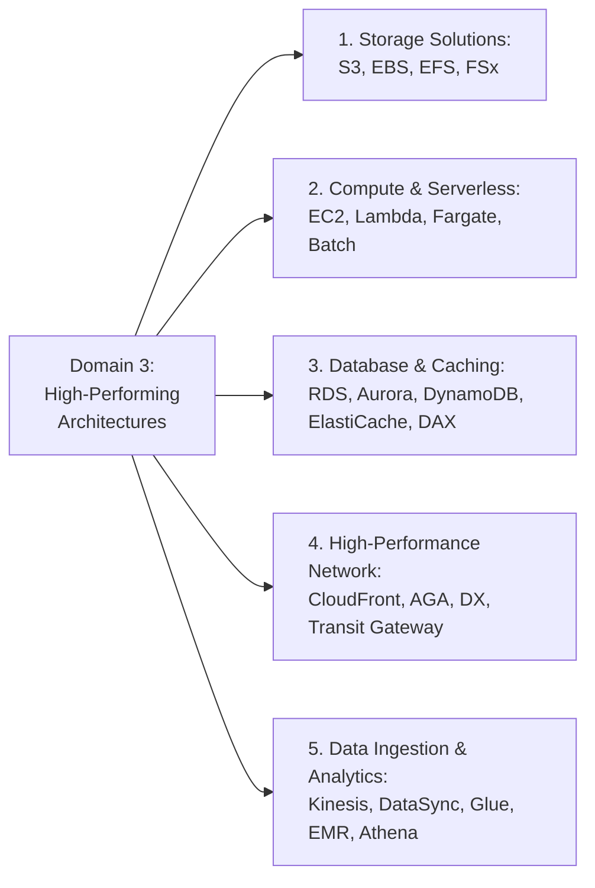
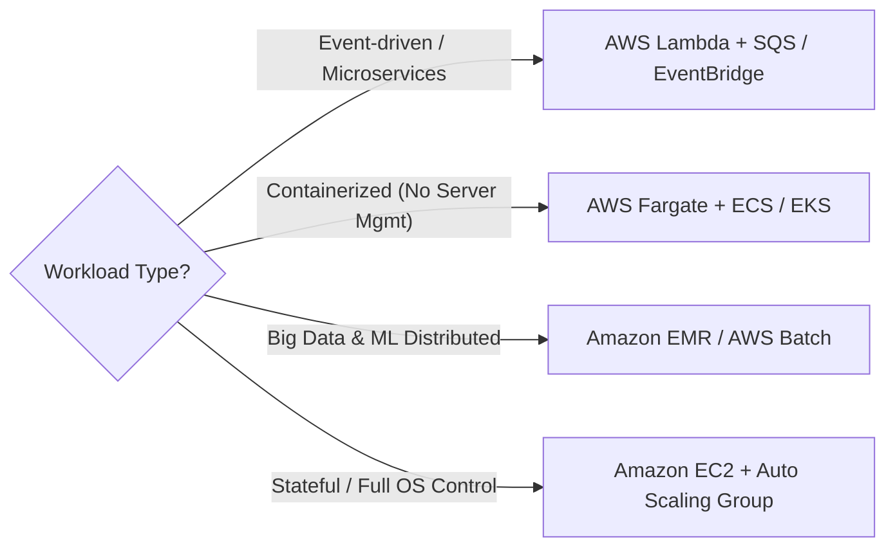
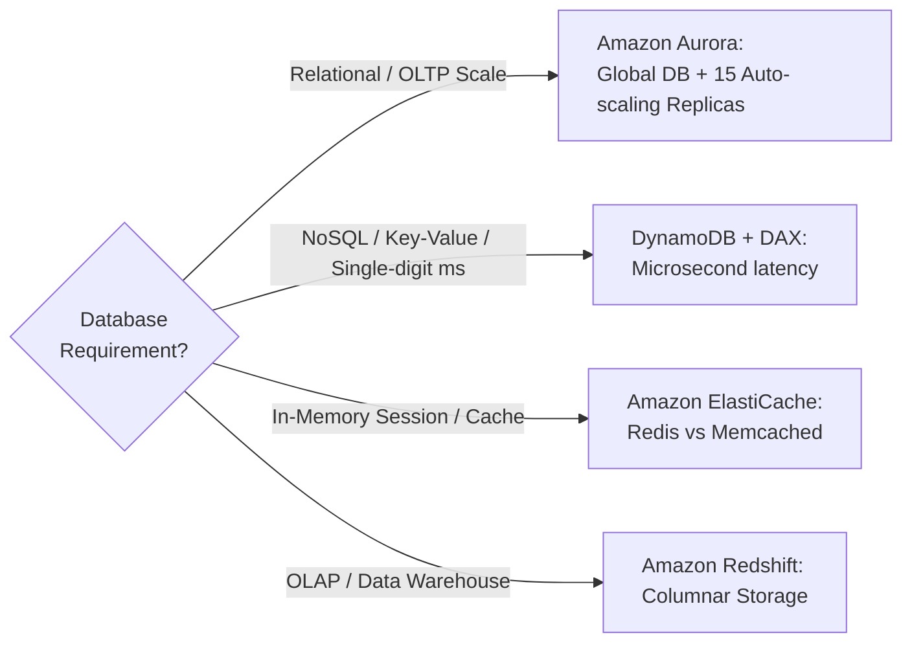
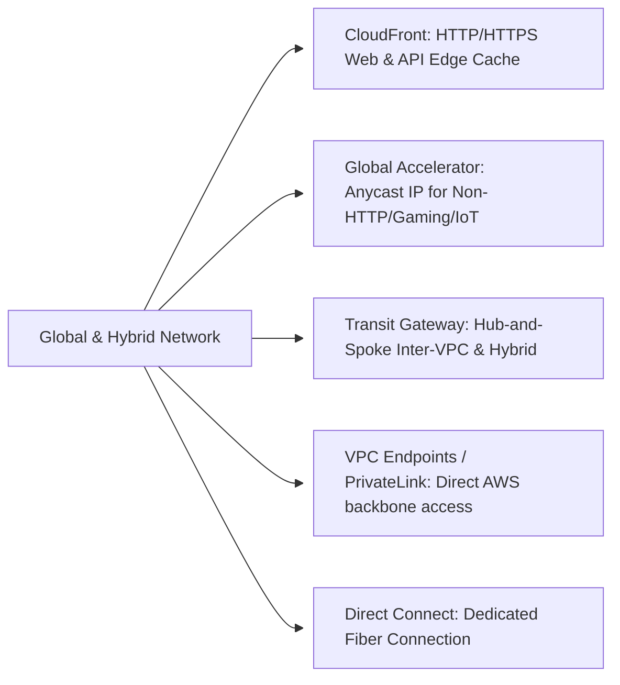

# Domain 3 Wrap-Up: Design High-Performing Architectures (SAA-C03)

## 1. Bản đồ Tổng quan Kiến trúc Hiệu năng cao (Domain 3 Architecture Map)

Domain 3 chiếm **24%** tổng số câu hỏi trong bài thi AWS Certified Solutions Architect - Associate (SAA-C03). Mục tiêu chính là lựa chọn và kết hợp các dịch vụ để đạt hiệu năng tối ưu, khả năng co giãn linh hoạt (*elasticity*) và độ trễ thấp nhất.

---

## 2. Tổng hợp Trọng tâm 5 Trụ cột Hiệu năng (Core Pillars Breakdown)

### 2.1. Trụ cột 1: Lưu trữ Hiệu năng cao & Co giãn (Storage)

| Loại hình Lưu trữ | Dịch vụ AWS | Đặc điểm Hiệu năng & Khả năng Mở rộng |
| :--- | :--- | :--- |
| **Object Storage** | **Amazon S3** | Co giãn không giới hạn; tự động đạt **3,500 PUT/POST** & **5,500 GET requests/s** trên mỗi prefix; tối ưu bằng Byte-Range Fetch & Multipart Upload. |
| **Block Storage** | **Amazon EBS** | Gắn đơn instance; dòng SSD: **io2 Block Express** (tối đa 256,000 IOPS, 4,000 MB/s), **gp3** (3,000 IOPS & 125 MB/s baseline có thể tùy chỉnh độc lập với dung lượng). |
| **Linux File Storage** | **Amazon EFS** | Network file system (NFSv4), chia sẻ cho hàng nghìn EC2/Lambda đồng thời; chế độ *General Purpose* vs *Max I/O*; *Bursting* vs *Provisioned Throughput*. |
| **Specialized File Storage** | **Amazon FSx** | **FSx for Lustre** (HPC, Machine Learning, sub-millisecond latency, liên kết S3); **FSx for Windows File Server** (SMB, Active Directory). |

---

### 2.2. Trụ cột 2: Tính toán & Serverless (Compute & Elasticity)

* **AWS Lambda & Serverless Scale:**
  * **Concurrency Limit:** Soft limit mặc định là 1,000 concurrent executions per Region (có thể xin tăng quota).
  * **Xử lý lỗi với SQS:** Cấu hình *Visibility Timeout*, *Dead-Letter Queue (DLQ)* sau số lần retry thất bại (*maxReceiveCount*), và *Batch Size* hợp lý.
* **API Gateway:** Cấu hình **Throttling** (Rate & Burst limits) và **Usage Plans / Quotas** để bảo vệ backend khỏi quá tải.
* **AWS AppSync:** Cung cấp giao diện **GraphQL** linh hoạt, tổng hợp dữ liệu từ nhiều nguồn (DynamoDB, Lambda, HTTP APIs) qua 1 request duy nhất với tính năng real-time subscriptions qua WebSockets.
* **Orchestration:** **AWS Step Functions** cho workflow phức tạp, **Amazon EventBridge** cho bus sự kiện phân tán.

---

### 2.3. Trụ cột 3: Cơ sở Dữ liệu & Chiến lược Caching (Database & Caching)

#### Bảng so sánh Chiến lược Caching & Read Scaling:

| Tình huống / Giải pháp | Amazon RDS Read Replicas | Amazon ElastiCache (Redis/Memcached) | Amazon DynamoDB DAX |
| :--- | :--- | :--- | :--- |
| **Nguyên lý** | Tạo thêm các bản sao chỉ đọc (tối đa 15 bản sao cho RDS/Aurora) để giảm tải cho Primary DB. | Lưu trữ dữ liệu thường truy vấn vào RAM (In-Memory Cache) phía trước CSDL. | In-Memory Cache chuyên dụng gắn liền phía trước DynamoDB. |
| **Độ trễ** | Milliseconds. | Sub-millisecond (Microseconds). | Microseconds (cho Point Reads). |
| **Phù hợp nhất khi** | Ứng dụng có các câu truy vấn phức tạp (complex SQL queries, reporting) chạy thường xuyên trên nhiều dữ liệu khác nhau. | Ứng dụng đọc lặp đi lặp lại cùng một tập dữ liệu cố định (*read-heavy, highly repetitive reads*). | Cần tăng tốc đọc tức thì cho bảng DynamoDB mà không cần sửa code logic ứng dụng. |

#### Chiến lược Caching Cơ bản:
1. **Lazy Loading (Cache-Aside):** Chỉ nạp dữ liệu vào cache khi bị Cache Miss. Ưu điểm: Tiết kiệm bộ nhớ; Nhược điểm: Chịu phạt độ trễ ở lần đọc đầu tiên và có nguy cơ dữ liệu cũ (*stale data*).
2. **Write-Through:** Ghi đồng thời vào cache và database. Ưu điểm: Dữ liệu luôn mới; Nhược điểm: Tốn tài nguyên ghi và chiếm RAM cho cả dữ liệu ít đọc.

#### Capacity Planning DynamoDB:
* **On-Demand Capacity:** Lựa chọn hoàn hảo khi tải **không thể dự đoán trước** hoặc ứng dụng mới ra mắt chưa rõ lưu lượng truy cập.
* **Provisioned Capacity:** Lựa chọn tối ưu chi phí khi lưu lượng **ổn định, có quy luật rõ ràng**, kết hợp với Auto Scaling RCU/WCU.

---

### 2.4. Trụ cột 4: Mạng & Tăng tốc Truyền tải (High-Performing Network)

* **Amazon CloudFront:** Tối ưu hóa phân phối nội dung tĩnh/động qua mạng lưới Edge Locations toàn cầu, hỗ trợ caching và TLS termination.
* **AWS Global Accelerator (AGA):** Dùng 2 địa chỉ **Static Anycast IP** định tuyến lưu lượng qua mạng trục AWS Backbone, tối ưu hóa giao thức TCP/UDP, VoIP, Gaming, IoT mà không cần caching.
* **VPC Endpoints:**
  * **Gateway Endpoints:** Cấu hình route table cho **S3** và **DynamoDB** (miễn phí).
  * **Interface Endpoints (PrivateLink):** Dùng ENI riêng trong subnet cho các dịch vụ AWS khác.
* **Hybrid Connectivity:** **AWS Direct Connect** (đường truyền vật lý riêng, thông lượng lớn, độ trễ ổn định) vs **Site-to-Site VPN** (nhanh, rẻ, chạy qua Internet).

---

### 2.5. Trụ cột 5: Thu nạp Dữ liệu & Chuyển đổi (Data Ingestion & Big Data)

* **Streaming:**
  * **Kinesis Data Streams:** Real-time ingestion, quản lý Shard, lưu trữ 1–365 ngày cho nhiều consumer.
  * **Amazon Data Firehose:** Serverless, tự động gom buffer nạp vào S3/Redshift/OpenSearch.
  * **Managed Service for Apache Flink:** Phân tích dữ liệu luồng bằng SQL.
* **ETL & Data Lake:**
  * **AWS Glue:** Serverless ETL, Crawler tự động tạo Data Catalog.
  * **Amazon EMR:** Xử lý Big Data quy mô PB với Spark/Hadoop, hỗ trợ Spot Instances tiết kiệm 90% chi phí.
  * **Tối ưu S3 Data Lake:** Luôn dùng định dạng **Parquet/ORC + Snappy Compression + Partitioning**.
* **Migration & Hybrid Transfer:**
  * **AWS Snow Family:** Vận chuyển offline khi dữ liệu $\ge$ hàng chục TB/PB.
  * **AWS DataSync:** Tự động hóa truyền file tốc độ cao online (NFS/SMB/HDFS $\rightarrow$ S3/EFS).
  * **AWS Transfer Family:** Serverless endpoint SFTP/FTPS/FTP vào S3/EFS.
  * **AWS DMS:** Di chuyển CSDL với tính năng đồng bộ liên tục CDC.

---

## 3. Các kịch bản Phân định Quyết định thi SAA-C03 (Decision Scenarios)

### 📌 Kịch bản 1: CSDL RDS MySQL bị nghẽn do đọc nhiều (Read-Heavy)
* **Câu hỏi:** Khi nào chọn **Read Replicas**, khi nào chọn **ElastiCache**?
* **Đáp án:**
  * Chọn **ElastiCache** nếu hệ thống đọc lặp lại cùng một dữ liệu nhiều lần (ví dụ: top sản phẩm, user session, bảng xếp hạng).
  * Chọn **Read Replicas** nếu các truy vấn đọc là các câu lệnh SQL phân tích phức tạp, lấy các tập dữ liệu khác nhau hoặc phục vụ hệ thống báo cáo (BI/Reporting).

### 📌 Kịch bản 2: Ứng dụng mới với DynamoDB chưa rõ mô hình lưu lượng
* **Câu hỏi:** Chọn **On-Demand** hay **Provisioned Capacity**?
* **Đáp án:** Chọn **On-Demand Capacity** cho giai đoạn launch ban đầu để không bị nghẽn (throttling) và đo lường lưu lượng thực tế. Sau khi traffic đã ổn định và dự đoán được, có thể chuyển sang **Provisioned Capacity** kết hợp Auto Scaling để tối ưu hóa chi phí.

### 📌 Kịch bản 3: Xử lý sự kiện quy mô lớn với SQS + Lambda
* **Câu hỏi:** Làm thế nào để đảm bảo không bị quá tải và không mất dữ liệu?
* **Đáp án:** 
  1. Cấu hình **Visibility Timeout** của SQS $\ge 6 \times$ Lambda Function Timeout.
  2. Thiết lập **Dead-Letter Queue (DLQ)** với `maxReceiveCount` (thường là 3-5 lần) để cô lập các tin nhắn lỗi.
  3. Cài đặt **Reserved Concurrency** trên Lambda để tránh ngốn toàn bộ concurrency quota của Region.

### 📌 Kịch bản 4: Tăng tốc ứng dụng toàn cầu cho giao thức Non-HTTP (TCP/UDP)
* **Câu hỏi:** Chọn CloudFront hay AWS Global Accelerator?
* **Đáp án:** Chọn **AWS Global Accelerator** vì CloudFront chỉ hỗ trợ HTTP/HTTPS/WebSockets và dựa trên HTTP Caching, trong khi Global Accelerator định tuyến Anycast IP qua mạng trục AWS cho mọi giao thức TCP/UDP.
