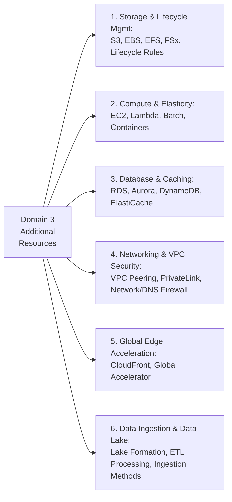

# Additional Resources: Domain 3 - Design High-Performing Architectures (SAA-C03)

Tài liệu tổng hợp các đường dẫn chính thức từ AWS Whitepapers, AWS Documentation và hướng dẫn kiến trúc chuyên sâu phục vụ ôn luyện và tra cứu cho **Domain 3: Design High-Performing Architectures**.

---

## 1. Lưu trữ & Vòng đời Dữ liệu (Storage & Lifecycle Management)

* **[Storage on AWS (Whitepaper)](https://docs.aws.amazon.com/whitepapers/latest/aws-overview/storage-services.html)**:
  * Tổng quan so sánh 3 loại hình lưu trữ: **Object** (Amazon S3), **Block** (Amazon EBS), và **File** (Amazon EFS, Amazon FSx).
  * Quy tắc lựa chọn dịch vụ lưu trữ dựa trên thông lượng (Throughput), IOPS, tính chia sẻ đa máy chủ và chi phí.
* **[Cloud Storage on AWS (Product Overview)](https://aws.amazon.com/products/storage/)**:
  * Các giải pháp lưu trữ Hybrid (AWS Storage Gateway, DataSync, Snow Family).
* **[Managing your storage lifecycle (Amazon S3 Guide)](https://docs.aws.amazon.com/AmazonS3/latest/userguide/object-lifecycle-mgmt.html)**:
  * Thiết lập quy tắc **S3 Lifecycle Configuration**:
    * **Transition Actions**: Tự động chuyển đổi các đối tượng ít truy cập theo thời gian ($S3\text{ Standard} \rightarrow S3\text{ Standard-IA} \rightarrow S3\text{ Glacier Flexible/Deep Archive}$).
    * **Expiration Actions**: Tự động xóa đối tượng hoặc các phiên bản cũ (*noncurrent versions*) sau số ngày quy định.

---

## 2. Dịch vụ Tính toán & Co giãn (Compute Services)

* **[Compute Services (AWS Overview Whitepaper)](https://docs.aws.amazon.com/whitepapers/latest/aws-overview/compute-services.html)**:
  * So sánh hạ tầng tính toán: Máy chủ ảo (**Amazon EC2**), Serverless (**AWS Lambda**), Quản lý container (**Amazon ECS/EKS** với **AWS Fargate**), và Xử lý hàng loạt theo lô (**AWS Batch**).
  * Lựa chọn instance type tối ưu theo mục đích: Compute Optimized (dòng C), Memory Optimized (dòng R/X), Storage Optimized (dòng I/D), Accelerated Computing (dòng P/G cho GPU).

---

## 3. Cơ sở Dữ liệu trên AWS (Databases on AWS)

* **[Databases on AWS (Whitepaper)](https://docs.aws.amazon.com/whitepapers/latest/aws-overview/database.html)**:
  * Phân loại mục đích chuyên biệt (*Purpose-built Databases*):
    * **Relational / OLTP**: Amazon RDS, Amazon Aurora.
    * **Key-Value / Document**: Amazon DynamoDB, Amazon DocumentDB.
    * **In-Memory Cache**: Amazon ElastiCache (Redis, Memcached), DynamoDB DAX.
    * **Data Warehouse / OLAP**: Amazon Redshift.
    * **Graph**: Amazon Neptune.
    * **Time Series**: Amazon Timestream.

---

## 4. Mạng Nâng cao, VPC & Tường lửa (Networking & VPC Security)

* **[Networking in Amazon EC2](https://docs.aws.amazon.com/AWSEC2/latest/UserGuide/ec2-networking.html)**:
  * Tối ưu hóa băng thông mạng EC2: **Enhanced Networking** sử dụng **ENA (Elastic Network Adapter)** lên tới 100+ Gbps; **EFA (Elastic Fabric Adapter)** cho ứng dụng tính toán hiệu năng cao HPC và MPI; cấu hình **Cluster Placement Group** để đạt độ trễ mạng dưới 1ms giữa các node.
* **[Get started with Amazon VPC](https://docs.aws.amazon.com/vpc/latest/userguide/vpc-getting-started.html)**:
  * Nguyên lý thiết kế VPC cơ bản: CIDR blocks, Public/Private Subnets, Internet Gateway (IGW), NAT Gateway, Route Tables và Security Groups / NACLs.
* **[Connect VPCs using VPC peering](https://docs.aws.amazon.com/vpc/latest/userguide/vpc-peering.html)**:
  * Kết nối 1-1 giữa các VPC không qua Internet; lưu ý không hỗ trợ truyền bắc cầu (*Non-transitive*), không được trùng lặp dải IP (No overlapping CIDRs).
* **[Connect your VPC to services using AWS PrivateLink](https://docs.aws.amazon.com/vpc/latest/userguide/endpoint-services-overview.html)**:
  * Truy cập an toàn các dịch vụ AWS hoặc đối tác SaaS thông qua Interface VPC Endpoint với Private IP, giữ toàn bộ lưu lượng bên trong mạng riêng AWS.
* **[Filter network traffic using AWS Network Firewall](https://docs.aws.amazon.com/vpc/latest/userguide/network-firewall.html)**:
  * Dịch vụ tường lửa mạng có trạng thái (*stateful*) cấp độ L3-L7, tích hợp kiểm tra sâu gói tin (DPI), IPS/IDS và lọc URL/domain ở quy mô toàn VPC.
* **[Filter DNS traffic using Route 53 Resolver DNS Firewall](https://docs.aws.amazon.com/vpc/latest/userguide/resolver-dns-firewall.html)**:
  * Bảo vệ và kiểm soát các truy vấn DNS gửi ra ngoài từ bên trong VPC, chống rò rỉ dữ liệu qua DNS (*DNS data exfiltration*) và chặn các domain độc hại.
* **[Scenarios with VPCs](https://docs.aws.amazon.com/vpc/latest/userguide/vpc-scenarios-intro.html)**:
  * Các kịch bản mạng phổ biến: Public & Private Subnets, Multi-Tier Web Architecture, DMZ Subnet cho thiết bị tường lửa kiểm tra tập trung.

---

## 5. Tăng tốc Truyền tải Toàn cầu (Global Edge Acceleration)

* **[What is AWS Global Accelerator?](https://docs.aws.amazon.com/global-accelerator/latest/dg/what-is-global-accelerator.html)**:
  * Sử dụng 2 địa chỉ **Static Anycast IP** để dẫn đường trực tiếp người dùng vào mạng trục toàn cầu của AWS; tối ưu hóa cho các ứng dụng TCP/UDP, game servers, IoT và các dịch vụ phi HTTP không thể dùng web caching.
* **[What is Amazon CloudFront?](https://docs.aws.amazon.com/AmazonCloudFront/latest/DeveloperGuide/Introduction.html)**:
  * Mạng lưới phân phối nội dung toàn cầu (CDN) phục vụ caching nội dung tĩnh và tối ưu hóa động (HTTP/HTTPS), tích hợp AWS WAF, Lambda@Edge và CloudFront Functions.

---

## 6. Thu nạp, Xử lý Dữ liệu & Data Lake (Data Ingestion & Big Data)

* **[Data ingestion methods (Data Lakes Whitepaper)](https://docs.aws.amazon.com/whitepapers/latest/building-data-lakes/data-ingestion-methods.html)**:
  * Các phương pháp thu nạp dữ liệu: Real-time Streaming (Kinesis Data Streams, MSK), Batch Upload (DataSync, S3 API), Offline Bulk Transfer (Snow Family).
* **[Data processing (Data Warehousing on AWS Whitepaper)](https://docs.aws.amazon.com/whitepapers/latest/data-warehousing-on-aws/data-processing.html)**:
  * Xây dựng pipeline xử lý dữ liệu lớn với AWS Glue, Amazon EMR và Amazon Athena; tối ưu hóa hiệu năng bằng cấu trúc lưu trữ dạng cột (Parquet/ORC).
* **[What is AWS Lake Formation?](https://docs.aws.amazon.com/lake-formation/latest/dg/what-is-lake-formation.html)**:
  * Dịch vụ đơn giản hóa việc thiết lập, bảo mật và quản trị Data Lake tập trung trên S3 với khả năng phân quyền chi tiết (Table, Column, Row-level security).
