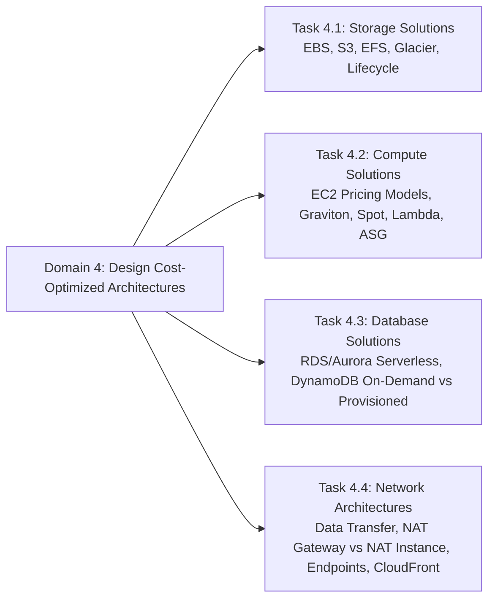

# Domain 4: Design Cost-Optimized Architectures - Overview & Introduction (SAA-C03)

## 1. Tổng quan Domain 4 (Design Cost-Optimized Architectures)
Trong kỳ thi **AWS Certified Solutions Architect - Associate (SAA-C03)**, Domain 4 tập trung vào việc **thiết kế các kiến trúc tối ưu hóa chi phí (Cost-Optimized Architectures)**.

> **Định nghĩa Tối ưu hóa Chi phí (Cost Optimization):**  
> Là năng lực mang lại giá trị kinh doanh cao nhất với **mức chi phí thấp nhất (delivering business value at the lowest price point)**.

Để làm chủ Domain 4, cần nắm vững trụ cột **Cost Optimization Pillar** thuộc **AWS Well-Architected Framework**, bao gồm các nguyên lý thiết kế (*design principles*) và thực hành chuẩn (*best practices*).

---

## 2. Các Trụ Cột Kỹ Thuật Trọng Tâm trong Domain 4

---

## 3. Cấu trúc 4 Task Statements của Domain 4

Domain 4 được phân rã thành **4 Task Statements** cốt lõi:

| Task Statement | Trọng tâm Kiến trúc & Dịch vụ AWS liên quan |
| :--- | :--- |
| **Task Statement 4.1** Design cost-optimized storage solutions | - Lựa chọn Storage Tiering và S3 Lifecycle Policies (S3 Standard, Intelligent-Tiering, Standard-IA, One Zone-IA, Glacier Instant/Flexible/Deep Archive). - Tối ưu EBS Volume types (gp3 vs gp2, io2, st1, sc1), xóa unattached EBS volumes và old snapshots. - Tối ưu chi phí EFS (Infrequent Access tier, Lifecycle Management). |
| **Task Statement 4.2** Design cost-optimized compute solutions | - Lựa chọn mô hình định giá EC2 phù hợp: On-Demand, Spot Instances (cho fault-tolerant/stateless workloads), Savings Plans, Reserved Instances (RI). - Sử dụng Compute Optimizer và AWS Graviton Processors (tiết kiệm lên tới 40% price-performance). - Serverless-first với AWS Lambda / Fargate để loại bỏ chi phí idle compute. |
| **Task Statement 4.3** Design cost-optimized database solutions | - Lựa chọn cơ chế cấp phát CSDL: Aurora Serverless v2, DynamoDB Capacity Modes (On-Demand cho workload biến động vs Provisioned + Auto Scaling / Reserved Capacity). - RDS Reserved DB Instances cho cơ sở dữ liệu chạy liên tục (24/7). - Tối ưu Read Replicas, dừng tạm thời các Dev/Test DB instances khi không sử dụng. |
| **Task Statement 4.4** Design cost-optimized network architectures | - Giảm thiểu chi phí **Data Transfer Out (DTO)**: Sử dụng CloudFront, Direct Connect, S3 Transfer Acceleration hợp lý. - Tối ưu kết nối nội bộ AWS: VPC Endpoints (Gateway vs Interface Endpoints) để tránh cước DTO và NAT Gateway. - Thiết kế giải pháp NAT tối ưu (Single NAT Gateway vs Multi-AZ NAT Gateway dựa trên yêu cầu HA vs Chi phí). |

---

## 4. Nguyên Tắc Tối Ưu Chi Phí Cần Nhớ (Exam Mindset)

1. **Right-sizing trước khi cam kết dài hạn:** Luôn định cỡ đúng tài nguyên (Right-sizing) trước khi mua Reserved Instances hoặc Savings Plans.
2. **Loại bỏ lãng phí tài nguyên không dùng (Unused/Idle Resources):** Xác định và xóa các EBS volumes mồ côi (unattached), Elastic IPs chưa gắn, old snapshots, và các idle load balancers.
3. **Sử dụng Tiering và Serverless tự động:** Tận dụng S3 Intelligent-Tiering, Aurora Serverless, và Auto Scaling để hệ thống tự động co giãn theo tải thực tế mà không tốn chi phí dự phòng dư thừa.
4. **Phân tích và kiểm soát chi phí liên tục:** Sử dụng AWS Cost Explorer, AWS Budgets, Cost Anomaly Detection và Allocation Tags để theo dõi chi tiêu.
