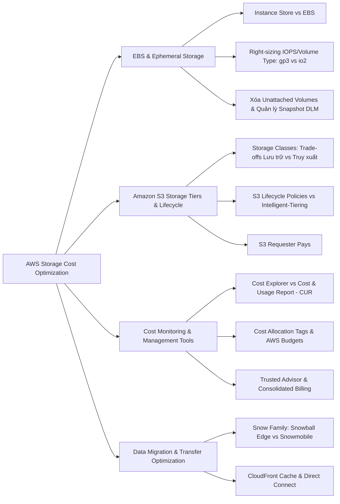
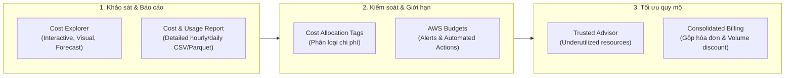

# Task Statement 4.1: Design Cost-Optimized Storage Solutions (SAA-C03)

## 1. Tổng quan & Tư duy Tối ưu Chi phí Lưu trữ (Exam Mindset)
Trong kiến trúc AWS, lưu trữ là một trong những thành phần phát sinh chi phí liên tục. Tối ưu hóa lưu trữ không chỉ là tìm giải pháp rẻ nhất mà là **lựa chọn đúng loại lưu trữ (Right-Sizing & Right-Tiering)** đáp ứng đủ yêu cầu kỹ thuật (hiệu năng, độ bền, độ trễ) với mức giá thấp nhất.

---

## 2. Tối ưu Chi phí Block Storage: Instance Store vs Amazon EBS

| Tiêu chí | Ephemeral Storage (Instance Store) | Amazon EBS (Elastic Block Store) |
| :--- | :--- | :--- |
| **Bản chất** | Ổ cứng gắn trực tiếp vật lý vào máy chủ chủ trì EC2. | Ổ cứng mạng độc lập (Network-attached Block Storage). |
| **Chi phí** | **Đã bao gồm sẵn trong giá thuê instance theo giờ** (Không tính thêm phí). | **Tính phí riêng biệt** theo dung lượng cấp phát (GB-month), IOPS, Throughput và Snapshot. |
| **Tính bền vững** | **Tạm thời (Volatile):** Mất dữ liệu khi instance `Stop`, `Terminate` hoặc phần cứng lỗi. | **Bền vững (Persistent):** Dữ liệu tồn tại độc lập ngay cả khi instance bị tắt/xóa. |
| **Use case tối ưu chi phí** | Temporary buffers, caches, scratch data, load-balanced stateless web tier. | Hệ điều hành (Root volume), CSDL, dữ liệu cần lưu trữ dài hạn và sao lưu. |

### Chiến lược tối ưu chi phí với Amazon EBS:
1. **Right-sizing dung lượng & IOPS:**
   - Tránh over-provisioning dung lượng hoặc IOPS vượt quá nhu cầu thực tế.
   - Chuyển đổi từ `io1/io2` (Provisioned IOPS đắt tiền) sang `gp3` (General Purpose SSD) nếu khối lượng công việc chỉ cần bursting IOPS hoặc có thể cấu hình độc lập baseline IOPS/Throughput trên `gp3` với giá rẻ hơn nhiều.
2. **Xóa Unattached EBS Volumes:**
   - Khi xóa EC2 instance, các EBS volume phụ (non-root) hoặc volume không bật cờ `DeleteOnTermination` vẫn tiếp tục bị tính tiền dung lượng đã cấp phát.
   - Sử dụng **AWS Trusted Advisor** để tự động rà quét và gắn cờ các **unattached / idle EBS volumes**.
3. **Quản lý Vòng đời EBS Snapshots:**
   - Sử dụng **Amazon Data Lifecycle Manager (Amazon DLM)** hoặc **AWS Backup** để tự động tạo bản sao lưu, chuyển snapshot cũ sang archive và xóa các snapshot hết hạn sử dụng.

---

## 3. Tối ưu Chi phí Object Storage: Amazon S3

Amazon S3 cung cấp độ bền $99.999999999\%$ (11 nines), không giới hạn dung lượng lưu trữ, nhưng có nhiều Storage Classes khác nhau với sự đánh đổi (trade-offs) giữa **Chi phí lưu trữ (Storage cost)** và **Chi phí truy xuất (Retrieval cost/time)**.

### So sánh các S3 Storage Classes & Chiến lược tối ưu:

| S3 Storage Class | Chi phí Lưu trữ ($/GB) | Chi phí Truy xuất ($/GB) | Thời gian Truy xuất | Đặc điểm & Phù hợp nhất cho |
| :--- | :--- | :--- | :--- | :--- |
| **S3 Standard** | Cao nhất | Miễn phí | Tức thì (Milliseconds) | Dữ liệu truy cập thường xuyên (Hot data). |
| **S3 Intelligent-Tiering** | Tự động tối ưu | Không có phí retrieval | Tức thì | Dữ liệu có **tần suất truy cập không xác định hoặc thay đổi liên tục**. Có phí giám sát nhỏ/object. |
| **S3 Standard-IA** | Thấp hơn | Có phí truy xuất | Tức thì | Dữ liệu ít truy cập (Infrequent Access) nhưng khi cần phải có ngay. Tối thiểu lưu trữ 30 ngày. |
| **S3 One Zone-IA** | Thấp hơn Standard-IA ($20\%$) | Có phí truy xuất | Tức thì | Dữ liệu ít truy cập, **chỉ lưu ở 1 AZ** $\rightarrow$ Dành cho dữ liệu thứ cấp, có thể tạo lại được. |
| **S3 Glacier Instant Retrieval** | Rất thấp | Có phí truy xuất | Tức thì (Milliseconds) | Dữ liệu lưu trữ (Archive) cần truy xuất ngay lập tức khi phát sinh yêu cầu. |
| **S3 Glacier Flexible Retrieval** | Cực thấp | Có phí truy xuất | Vài phút đến vài giờ (Expedited / Standard / Bulk) | Dữ liệu lưu trữ lưu trữ định kỳ (Backup/Archive) chấp nhận chờ. |
| **S3 Glacier Deep Archive** | Thấp nhất trên AWS | Có phí truy xuất | 12 - 48 giờ | Dữ liệu lưu trữ tuân thủ pháp lý (Compliance), lưu 7-10 năm, hiếm khi đọc lại. |

### Cơ chế tự động hóa chuyển đổi tầng (Tiering):
- **S3 Lifecycle Policies (Lifecycle Configuration):** Áp dụng quy tắc chuyển tầng tự động cho toàn bộ bucket/prefix dựa trên **mốc thời gian cố định** (Ví dụ: sau 30 ngày chuyển sang Standard-IA, sau 90 ngày chuyển sang Glacier, sau 365 ngày xóa hẳn).
- **S3 Intelligent-Tiering:** Tự động di chuyển **từng object riêng lẻ** giữa các tier (Frequent, Infrequent, Archive Instant, Archive Auto/Deep Auto) khi tần suất truy cập thay đổi mà **không tốn phí truy xuất**.
- **S3 Requester Pays Buckets:** Cấu hình để bên gửi yêu cầu tải dữ liệu (Requester) chi trả chi phí truy vấn và cước truyền dữ liệu (Data Transfer Out), thay vì chủ sở hữu bucket (Bucket Owner).

---

## 4. Công cụ Giám sát & Quản lý Chi phí (Cost Monitoring & Governance)

1. **AWS Cost Explorer vs AWS Cost and Usage Report (CUR):**
   - **Cost Explorer:** Cung cấp giao diện biểu đồ trực quan cấp cao (high-level interactive reports), xem xu hướng chi tiêu theo thời gian, dự báo chi phí tương lai (forecasting), drill-down theo dịch vụ, tag, Region.
   - **Cost and Usage Report (CUR):** Báo cáo toàn diện và chi tiết nhất của AWS, bóc tách chi phí theo từng giờ/ngày/tháng, từng tài nguyên và tag cụ thể; xuất dữ liệu ra S3 (CSV/Parquet) để phân tích bằng Athena/QuickSight.
2. **Cost Allocation Tags:**
   - Gắn tag cho tài nguyên (`Environment=Prod`, `CostCenter=Fin123`, `Project=AppA`) để kích hoạt trong Billing Console, giúp lọc và phân bổ chi phí minh bạch trên Cost Explorer/CUR.
3. **AWS Budgets & Billing Alarms:**
   - Thiết lập ngưỡng chi tiêu theo ngân sách dự tính.
   - Gửi thông báo SNS/Email hoặc **kích hoạt hành động tự động (Automated Actions)** qua IAM Policies hoặc Service Control Policies khi chi phí dự báo hoặc thực tế vượt ngưỡng.
4. **AWS Trusted Advisor:**
   - Đưa ra khuyến nghị tối ưu chi phí: Phát hiện unattached EBS volumes, idle Load Balancers, underutilized EC2/RDS, over-provisioned IOPS.
5. **AWS Organizations & Consolidated Billing:**
   - Gom hóa đơn nhiều tài khoản con về một tài khoản thanh toán duy nhất (Payer Account).
   - Tự động cộng dồn dung lượng lưu trữ (S3/EBS) và sử dụng tài nguyên giữa các tài khoản để đạt ngưỡng **Volume Discounts** (giảm giá theo bậc khối lượng).

---

## 5. Tối ưu Chi phí Di chuyển & Truyền Dữ liệu (Data Migration & Transfer)

### 1. Di chuyển dữ liệu lớn On-Premises lên S3 (Large Scale Data Migration):
- Nếu chuyển dữ liệu dung lượng lớn (từ hàng chục Terabytes đến hàng trăm Terabytes, ví dụ **250 TB**):
  - **Không nên** dùng đường truyền Internet công cộng (tốn băng thông, thời gian lâu, rủi ro đứt đoạn).
  - **Lựa chọn tối ưu:** Sử dụng **AWS Snowball Edge** (thiết bị vật lý dung lượng 80TB/100TB chuyển phát tận nơi), đặt nhiều thiết bị để transfer dữ liệu ngoại tuyến nhanh chóng, an toàn và tiết kiệm chi phí nhất.
  - **AWS Snowmobile:** Dành cho quy mô khổng lồ cấp độ Exabyte (100 PB / xe container).

### 2. Tối ưu cước Data Transfer Out (DTO):
- Cước mạng AWS: **Data Transfer In (DTI) là miễn phí**, **Data Transfer Out (DTO) ra Internet là có phí**.
- Sử dụng **Amazon CloudFront:** Caching dữ liệu tĩnh tại các Edge Location gần người dùng giúp giảm số lượng request tải về Origin, đồng thời cước DTO từ CloudFront thường rẻ hơn cước DTO trực tiếp từ EC2/S3 ra Internet.
- Sử dụng **AWS Direct Connect:** Cung cấp kết nối chuyên dụng riêng biệt, cước DTO qua Direct Connect thấp hơn so với DTO qua Internet công cộng.

---

## 6. Điểm Cần Nhớ Khi Đi Thi (Key Exam Takeaways)

| Câu hỏi tình huống | Lời giải tối ưu chi phí |
| :--- | :--- |
| Workload cần lưu trữ tạm thời, tốc độ cao, không cần lưu trữ dài hạn | **Instance Store (Ephemeral Storage)** (chi phí đã tính trong EC2 rate). |
| Workload có tần suất truy cập thay đổi khó dự đoán, muốn tránh phí retrieval | **S3 Intelligent-Tiering**. |
| Dữ liệu lưu trữ theo chu kỳ cố định (vd: 30 ngày xóa, 90 ngày archive) | **S3 Lifecycle Policies**. |
| Muốn chia sẻ dữ liệu lớn cho đối tác tải về nhưng không muốn chịu cước DTO | **S3 Requester Pays**. |
| Cần di chuyển 250 TB dữ liệu từ Data Center lên S3 nhanh nhất và rẻ nhất | **Đặt nhiều thiết bị AWS Snowball Edge**. |
| Phát hiện chi phí EBS tăng cao bất thường do dung lượng nhàn rỗi | Dùng **Trusted Advisor** tìm và xóa các **unattached EBS volumes**. |
| Báo cáo chi tiết chi phí đến từng giờ, từng resource ID để phân tích bằng SQL | **AWS Cost and Usage Report (CUR)** kết hợp **Amazon Athena**. |
