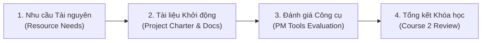

# Course 2: Project Initiation - Starting a Successful Project
## Module 4 - Bài học: Introduction: Utilizing Resources and Tools for Project Success

---

### 1. Tổng quan & Kết nối Kiến thức
- **Ôn tập Module 3:** Đã nắm vững cách xác định **vai trò và trách nhiệm (*roles and responsibilities*)** trong dự án, cùng các công cụ đảm bảo tính giải trình (*team accountability*) như **Phân tích các bên liên quan (*Stakeholder Analysis*)** và **Ma trận RACI (*RACI Chart*)**.
- **Trọng tâm Module 4:** Tập trung vào **tài nguyên dự án (*project resources*)**, **giá trị của tài liệu hóa (*value of documentation*)** và **công cụ quản lý dự án (*project management tools*)** để chuẩn bị cho giai đoạn khởi động (*kick-off*).

---

### 2. Mục tiêu Học tập của Module 4
Khi kết thúc Module 4, bạn sẽ có thể:
1. **Hiểu các loại tài nguyên (*resources*):** Nhận diện và nắm rõ các loại tài nguyên sẵn có mà một Project Manager có thể huy động và quản lý.
2. **Lập tài liệu dự án (*Project Charter*):** Biết cách hệ thống hóa và ghi nhận các thông tin cốt lõi vào một bản **Điều lệ dự án (*Project Charter*)** chính thức.
3. **Đánh giá & sử dụng công cụ (*Tools*):** So sánh và lựa chọn, sử dụng thành thạo các công cụ quản lý dự án khác nhau sao cho phù hợp với nhu cầu thực tế của nhóm.

---

### 3. Lộ trình Nội dung Module 4

- **Phần 1 — Understanding project resource needs:** Tìm hiểu các nguồn lực thiết yếu và cách quản lý tài nguyên để hoàn thành công việc.
- **Phần 2 — Developing documentation for project kick-off:** Giá trị của tài liệu dự án, đề xuất dự án (*Project Proposal*) và xây dựng bản *Project Charter*.
- **Phần 3 — Evaluating tools to meet project needs:** Khám phá các loại công cụ quản lý dự án phổ biến (như Google Sheets, v.v.), cách đánh giá và giới thiệu công cụ mới cho đội ngũ.
- **Phần 4 — Course review:** Thử thách Module 4 (*Module 4 Challenge*), tổng kết toàn bộ Course 2 và chuẩn bị bước sang Course 3.
