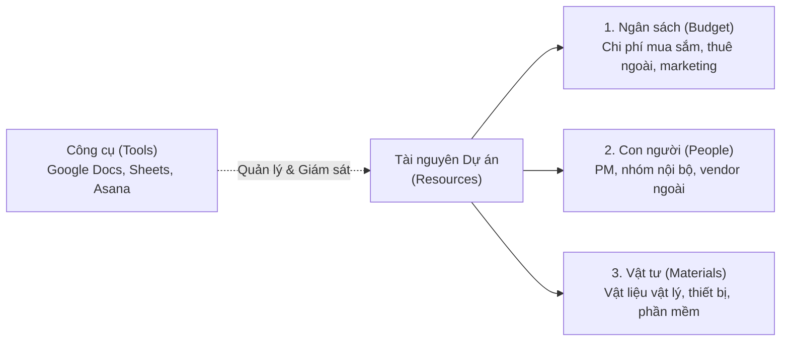

# Course 2: Project Initiation - Starting a Successful Project
## Module 4 - Bài học: Essential Project Resources

---

### 1. Vai trò của Nguồn lực trong giai đoạn Initiation
- Sau mục tiêu (*Goals*), phạm vi (*Scope*) và các bên liên quan (*Stakeholders*), PM cần xác định **Tài nguyên/Nguồn lực (*Resources*)**.
- **Câu hỏi then chốt:** *"Cần huy động thêm những gì để hoàn thành dự án?"*
- **Trách nhiệm của PM:** Không trực tiếp làm hết việc, mà **tạo điều kiện và hỗ trợ đội ngũ (*support the team*)** làm việc đúng tiến độ và ngân sách.
- **Xác định sớm giúp tránh rủi ro:**
  - **Thiếu nhân sự (*Understaffing*):** Làm nghẽn tiến độ và trễ hạn bàn giao.
  - **Đánh giá thấp ngân sách (*Underestimating budget*):** Không đủ kinh phí mua vật tư, thuê ngoài (*vendors*) hay trả thêm giờ (*overtime*).

---

### 2. Ba Nhóm Tài nguyên Cốt lõi & Công cụ Quản lý

- **Ngân sách (*Budget*):** Dự toán toàn bộ chi phí dự án. PM cần đặt câu hỏi để phát hiện **chi phí tiềm ẩn (*hidden costs*)** như thuế, phụ phí để đưa vào *Project Charter*.
- **Con người (*People*):** Đội ngũ thực thi gồm PM, nhân sự nội bộ và nhà thầu/đối tác bên ngoài có kỹ năng chuyên biệt.
- **Vật tư (*Materials*):** Các hạng mục/thiết bị phục vụ công việc (gỗ thi công, chậu cây, máy móc,...).
- **Công cụ (*Tools*):** Phương tiện hỗ trợ PM quản lý nguồn lực, theo dõi tiến độ và cộng tác (Docs, Sheets, Asana,...).

---

### 3. Ví dụ thực tế: Office Green (Plant Pal Service)
- **Mục tiêu:** Tăng doanh thu 5% nhờ bán cây cảnh nhỏ văn phòng (online & catalogue).
- **Hoạch định nguồn lực ban đầu:**
  - **Ngân sách:** Tính toán chi phí tạo website, tài liệu quảng cáo, đóng gói, vận chuyển và phần mềm quản lý dự án.
  - **Con người:** Phân công nhân sự chăm sóc khách hàng và liên hệ nhà cung cấp cây cảnh uy tín bên ngoài.
  - **Vật tư:** Cây cảnh giống, chậu và bao bì bảo vệ khi vận chuyển.
