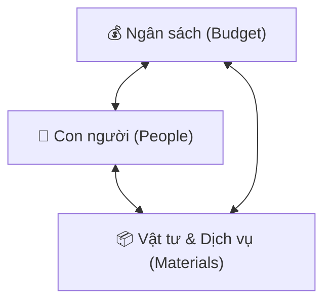

# Course 2: Project Initiation - Starting a Successful Project
## Module 4 - Bài đọc: Managing Resources to Get the Job Done

---

### 1. Bản chất & Tính phụ thuộc của Tài nguyên Dự án
- **Định nghĩa:** Tài nguyên dự án là **"ai" và "cái gì"** bạn dựa vào để hoàn thành dự án (*who and what you depend on*).
- **Tính phụ thuộc lẫn nhau (*Interdependence*):**
  - Đội ngũ (*People*) không thể làm việc nếu thiếu vật tư/công cụ (*Materials*).
  - Không thể sắm vật tư hay thuê người nếu thiếu ngân sách (*Budget*).
  - Bội chi ở một nhóm sẽ buộc phải cắt giảm hoặc điều chỉnh các nhóm còn lại.

---

### 2. Ba Nhóm Tài nguyên & Mẹo Quản lý Thực chiến

- **Ngân sách (*Budget*):**
  - Bao gồm: Chi phí nhân sự làm việc (*Team*), dịch vụ đối tác bên ngoài (*Services/Vendors*), và vật tư mua sắm (*Materials*).
  - Ngân sách có thể cố định khắt khe (*no margin for error*) hoặc linh hoạt tùy dự án. Cốt lõi là phải luôn bám sát phạm vi (*Scope*) và yêu cầu của stakeholders.
- **Con người (*People*):**
  - Cần một đội ngũ đa dạng kỹ năng và chuyên môn.
  - Phải có sự cam kết rõ ràng về **số giờ làm việc (*hours commitment*)**.
  - Ưu tiên chọn nhân sự thực sự hứng thú và đồng điệu với mục tiêu dự án.
- **Vật tư (*Materials*):**
  - **Hữu hình (*Tangible*):** Máy tính, ổ cứng, thiết bị văn phòng, máy móc.
  - **Vô hình (*Intangible*):** Dung lượng lưu trữ đám mây (*cloud storage*), bản quyền phần mềm, đào tạo nhân sự (*training*).

---

### 3. Bài học Cốt lõi (Key Takeaways)
1. **Lường trước tác động liên đới:** Luôn đánh giá ảnh hưởng qua lại giữa Ngân sách - Con người - Vật tư trước bất kỳ thay đổi nào.
2. **Chủ động phỏng vấn sớm:** Trao đổi với stakeholder và các nhân sự nòng cốt để phát hiện nhu cầu vật tư chuyên biệt hoặc nhân sự có chuyên môn sâu còn thiếu trước khi chốt kế hoạch.
3. **Chuẩn bị cho bước tiếp theo:** Toàn bộ thông tin nguồn lực này sẽ được tổng hợp vào **Project Charter**.
