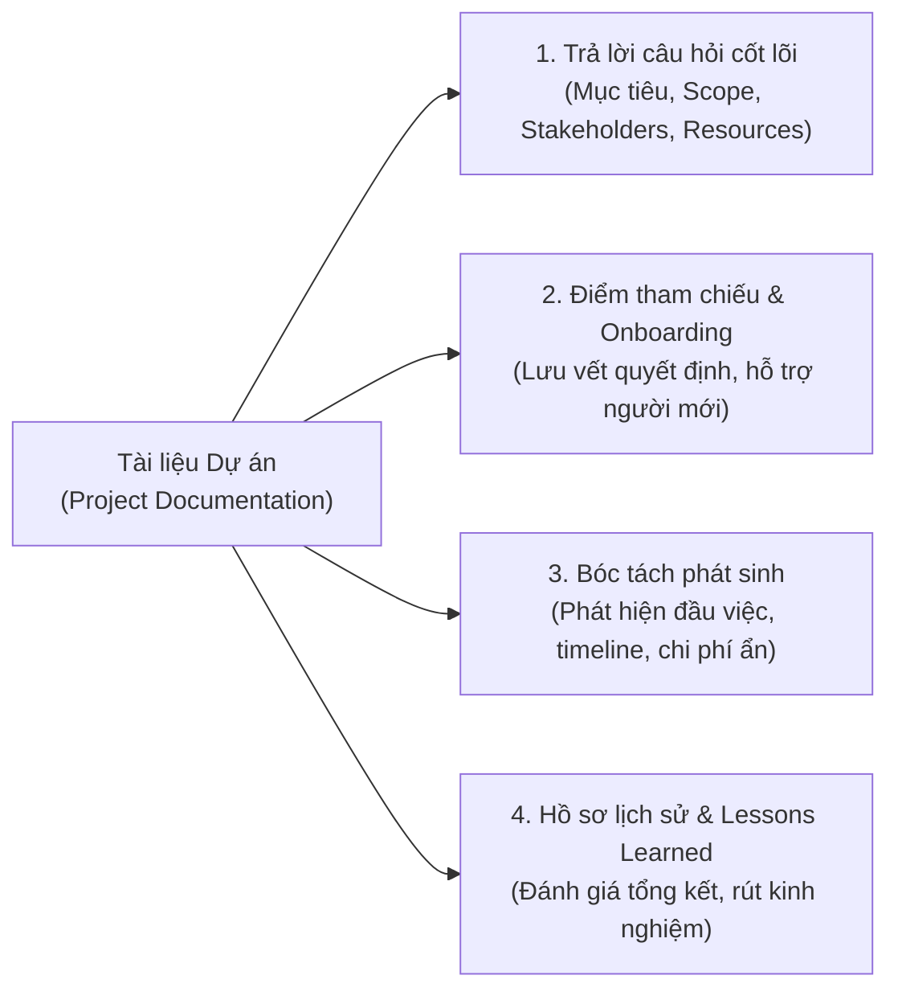

# Course 2: Project Initiation - Starting a Successful Project
## Module 4 - Bài học: The Value of Project Documentation

---

### 1. Tại sao Tài liệu hóa (Documentation) lại thiết yếu?
- **Quản lý quyết định:** Phần lớn công việc của PM là định hướng và theo dõi các quyết định (dù PM không phải lúc nào cũng là người đưa ra quyết định cuối cùng).
- **Vượt quá khả năng ghi nhớ:** Có quá nhiều quyết định quan trọng (mục tiêu, deliverables, nhân sự, ngân sách). Không một ai có thể nhớ hết trong đầu.
- **Tính minh bạch & Giao tiếp xuyên suốt:** Trong khi thành viên chỉ tập trung vào mảng việc chuyên môn của họ, PM là người duy nhất nắm góc nhìn toàn cảnh (*big picture*). Tài liệu hóa giúp kết nối và truyền đạt thông suốt giữa các bên.

---

### 2. Giá trị Cốt lõi của Tài liệu Dự án

- **Trả lời các câu hỏi nền tảng:**
  - Vấn đề cần giải quyết là gì?
  - Mục tiêu, phạm vi (*scope*) và sản phẩm bàn giao (*deliverables*) gồm những gì?
  - Ai là bên liên quan (*stakeholders*) và cần những nguồn lực nào?
- **Lưu giữ quyết định & Điểm tham chiếu (*Reference Point*):** Giúp người mới gia nhập nhóm nhanh chóng nắm bắt ngữ cảnh mà không cần giải thích lại từ đầu.
- **Phát hiện việc chưa tính tới:** Quá trình viết tài liệu buộc PM phải suy nghĩ chi tiết, từ đó bộc lộ các đầu việc, mốc thời gian hoặc chi phí bị bỏ sót.
- **Lưu trữ dữ liệu lịch sử (*Historical Record*):** Đóng vai trò làm cơ sở để đánh giá kết thúc dự án và rút ra bài học kinh nghiệm (*lessons learned*) cho các dự án sau.

---

### 3. Trách nhiệm của Project Manager
- Đảm bảo tài liệu được trình bày rõ ràng, nhất quán và dễ dàng tiếp cận (*easily accessible*) qua email, bản thuyết trình (*slides*) hoặc tài liệu số (*digital documents/docs*).
- **Bước tiếp theo:** Tìm hiểu 2 tài liệu khởi động quan trọng nhất: **Đề xuất dự án (*Project Proposal*)** và **Bản điều lệ dự án (*Project Charter*)**.
