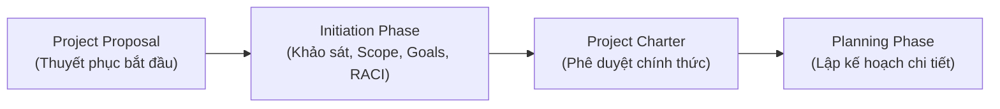

# Course 2: Project Initiation - Starting a Successful Project
## Module 4 - Bài học: Project Proposals and Charters 101

---

### 1. Phân biệt Project Proposal và Project Charter
Hai loại tài liệu cốt lõi trong giai đoạn khởi tạo (*Initiation phase*):

| Tiêu chí | Project Proposal (Đề xuất dự án) | Project Charter (Điều lệ dự án) |
| :--- | :--- | :--- |
| **Thời điểm xuất hiện** | Ngay từ đầu giai đoạn Khởi tạo (*very beginning*). | Cuối giai đoạn Khởi tạo (*end of initiation*). |
| **Mục đích chính** | Thuyết phục các bên phê duyệt cho phép bắt đầu dự án. | Định nghĩa chi tiết dự án, thiết lập khung thực thi và cơ sở giao tiếp. |
| **Người tạo chủ yếu** | Thường do lãnh đạo cấp cao (*senior leader*) tạo ra. PM theo dõi tiến độ. | Do Project Manager tổng hợp và soạn thảo chính thức. |
| **Vòng đời sử dụng** | Chỉ dùng ở giai đoạn đầu để "bật đèn xanh". | Điểm tham chiếu xuyên suốt vòng đời dự án (*living document*). |
| **Định dạng** | Email ngắn, slide thuyết trình, hoặc văn bản đề xuất. | Tài liệu chính thức được chuẩn hóa. |

---

### 2. Ý nghĩa & Giá trị của Project Charter
- **Chứng minh Lợi ích > Chi phí (Benefit > Cost):** Tích hợp kết quả phân tích Cost-Benefit Analysis (giá trị tạo ra, chi phí tiết kiệm, thời gian đầu tư).
- **Thống nhất kỳ vọng giữa PM và Stakeholders:** Đảm bảo đôi bên cùng nhìn về một hướng về mục tiêu, phạm vi và tài nguyên.
- **Cấp thẩm quyền chính thức cho PM (*Authority*):** Khi Sponsor và Stakeholders ký duyệt Charter, PM chính thức có quyền huy động nguồn lực và triển khai bước tiếp theo.
- **Tài liệu sống (*Living Document*):** Có thể được xem xét và tinh chỉnh linh hoạt khi dự án tiến triển, nhưng luôn giữ vai trò là "kim chỉ nam".

---

### 3. Tùy biến Nội dung theo Đối tượng Stakeholder
Tùy vào bên liên quan chính, PM có thể nhấn mạnh các khía cạnh tương ứng trong Charter:
- **Marketing Executive:** Nhấn mạnh tác động đến thương hiệu (*brand impact*), truyền thông và khách hàng.
- **Chief Technology Officer (CTO):** Nhấn mạnh chi phí tài nguyên kỹ thuật (*engineering resources*), hạ tầng công nghệ và tính bảo trì.

> [!IMPORTANT]
> **Quy tắc vàng:** Dù định dạng nào, việc hoàn thành và phê duyệt **Project Charter** là bước bắt buộc phải có để chuyển từ giai đoạn **Khởi tạo (Initiation)** sang giai đoạn **Lập kế hoạch (Planning)**.
