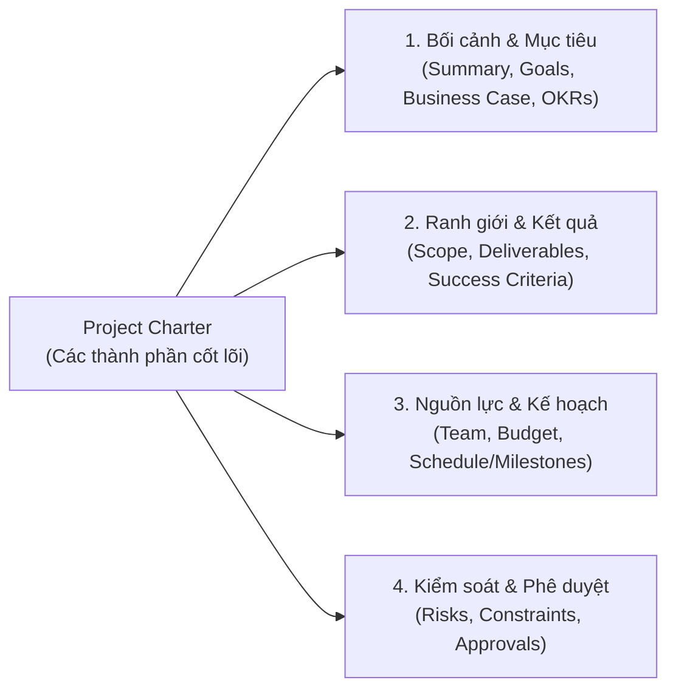

# Course 2: Project Initiation - Starting a Successful Project
## Module 4 - Bài đọc: Project Charters: Elements and Formats

---

### 1. Vai trò của Project Charter
- **Định nghĩa:** Là văn bản chính thức định nghĩa toàn diện dự án và phác thảo các chi tiết cần thiết để đạt mục tiêu.
- **"Vũ khí bí mật" & Chiếc la bàn (*Compass*):** Là tài liệu tham chiếu xuyên suốt toàn bộ vòng đời dự án để đảm bảo dự án luôn bám sát mục tiêu chiến lược.
- **Nguyên tắc viết:** Đưa vào lượng thông tin vừa đủ (*right amount of detail*), bỏ qua các chi tiết vụn vặt; luôn lấy **Business Case (lý do khởi tạo dự án)** làm kim chỉ nam.
- **Cộng tác từ sớm (*Collaborate early & often*):** Cần thảo luận với cả nhóm thực thi và stakeholders để giải quyết đúng mối bận tâm của họ.

---

### 2. Các Thành phần Cốt lõi của một Project Charter
Tùy vào quy mô dự án và tổ chức, một Project Charter thường kết hợp các thành phần sau:

| Nhóm thành phần | Chi tiết nội dung |
| :--- | :--- |
| **Bối cảnh & Giá trị** | • **Introduction / Summary:** Tóm tắt dự án. • **Goals / Objectives:** Mục tiêu cụ thể. • **Business Case:** Lợi ích & chi phí (Cost-Benefit). • **OKRs:** Bộ chỉ số đo lường hiệu quả then chốt. |
| **Phạm vi & Kết quả** | • **Scope:** Giới hạn công việc (In-scope / Out-of-scope). • **Key Deliverables:** Các sản phẩm/hạng mục bàn giao chính. • **Success Criteria:** Tiêu chí đánh giá thành công. |
| **Thực thi & Nguồn lực**| • **Project Team:** Nhân sự và phân định vai trò. • **Budget:** Dự toán ngân sách cần dùng. • **Schedule / Milestones:** Mốc thời gian và tiến độ lớn. |
| **Rủi ro & Phê duyệt** | • **Constraints & Assumptions:** Các ràng buộc và giả định đặt ra. • **Risks:** Các rủi ro tiềm ẩn ban đầu. • **Approvals:** Chữ ký phê duyệt của Sponsor & Stakeholders. |

---

### 3. Định dạng & Tính chất của Charter
- **Đa dạng về định dạng (*Formats*):**
  - **Dự án nhỏ/ít phức tạp:** Dùng mẫu tinh gọn (*condensed/simplified format*).
  - **Dự án lớn/phức tạp:** Văn bản chi tiết, có kèm phần **Phụ lục (*Appendix*)** để dẫn link đến các bảng phân tích, tài liệu kỹ thuật phụ trợ.
- **Tài liệu sống (*Living Document*):** Charter có thể được chỉnh sửa và cập nhật theo sự phát triển của dự án. PM cần xem xét và đối chiếu thường xuyên để giữ vững sự thống nhất.
