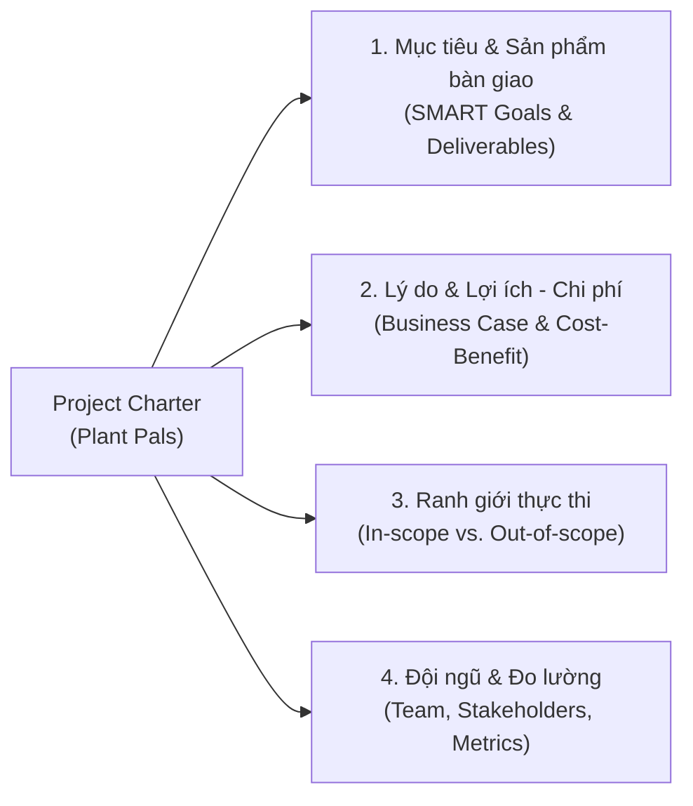

# Course 2: Project Initiation - Starting a Successful Project
## Module 4 - Bài học: Developing a Project Charter

---

### 1. Ý nghĩa Thực hành Lập Project Charter
- Sau khi nắm lý thuyết, PM sẽ áp dụng mẫu biểu (*template*) chuẩn hóa (tương tự mẫu PM tại Google sử dụng) để lập **Project Charter** cho dự án thực hành xuyên suốt: **Project Plant Pals (Office Green)**.
- Charter là căn cứ cốt lõi để trình duyệt lên **Stakeholders** và **Project Sponsor** nhằm nhận phê duyệt chính thức trước khi bắt tay lập kế hoạch chi tiết.

---

### 2. Chi tiết Bản Project Charter Mẫu: Project Plant Pals

| Mục trong Charter | Nội dung cụ thể (Dự án Plant Pals) |
| :--- | :--- |
| **Project Name & Summary** | • **Tên dự án:** Project Plant Pals. • **Tóm tắt (*Summary*):** Cung cấp các loại cây nhỏ, ít tốn công chăm sóc, sống tốt trong môi trường văn phòng cho các khách hàng doanh nghiệp lớn. |
| **Project Goals (SMART)** | Tăng trưởng **5% doanh thu** vào cuối năm thông qua triển khai dịch vụ cung cấp cây văn phòng cho các khách hàng VIP. |
| **Deliverables (Sản phẩm bàn giao)** | 1. Bàn giao 1.000 cây cảnh cho 100 khách hàng đầu tiên. 2. Ra mắt website mới phục vụ đặt hàng và hỗ trợ khách hàng. |
| **Business Case & Cost-Benefit** | • **Lý do (*Business Case*):** Nhu cầu lớn được yêu cầu nhiều từ khách hàng; giúp tăng sự hài lòng và giữ chân khách hàng (*retention*). • **Lợi ích (*Benefits*):** Tăng độ hài lòng khách hàng và tăng doanh thu. • **Chi phí (*Costs*):** Mua hàng/nguồn cây, lập trình website, marketing. Ước tính ngân sách: **\$250,000** (Nguyên tắc: *Benefits phải luôn lớn hơn Costs*). |
| **Project Scope** | • **In-Scope (Làm):** Xây dựng dịch vụ giao các chậu cây nhỏ đến nhóm khách hàng hàng đầu của năm trước. • **Out-of-Scope (Không làm):** Dịch vụ chăm sóc/bảo dưỡng cây sau khi đã bàn giao (*plant care after delivery*). |
| **Project Team & Stakeholders** | • **Project Sponsor:** Director of Product. • **Project Lead:** Project Manager (chính bạn). • **Project Team:** Marketing associates, Web developers, External plant vendors. • **Additional Stakeholders:** VP of Customer Success, Account Manager, Fulfillment Manager. |
| **Success Criteria (Đo lường thành công)** | 1. Tăng trưởng **5% doanh thu** vào cuối năm. 2. Đạt tỷ lệ hài lòng khách hàng (*CSAT*) **95%** sau 3 tháng ra mắt dịch vụ. |

---

### 3. Đúc kết Cốt lõi (Key Takeaways)
1. **Ranh giới rõ ràng (*Scope Boundaries*):** Việc nêu bật *In-scope* và *Out-of-scope* ngay trong Charter giúp toàn bộ nhóm tập trung nguồn lực, tránh lan man hay phát sinh kỳ vọng sai lệch từ khách hàng.
2. **Tiêu chí thành công định lượng (*Measurable Metrics*):** Luôn gắn liền với số liệu cụ thể (doanh thu %, mức độ hài lòng %, mốc thời gian hoàn thành).
3. **Hoàn tất giai đoạn Initiation:** Khi Charter được ký duyệt, PM chính thức có quyền bước sang giai đoạn **Planning** và bắt đầu lựa chọn công cụ quản lý dự án (*Project Management Tools*).
