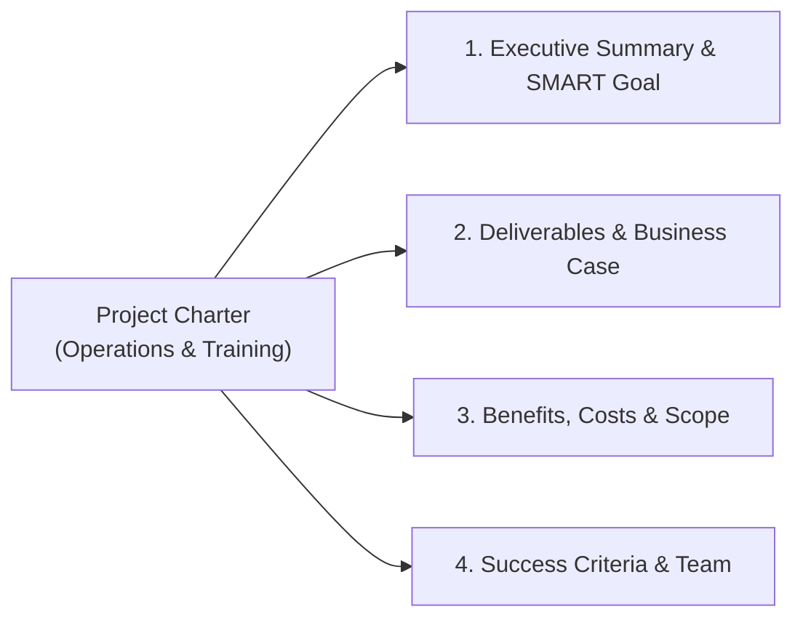

# Course 2: Project Initiation - Starting a Successful Project
## Module 4 - Bài tập thực hành: Activity: Create a Project Charter

---

### 1. Tổng quan Hoạt động
- **Mục tiêu:** Thực hành điền đầy đủ một bản **Project Charter (Điều lệ dự án)** hoàn chỉnh cho dự án nhánh: **Kế hoạch Vận hành và Đào tạo (Operations and Training Plan)** thuộc dự án tổng thể **Plant Pals (Office Green)**.
- **Vai trò:** Giúp PM hình thành tư duy hệ thống hóa văn bản, chuẩn bị bước vào giai đoạn lập kế hoạch (*Planning*) chi tiết ở Course 3.

---

### 2. Các Thành phần Cần Hoàn thành trong Template

1. **Executive Summary (Tóm tắt điều hành):** Viết 1-3 câu nêu rõ mục đích của kế hoạch vận hành & đào tạo và kết quả mong muốn.
2. **Project Goal (Mục tiêu dự án):** Thiết lập mục tiêu chuẩn **SMART** (có số liệu, mốc thời gian rõ ràng).
3. **Deliverables (Sản phẩm bàn giao):** Xác định ít nhất 3 kết quả cụ thể (ví dụ: quy trình vận hành, phần mềm chuỗi cung ứng, chương trình đào tạo).
4. **Business Case / Background (Lý do thực hiện & Bối cảnh):** Nêu bật lý do tại sao công ty cần thực hiện dự án (nâng cao trải nghiệm khách hàng, giảm tỷ lệ rời bỏ, tối ưu vận hành).
5. **Benefits & Costs (Lợi ích và Chi phí):** Lợi ích doanh thu/uy tín; các nhóm chi phí nhân sự, phần mềm, đào tạo (ngân sách dự toán sơ bộ).
6. **Scope & Exclusions (Phạm vi làm và không làm):** Xác định rõ các hạng mục *In-scope* và *Out-of-scope*.
7. **Measuring Success (Tiêu chí thành công):** Tối thiểu 2 chỉ số đo lường cụ thể (tỷ lệ đơn đúng hạn, hoàn thành đào tạo nhân viên, tăng trưởng doanh thu).

---

### 3. Hướng dẫn Tự Đánh giá theo Bản Mẫu (Exemplar Review)
- Executive summary ngắn gọn, tập trung vào giải pháp vận hành.
- Mục tiêu đạt chuẩn 5 tiêu chí SMART.
- Ba sản phẩm bàn giao rõ ràng, có thể định lượng được.
- Business Case nêu bật được "Why" (Lý do cốt lõi).
- Tiêu chí thành công gắn chặt với con số và mốc thời gian cụ thể.
