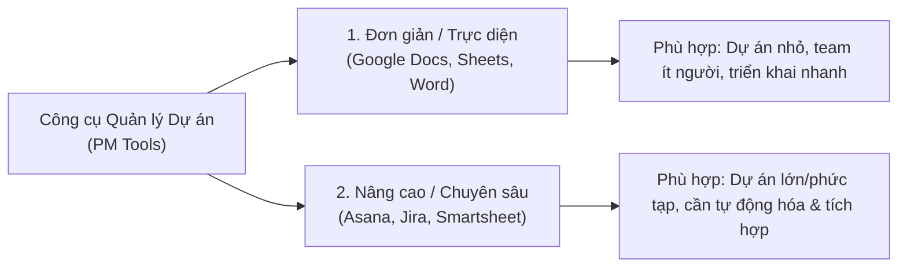

# Course 2: Project Initiation - Starting a Successful Project
## Module 4 - Bài học: Utilizing Tools for Effective Project Management

---

### 1. Tại sao Công cụ (Tools) lại sống còn với Project Manager?
- **Định nghĩa:** Tools là các phương tiện trợ giúp giúp PM và đội ngũ quản lý tài nguyên, sắp xếp công việc và theo dõi tiến độ.
- **Hai chức năng cốt lõi:**
  - **Theo dõi chi tiết (*Tracking*):** Giám sát trạng thái từng tác vụ, tiến độ bàn giao (*deliverables*), mốc thời gian (*milestones*) và ngân sách.
  - **Giao tiếp hai chiều (*Two-way Communication*):** Cho phép thành viên cập nhật tiến độ, báo cáo sự cố/chậm trễ nhanh chóng mà không cần họp hành hay gọi điện thoại liên tục.
- **Tăng tính minh bạch (*Visibility & Transparency*):** Giúp mọi người (từ team members đến stakeholders) luôn có cùng một bức tranh toàn cảnh về dự án.

---

### 2. Phân loại & Cách Lựa chọn Công cụ Phù hợp

| Loại công cụ | Đặc điểm & Phù hợp | Điểm cần lưu ý |
| :--- | :--- | :--- |
| **Đơn giản / Trực diện (*Straightforward*)** | • Bảng tính số (*spreadsheets*), tài liệu dùng chung (Docs, Word). • Phù hợp với dự án nhỏ, cấu trúc đơn giản, nhóm ít người. | Không tốn thời gian học; dễ tiếp cận ngay lập tức. |
| **Nâng cao / Chuyên sâu (*Sophisticated*)** | • Phần mềm quản lý công việc và lịch trình chuyên nghiệp (Asana, Jira, MS Project). • Phù hợp với dự án quy mô lớn, nhiều luồng việc và phụ thuộc chéo. | Đội ngũ và stakeholders **cần thời gian làm quen và đào tạo** (*learning curve*). |

---

### 3. Nguyên tắc Ứng dụng Thực tế cho Project Manager
1. **Cân nhắc chi phí thời gian làm quen:** Nếu dự án nhỏ mà ép dùng công cụ quá phức tạp sẽ gây lãng phí thời gian và phiền toái không đáng có (*more trouble than it's worth*).
2. **Tính linh hoạt (*Flexibility*):** Nhiều tổ chức đã chuẩn hóa sẵn một bộ công cụ nội bộ (ví dụ Google Workspace hoặc Jira). PM cần thích ứng linh hoạt và tối ưu hóa trên nền tảng sẵn có của doanh nghiệp.
3. **Mục tiêu tối thượng:** Bất kể công cụ đơn giản hay phức tạp, điều quan trọng nhất là phục vụ việc **giao tiếp hiệu quả và giữ dự án đi đúng hướng (*keep projects on track*)**.
