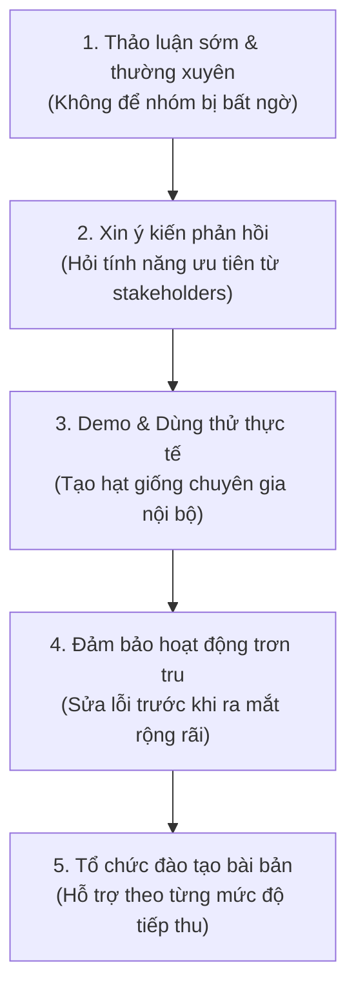

# Course 2: Project Initiation - Starting a Successful Project
## Module 4 - Bài đọc: Introducing New Tools to a Team

---

### 1. Tâm lý Tiếp nhận Thay đổi & Thách thức
- **Sự thay đổi luôn diễn ra:** Quy trình và công cụ quản lý dự án không ngừng cải tiến. PM cần cởi mở với việc áp dụng công cụ mới nhằm nâng cao hiệu quả.
- **Tâm lý phản kháng (*Resistance to Change*):** Con người tiếp nhận sự thay đổi khác nhau, đặc biệt khi nó đảo lộn thói quen làm việc hàng ngày. Đội ngũ có thể do dự hoặc bài xích nếu bị áp đặt công cụ mới bất ngờ (nhất là ở giữa chừng dự án).
- **Trách nhiệm của PM:** Chứng minh công cụ mới thực sự đem lại giá trị vượt trội, đã được đánh giá kỹ lưỡng và PM thực sự quan tâm đến trải nghiệm của nhóm chứ không chỉ chạy theo tiến độ dự án.

---

### 2. Năm Bước Giới thiệu Công cụ Mới Thành công

1. **Thảo luận sớm và thường xuyên (*Early & Often*):** Báo trước để nhóm chuẩn bị tâm lý và sẵn sàng cho việc chuyển đổi (*migration*).
2. **Thu thập phản hồi từ Stakeholders (*Solicit Feedback*):** Nhờ chuyên gia và các bên liên quan ưu tiên các tính năng cần thiết, giúp tránh bỏ sót nhu cầu thực tế.
3. **Mời tham gia Demo & Dùng thử (*Pilot / Trial*):** Cho một nhóm người dùng nòng cốt trải nghiệm trước. Họ sẽ trở thành **chuyên gia nội bộ (*in-house experts*)** hỗ trợ đào tạo lại cho toàn nhóm sau này.
4. **Đảm bảo công cụ chạy trơn tru trước khi bàn giao (*Fully Functional*):** Tránh giới thiệu công cụ còn lỗi hoặc thiếu quyền truy cập. Trải nghiệm đầu tiên tồi tệ sẽ gây ấn tượng xấu và làm tăng sự phản kháng.
5. **Thiết lập chương trình đào tạo (*Set up Training*):** Hướng dẫn cụ thể, giải tỏa lo lắng cho những thành viên chưa thạo công nghệ.

---

### 3. Mẹo Quản lý Chuyển tiếp (Transition Period & Sunsetting)
- **Giai đoạn chuyển tiếp (*Transition Period*):** Khi thay thế công cụ cũ, nên cho phép cả hai công cụ chạy song song trong một khoảng thời gian ngắn để mọi người thích nghi dần.
- **Kế hoạch dừng công cụ cũ (*Sunset the old tool*):** Đặt thời hạn rõ ràng để khai tử công cụ cũ khi công cụ mới đã vận hành ổn định.
- **Dự phòng sụt giảm năng suất:** Chuẩn bị tâm lý rằng năng suất làm việc có thể giảm nhẹ tạm thời trong giai đoạn làm quen (*learning curve*).
