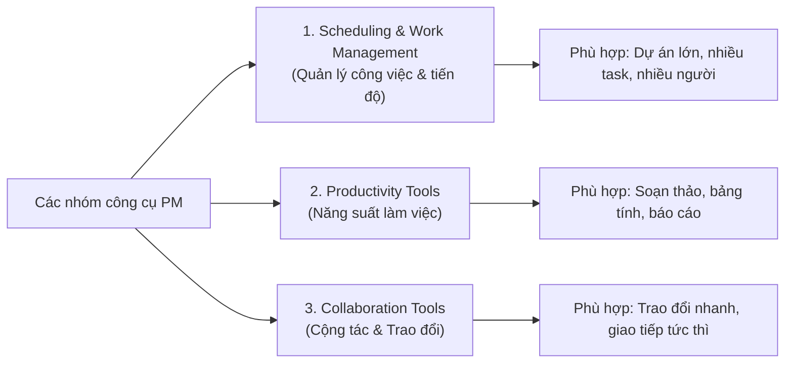

# Course 2: Project Initiation - Starting a Successful Project
## Module 4 - Bài học: Exploring Types of Project Management Tools

---

### 1. Ba Nhóm Công cụ Quản lý Dự án Phổ biến

---

### 2. Chi tiết Từng Nhóm Công cụ

| Nhóm công cụ | Các ứng dụng tiêu biểu | Công dụng chính & Tình huống áp dụng |
| :--- | :--- | :--- |
| **1. Quản lý công việc & Lịch trình (*Scheduling & Work Management*)** | Asana, Jira, Trello, Monday.com | • Phân chia đầu việc cho nhiều thành viên. • Theo dõi và trực quan hóa tiến độ. • **Phát hiện điểm nghẽn (*blockers*):** Ví dụ tuần trước xong 50 tasks nhưng tuần này chỉ xong 3 tasks $\rightarrow$ tín hiệu cảnh báo cần can thiệp ngay. • Phù hợp với dự án lớn, phức tạp. |
| **2. Công cụ Năng suất (*Productivity Tools*)** | Google Docs, Sheets, Slides, MS Word, Excel, PowerPoint | • **Xử lý văn bản (Docs/Word):** Tạo Project Charter, biên bản cuộc họp (*meeting agendas*), báo cáo trạng thái. • **Bảng tính (Sheets/Excel):** Lập RACI chart, ngân sách, kế hoạch dự án. • **Trình chiếu (Slides/PowerPoint):** Báo cáo trực quan cho stakeholders. |
| **3. Công cụ Cộng tác (*Collaboration Tools*)** | Email (Gmail, Outlook), Chat (Slack, MS Teams, Google Chat) | • Giao tiếp nhanh, cập nhật thông tin và hỏi đáp tức thì. • Giữ liên lạc liên tục giữa các thành viên trong nhóm. |

---

### 3. Nguyên tắc Lựa chọn Thực chiến
- **Dự án nhỏ, ít người, ít tác vụ:** Bộ công cụ **Năng suất (Docs/Sheets)** kết hợp **Cộng tác (Email/Chat)** là đủ và hiệu quả nhất vì đơn giản, không mất thời gian đào tạo.
- **Dự án lớn, nhiều người, quy trình phức tạp:** Bắt buộc cần **Phần mềm Quản lý công việc (Work Management Software)** để kiểm soát các luồng việc chéo, trạng thái phụ thuộc và tiến độ tổng thể.
