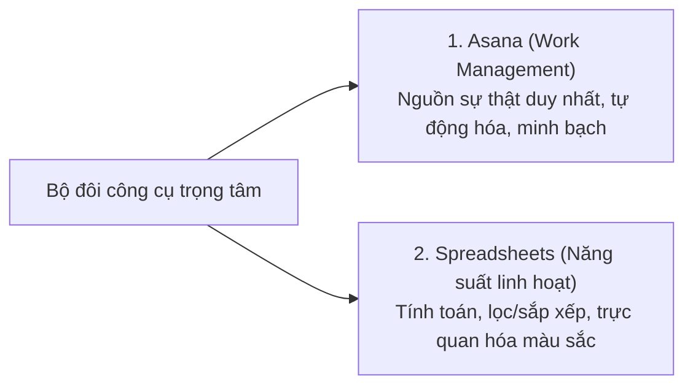

# Course 2: Project Initiation - Starting a Successful Project
## Module 4 - Bài học: Common Project Management Tools

---

### 1. Tổng quan về Hai Công cụ Trọng tâm
Khóa học Google Project Management tập trung sâu vào hai công cụ quản lý dự án phổ biến và thiết thực nhất:
1. **Asana:** Nền tảng quản lý công việc và quy trình tự động (*Work Management Platform*).
2. **Spreadsheet (Bảng tính - Google Sheets / Excel):** Công cụ đa năng xử lý dữ liệu và theo dõi linh hoạt.

---

### 2. Chi tiết Từng Công cụ

| Tiêu chí | Asana (Nền tảng Quản trị Công việc) | Spreadsheets (Bảng tính - Sheets/Excel) |
| :--- | :--- | :--- |
| **Bản chất** | Nền tảng "hệ thống sống" & nguồn sự thật duy nhất (*single source of truth*). | Công cụ bảng tính đa năng, linh hoạt tùy biến. |
| **Tính năng then chốt** | • Làm rõ: **Ai làm gì và hạn chót khi nào** (*who is doing what by when*). • Hiển thị đa dạng: Dạng danh sách (*list*), lịch biểu (*calendar*), bảng (*board*). • Tự động hóa quy trình (*automate workflows*). • Chia sẻ cập nhật tiến độ dễ dàng với cả stakeholders bên ngoài. | • Dễ dàng biến đổi và thao tác dữ liệu (*manipulate & transform*). • **Sắp xếp & Lọc (*Sort & Filter*):** Xem việc sắp đến hạn hoặc lọc riêng việc của từng cá nhân. • **Tô màu có điều kiện (*Conditional Formatting*):** Đánh dấu màu các đầu việc chậm tiến độ. |
| **Tình huống sử dụng** | Quản lý dự án chiến lược, nhiều nhóm cộng tác, theo dõi luồng việc phức tạp. | Lập ngân sách (*budgeting*), bảng RACI, tạo tiến độ nhanh, theo dõi chi phí. |

---

### 3. Lời khuyên Thực chiến cho Project Manager
- **Khả năng đề xuất giải pháp:** Việc biết cách đánh giá và đề xuất công cụ phù hợp với quy mô dự án là cách tạo giá trị lớn cho đội ngũ ngay từ đầu.
- **Nắm vững nguyên lý cốt lõi thay vì chạy theo số lượng:**
  - Không ai có thể hay cần biết tất cả các phần mềm trên thị trường (vì công cụ và tính năng mới liên tục ra đời).
  - Hầu hết các công cụ quản lý công việc đều có chung các tính năng nền tảng: **Tạo việc (*task creation*), Phân công (*assignment*), Hạn chót (*due date*), và Theo dõi trạng thái (*status tracking*)**.
  - **Quy tắc:** Chỉ cần hiểu sâu một công cụ tiêu biểu (như Asana), bạn sẽ dễ dàng thích nghi nhanh chóng với bất kỳ công cụ nào khác (Jira, Monday, ClickUp) khi nhận dự án mới.
