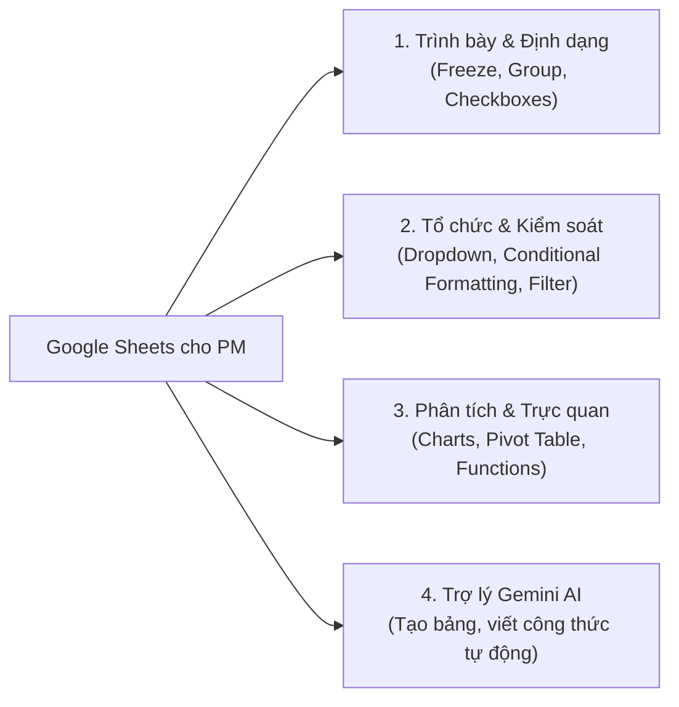

# Course 2: Project Initiation - Starting a Successful Project
## Module 4 - Bài đọc: Using Google Sheets for Project Management

---

### 1. Tổng quan về Google Sheets trong Quản lý Dự án
- **Lợi ích cốt lõi:** Dễ tiếp cận, linh hoạt, khả năng cộng tác theo thời gian thực (*real-time collaboration*), rất thích hợp cho các nhóm làm việc từ xa hoặc lệch múi giờ.
- **Phân quyền chia sẻ (*Share Permissions*):**
  - **Viewer (Chỉ xem):** Tránh người khác vô tình thay đổi dữ liệu.
  - **Commenter (Nhận xét):** Góp ý, thảo luận mà không làm xáo trộn bảng tính.
  - **Editor (Chỉnh sửa trực tiếp):** Cho phép nhóm cùng cập nhật dữ liệu và giao việc thông qua bình luận (*assign tasks in comments*).

---

### 2. Các Tính năng Thiết yếu (Essential Features)

| Nhóm tính năng | Công cụ cụ thể | Ứng dụng thực tế trong Quản lý Dự án |
| :--- | :--- | :--- |
| **Trình bày (*Format*)** | • **Freeze rows/cols:** Cố định tiêu đề bảng khi cuộn trang. • **Group rows/cols:** Gom nhóm để thu gọn (*collapse*) hoặc mở rộng (*expand*) các giai đoạn dự án. • **Checkboxes:** Hộp kiểm đánh dấu việc đã xong trực quan. | Giữ giao diện gọn gàng, dễ theo dõi các danh sách dài. |
| **Kiểm soát (*Organize*)** | • **Dropdowns (Data Validation):** Menu thả xuống (ví dụ: *Not Started, In Progress, Complete*) giúp chuẩn hóa dữ liệu, tránh gõ sai. • **Conditional Formatting:** Tự đổi màu ô theo trạng thái (đỏ: chưa làm, xanh: hoàn thành). • **Sort & Filter:** Sắp xếp theo hạn chót, lọc riêng task của từng người. | Giám sát tiến độ nhanh bằng thị giác; tìm kiếm và lọc tác vụ tức thì. |
| **Phân tích (*Analytics*)** | • **Built-in Functions:** Tính tổng chi phí (`SUM`), trung bình (`AVERAGE`), ngày kết thúc tự động. • **Charts & Graphs:** Biểu đồ hóa tiến độ, ngân sách để báo cáo Stakeholders. • **Pivot Table:** Bảng tổng hợp xoay chiều để phân tích mối tương quan dữ liệu. | Tự động hóa tính toán chi phí, thời gian và đo lường tỷ lệ hoàn thành. |
| **Trợ lý Gemini AI** | • Nhắc lệnh tự tạo bảng theo dõi tiến độ. • Viết công thức phức tạp theo ngôn ngữ tự nhiên. • Tự nhận diện mẫu và giảm lỗi nhập liệu (*reduce data entry errors*). | Tăng tốc độ xây dựng bảng biểu quản lý dự án. |

---

### 3. Bốn Mẫu Bảng tính Quản lý Dự án Phổ biến (Spreadsheet Templates)
1. **Project Timeline (Tiến độ dự án):** Bố cục toàn bộ vòng đời dự án từ lúc khởi tạo đến khi đóng, hiển thị rõ hoạt động chính của từng giai đoạn.
2. **Project Tracking (Bảng theo dõi dự án):** Theo dõi chi phí, giờ công, mức độ ưu tiên (dropdowns) và phần trăm hoàn thành sản phẩm bàn giao (*deliverables*).
3. **Gantt Chart (Biểu đồ Gantt):** Tổ chức công việc theo từng ngày, hiển thị rõ mối quan hệ phụ thuộc giữa các công việc và tiến độ trực quan bằng màu sắc.
4. **Event Marketing Timeline (Tiến độ Tiếp thị Sự kiện):** Theo dõi các bài đăng mạng xã hội, nghiên cứu thị trường và phối hợp nội dung đa kênh.
