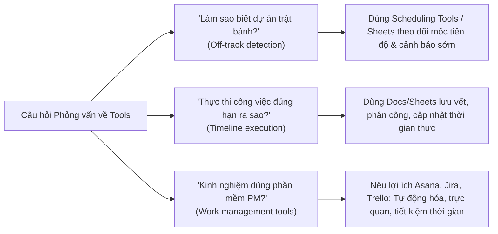

# Course 2: Project Initiation - Starting a Successful Project
## Module 4 - Bài đọc: Demonstrating Your Knowledge of Project Management Tools

---

### 1. Tầm quan trọng của Kiến thức Công cụ khi Phỏng vấn
- Nhà tuyển dụng vị trí Project Manager thường xuyên hỏi về các công cụ quản lý bạn từng sử dụng và cách bạn vận hành chúng.
- **Mục tiêu phỏng vấn:** Đánh giá xem bạn có hiểu **bản chất và mục đích** của công cụ hay không (theo dõi tiến độ, kiểm soát ngân sách, giải quyết điểm nghẽn, cộng tác nhóm).

---

### 2. Chiến lược Trả lời Câu hỏi Phỏng vấn Thực chiến

#### Câu hỏi 1: *"Làm thế nào bạn biết một dự án đang bị chậm tiến độ (off-track)?"*
- **Cách trả lời:** Liên hệ với các công cụ lập lịch (*scheduling tools*) như Smartsheet, bảng tính (*spreadsheets*).
- **Mẹo chuyển đổi kinh nghiệm thực tế (*Transferable skills*):** Nếu chưa dùng phần mềm chuyên dụng tại công ty cũ, hãy lấy ví dụ đời thực (như chuyển nhà, tổ chức sự kiện). Kể về việc lập timeline theo dõi đối tác vận chuyển, dùng spreadsheet kiểm soát danh mục đồ đạc và ngân sách. Điều này chứng minh bạn có tư duy lập kế hoạch và giám sát tiến độ.

#### Câu hỏi 2: *"Làm cách nào bạn đảm bảo thực thi các đầu việc đúng tiến độ (timeline)?"*
- **Cách trả lời:** Nhấn mạnh việc sử dụng tài liệu số (Docs) và bảng tính (Sheets) làm nơi lưu trữ tập trung dữ liệu dự án (*single source of truth*), tạo văn bản dự án (*artifacts*), phân công rõ người phụ trách và cập nhật tiến độ hai chiều theo thời gian thực (*real-time collaboration*).

#### Câu hỏi 3: *"Bạn hiểu và sử dụng các phần mềm quản lý công việc chuyên nghiệp (Work Management Tools) như thế nào?"*
- **Cách trả lời:** Nhắc đến các công cụ hàng đầu (Asana, Monday.com, Trello, Jira, Basecamp).
- Nhấn mạnh giá trị chúng mang lại: Trực quan hóa quy trình làm việc, tự động hóa tác vụ lặp lại (*automation*), tiết kiệm thời gian và giúp toàn bộ nhóm lẫn stakeholders có chung tầm nhìn.

---

### 3. Lời khuyên Nâng cao Năng lực (Pro Tips)
- Đăng ký tài khoản miễn phí hoặc bản dùng thử (*free trials / tutorials*) của các phần mềm phổ biến để có trải nghiệm thực tế trước khi đi phỏng vấn:
  - **Quản trị công việc / linh hoạt:** *Asana, Trello, Monday.com, ClickUp, Basecamp*.
  - **Quản lý kỹ thuật / Agile:** *Jira*.
  - **Lập kế hoạch chuyên sâu:** *Smartsheet, Microsoft Project / ProjectLibre*.
