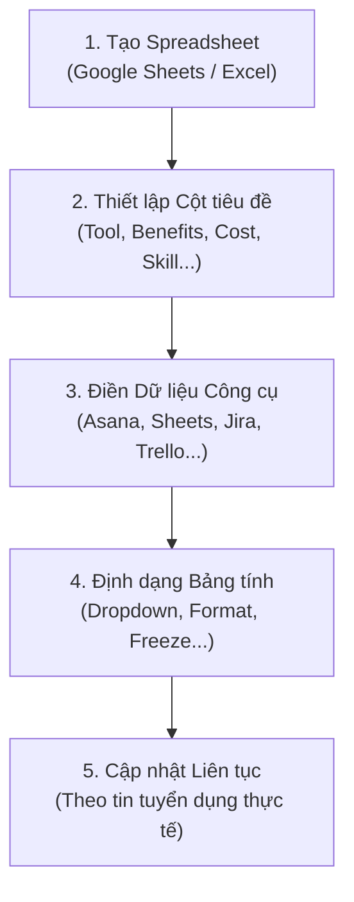

# Course 2: Project Initiation - Starting a Successful Project
## Module 4 - Bài đọc: Build a Project Management Tool Tracker

---

### 1. Mục đích của Bảng Theo dõi Công cụ (Tool Tracker)
- **Định nghĩa "Tools" mở rộng:** Không chỉ là phần mềm (Asana, Jira, Google Sheets), mà còn bao gồm phương pháp luận (*methodologies*), kỹ thuật, công thức và công nghệ phục vụ quản lý dự án.
- **Giá trị thực tiễn:** 
  - Hệ thống hóa các công cụ đã học và các yêu cầu công việc từ nhà tuyển dụng.
  - Tự đánh giá mức độ thành thạo hiện tại (*current experience level*).
  - Xác định các kỹ năng cần tập trung đào tạo và phát triển bản thân (*professional development*).

---

### 2. Quy trình 5 Bước Xây dựng Tool Tracker

#### Chi tiết các cột tiêu đề đề xuất (*Column Headers*):
1. **Tool Name:** Tên công cụ / phần mềm.
2. **Description / Benefits:** Mô tả chức năng và lợi ích cốt lõi mang lại.
3. **Link to Website:** Đường link trang chủ sản phẩm.
4. **Link to Course Content:** Link bài học liên quan trong Coursera.
5. **Cost to use:** Chi phí sử dụng (miễn phí, trả phí theo người dùng/tháng).
6. **Requirements:** Yêu cầu phần cứng, tài khoản hoặc thời gian đào tạo.
7. **Current Experience Level:** Mức độ thành thạo cá nhân (ví dụ dropdown: *Chưa biết / Cơ bản / Thành thạo*).
8. **Notes:** Ghi chú cá nhân hoặc tình huống áp dụng tốt nhất.

---

### 3. Đúc kết Cốt lõi (Key Takeaways)
- **Chuẩn bị cho tuyển dụng:** Nắm rõ danh mục công cụ, ưu/nhược điểm và mức độ tự tin sử dụng sẽ giúp bạn trả lời phỏng vấn thuyết phục ngay cả khi ứng tuyển vị trí PM đầu tiên.
- **Học tập chủ động:** Tự tra cứu thêm chi phí và tính năng nâng cao của các công cụ (như Asana, Jira) để hoàn thiện bảng theo dõi và làm giàu hồ sơ năng lực cá nhân (*portfolio*).
