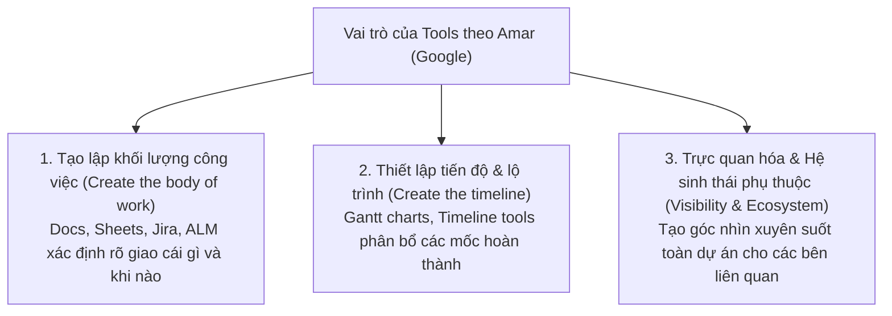

# Course 2: Project Initiation - Starting a Successful Project
## Module 4 - Bài học: Amar: Tools Are Our Best Friends

---

### 1. Quan điểm của Google Program Manager về Công cụ
- **Chia sẻ từ Amar:** *Senior Engineering Program Manager tại Google Shopping*, quản lý các chương trình quy mô lớn trải dài trên nhiều dòng sản phẩm tại Google.
- **Thông điệp cốt lõi:** 
  > *"Đối với một Project Manager, công cụ là những người bạn thân thiết nhất (Tools are our best friends). Những công cụ giúp thúc đẩy việc thực thi phải luôn là thứ gắn liền và thân thuộc với chúng ta."*

---

### 2. Các Vai trò Cốt lõi của Công cụ trong Thực tế tại Google

- **Tạo lập khối lượng công việc (*Body of work*):** Sử dụng các công cụ linh hoạt (Google Docs, Sheets) và công cụ chuyên dụng (Jira, ALM) để định nghĩa rõ ràng: **Cần bàn giao cái gì và khi nào (*what needs to be delivered and when*)**.
- **Lập tiến độ (*Timeline*):** Dùng các công cụ trực quan như Biểu đồ Gantt để theo dõi tiến trình.
- **Tăng tính hiển thị (*Visibility*):** Giúp mọi người nhìn thấy rõ hệ sinh thái các nhiệm vụ phụ thuộc lẫn nhau (*dependent ecosystem*).

---

### 3. Chiến lược Tiếp cận Công cụ khi Bắt đầu Dự án mới
Amar đưa ra lời khuyên quý báu để tránh làm phân mảnh (*defragging*) và phức tạp hóa hệ thống của tổ chức:

1. **Khảo sát bộ công cụ sẵn có (*Audit existing toolset*):** 
   - Kiểm tra xem đội ngũ hiện tại đang quen dùng những công cụ nào?
   - Mức độ chấp nhận (*adoption rate*) và độ hỗ trợ kỹ thuật của các công cụ đó ra sao?
2. **Ưu tiên hòa nhập công cụ hiện tại:**
   - Nếu đội ngũ đã có quy trình và công cụ quen thuộc, hãy chủ động học và thích nghi ngay với bộ công cụ đó. Điều này giúp dự án khởi động nhanh mà không gặp trở lực.
3. **Chỉ đề xuất công cụ mới khi có khoảng trống (*Identify the gaps*):**
   - Chỉ khi phát hiện công cụ cũ không đáp ứng được yêu cầu (tạo ra khoảng trống hiệu suất), PM mới nên đề xuất công cụ mới để nâng cao năng suất mà không gây quá tải cho nhóm.
