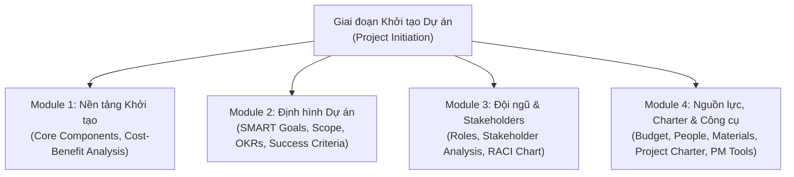

# Course 2: Project Initiation - Starting a Successful Project
## Module 4 - Bài học: Course Wrap-up (Tổng kết Khóa học 2)

---

### 1. Chúc mừng Hoàn thành Khóa học 2!
Bạn đã hoàn tất toàn bộ khóa học **Project Initiation: Starting a Successful Project** — khóa học thứ 2 trong chứng chỉ chuyên nghiệp Google Project Management Certificate, trang bị trọn vẹn tư duy và công cụ cho giai đoạn khởi tạo dự án.

---

### 2. Tổng kết Toàn bộ Kiến thức Course 2 theo 4 Trụ cột

| Module | Trọng tâm Kiến thức & Công cụ Cốt lõi |
| :--- | :--- |
| **Module 1: Fundamentals of Initiation** | • Ý nghĩa sống còn của giai đoạn Khởi tạo. • Phân tích Chi phí - Lợi ích (*Cost-Benefit Analysis*): Lợi ích phải luôn vượt trội so với chi phí đầu tư. |
| **Module 2: Goals, Scope & Success** | • Thiết lập mục tiêu chuẩn **SMART** và khung quản trị **OKRs**. • Xác định ranh giới phạm vi: *In-scope* vs. *Out-of-scope*, ngăn chặn phình phạm vi (*Scope creep*). • Phân biệt Khởi chạy (*Launching*) và Hạ cánh an toàn (*Landing*) dự án. |
| **Module 3: Team & Stakeholders** | • Xác định vai trò thiết yếu trong nhóm (Sponsor, PM, Team members, Customers). • Phân tích bên liên quan (*Stakeholder Analysis & Power Grid*). • Ma trận trách nhiệm giải trình **RACI Chart** (Responsible, Accountable, Consulted, Informed). |
| **Module 4: Resources, Charter & Tools** | • 3 Nhóm tài nguyên then chốt: **Ngân sách (Budget), Con người (People), Vật tư (Materials)**. • Soạn thảo và bảo vệ bản **Project Charter (Điều lệ dự án)** để nhận thẩm quyền chính thức. • Đánh giá và làm chủ các công cụ quản lý dự án (Google Sheets, Asana, Jira,...). |

---

### 3. Sẵn sàng Bước sang Khóa học 3: Project Planning
- **Chuyển giao giai đoạn:** Sau khi hoàn thành *Initiation* và có trong tay bản *Project Charter* được phê duyệt, bạn chính thức bước sang giai đoạn thứ hai trong vòng đời dự án: **Giai đoạn Lập kế hoạch (*Project Planning Phase*)**.
- **Người đồng hành tiếp theo:** Chuyên gia Rowena từ Google sẽ dẫn dắt bạn khám phá quy trình lập kế hoạch chuyên sâu trong Course 3: *"Project Planning: Putting It All Together"*.
