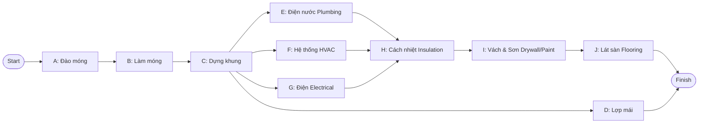

# Creating a Critical Path (Thiết lập Đường găng trong Dự án)

- **Khóa học:** Google Project Management Certificate | Course 3: Project Planning
- **Vị trí bài học:** Module 2: Building a project plan > Using estimation to set project timelines
- **Định dạng:** Reading (~8 phút đọc / 7 phút 32 giây audio)

---

## 1. Tầm quan trọng của Critical Path
- **Critical Path (Đường găng):** Chuỗi các cột mốc và nhiệm vụ bắt buộc (*mandatory tasks*) nhằm đảm bảo dự án về đích đúng hạn.
- **Giá trị cốt lõi:**
  - Định hình khung làm việc rõ ràng: đang ở đâu, đi về đâu và khi nào sẽ tới đích.
  - Phân loại rõ ràng giữa nhiệm vụ cốt lõi bắt buộc (**need-to-do**) và nhiệm vụ phụ trợ (**nice-to-do**).
  - Cảnh báo các đầu việc có **Float = 0**: nếu chậm trễ sẽ trực tiếp kéo lùi ngày hoàn thành toàn dự án.
  - Xác định nguồn lực cần thiết, đường cơ sở dự án (*project baselines*), và độ linh hoạt lịch trình (*schedule flexibility*).

---

## 2. 5 Bước Thiết lập Critical Path Chuẩn hóa

### Bước 1: Thu thập toàn bộ công việc (Capture All Tasks)
- Tận dụng cấu trúc phân rã công việc (**WBS**) để không bỏ sót đầu việc quan trọng.
- Tập trung vào các task thiết yếu trực tiếp cấu thành mục tiêu chính (loại bỏ việc ngoài lề như cảnh quan sân vườn khi mục tiêu là xây phần thô ngôi nhà).
  - *Ví dụ Xây nhà:* A) Đào móng $\rightarrow$ B) Làm móng $\rightarrow$ C) Khung nhà $\rightarrow$ D) Mái $\rightarrow$ E) Cấp thoát nước $\rightarrow$ F) Điều hòa/thông gió (HVAC) $\rightarrow$ G) Điện $\rightarrow$ H) Cách nhiệt $\rightarrow$ I) Vách thạch cao + Sơn $\rightarrow$ J) Lát sàn.

### Bước 2: Xác định mối phụ thuộc (Set Dependencies)
Đặt 3 câu hỏi cho mỗi task:
1. *Công việc nào bắt buộc phải xong trước task này?*
2. *Công việc nào có thể làm cùng lúc (song song)?*
3. *Công việc nào tiếp diễn ngay sau task này?*

| Mã Task | Tên Task | Mối phụ thuộc (Dependencies) |
| :---: | :--- | :--- |
| **A** | Excavation (Đào móng) | *Bắt đầu dự án* |
| **B** | Foundation (Làm móng) | A |
| **C** | Framing (Dựng khung) | B |
| **D** | Roof (Lợp mái) | C |
| **E** | Plumbing (Hệ thống nước) | C |
| **F** | HVAC (Hệ thống thông gió) | C |
| **G** | Electrical (Hệ thống điện) | C |
| **H** | Insulation (Cách nhiệt) | **E, F, G** (bắt buộc cả 3 cùng xong) |
| **I** | Drywall + Paint (Vách + Sơn) | H |
| **J** | Flooring (Lát sàn) | I |

---

### Bước 3: Vẽ sơ đồ mạng (Create a Network Diagram)
- Trực quan hóa dòng chảy công việc từ điểm xuất phát đến kết thúc.
- Giúp nhìn thấy:
  - Các nhánh chạy song song (Roof, Plumbing, HVAC, Electrical chạy đồng thời sau khi Framing xong).
  - Điểm hội tụ (*convergence*): Insulation chỉ bắt đầu khi Plumbing, HVAC và Electrical đều hoàn tất.
  - Tách bạch các task không thiết yếu (*non-essential tasks* - ví dụ: lát đường xe chạy, làm vườn).

---

### Bước 4: Ước tính thời gian thực thi (Make Time Estimates)
Trao đổi trực tiếp với stakeholder và người phụ trách để có thời lượng chuẩn xác:

| Task | Tên Task | Thời lượng (Duration) | Phụ thuộc |
| :---: | :--- | :---: | :--- |
| **A** | Excavation | 1 Ngày | - |
| **B** | Foundation | 3 Ngày | A |
| **C** | Framing | 15 Ngày | B |
| **D** | Roof | 3 Ngày | C |
| **E** | Plumbing | **4 Ngày** | C |
| **F** | HVAC | 3 Ngày | C |
| **G** | Electrical | 3 Ngày | C |
| **H** | Insulation | 2 Ngày | E, F, G |
| **I** | Drywall + Paint | 15 Ngày | H |
| **J** | Flooring | 7 Ngày | I |

---

### Bước 5: Xác định Đường găng (Find the Critical Path)

Cộng dồn thời lượng của các nhánh chạy qua hệ thống ME (Cơ điện) nối vào H:
- Nhánh qua Roof (D): Xong sau $15 + 3 = 18\text{ ngày}$.
- Nhánh qua HVAC (F): Cần $3\text{ ngày}$.
- Nhánh qua Electrical (G): Cần $3\text{ ngày}$.
- Nhánh qua Plumbing (E): Cần **$4\text{ ngày}$** (nhánh dài nhất giữa E, F, G).

Do đó, **Critical Path** là chuỗi dài nhất:
$$\text{A (1) } \rightarrow \text{ B (3) } \rightarrow \text{ C (15) } \rightarrow \text{ E (4) } \rightarrow \text{ H (2) } \rightarrow \text{ I (15) } \rightarrow \text{ J (7)} = \mathbf{47\text{ ngày}}$$

> Nhánh Roof (D), HVAC (F), Electrical (G) có thời gian ngắn hơn nên có **Float (Slack)**; trong khi nhánh Plumbing (E) quyết định tiến độ của Insulation (H) nên nằm trên Critical Path (Float = 0).

---

## 3. Hai kỹ thuật tính toán: Forward Pass vs. Backward Pass

| Kỹ thuật | Chiều tính | Mục đích xác định | Cách ứng dụng |
| :--- | :--- | :--- | :--- |
| **Forward Pass** | Từ **Đầu $\rightarrow$ Cuối** (Start to Finish) | Xác định **Earliest Start Date (ES)** và thời gian ngắn nhất hoàn thành toàn bộ dự án. | Bắt đầu từ task đầu tiên, cộng dồn thời lượng dọc theo các nhánh để tìm chuỗi dài nhất. |
| **Backward Pass** | Từ **Cuối $\rightarrow$ Đầu** (Finish to Start) | Xác định **Latest Start Date (LS)** và lượng thời gian trượt (**Slack/Float**). | Bắt đầu từ deadline chốt, lùi dần về trước để biết task nào có thể hoãn/cắt giảm khi bị áp lực tiến độ gắt gao. |
