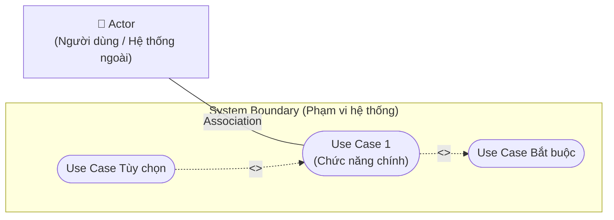

# Use Case Diagrams, Scenarios, and Relationships

Tóm tắt nội dung video về Sơ đồ trường hợp sử dụng (**Use Case Diagram**), các kịch bản (**Scenarios**) và các mối quan hệ (**Relationships**).

---

## 1. Bản chất & Vai trò của Sơ đồ Use Case
- **Mục đích:** Trực quan hóa các yêu cầu chức năng (**Functional Requirements**) từ góc nhìn người dùng, giúp cả chuyên gia kinh doanh và đội ngũ kỹ thuật thấy rõ cách thức tương tác giữa người dùng và hệ thống.
- **Đối tượng ứng dụng:** BA (**Business Analyst** - Chuyên viên Phân tích Nghiệp vụ), PM (**Project Manager** - Quản lý Dự án), PO (**Product Owner** - Chủ sản phẩm), Quản lý vận hành và kỹ sư IT (**Information Technology** - Công nghệ Thông tin).

---

## 2. 4 Thành phần cốt lõi của Use Case Diagram

| Thành phần | Định nghĩa | Ví dụ trong E-commerce |
| :--- | :--- | :--- |
| **1. Actors** (Tác nhân) | Thực thể tương tác với hệ thống (người dùng, thiết bị, hệ thống bên ngoài). | *Customer* (Khách hàng), *Admin*, *Payment Gateway* (Cổng thanh toán). |
| **2. Use Cases** (Trường hợp sử dụng) | Các chức năng hoặc hành động cụ thể hệ thống thực hiện phản hồi lại tác nhân (vẽ bằng hình oval). | *Place Order* (Đặt hàng), *View Product* (Xem sản phẩm). |
| **3. System Boundary** (Ranh giới hệ thống) | Khung chữ nhật xác định phạm vi hệ thống. Mọi thứ bên trong là tính năng hệ thống; bên ngoài là Actors. | Hộp ranh giới ứng dụng mua sắm trực tuyến. |
| **4. Relationships** (Mối quan hệ) | Đường nối mô tả tương tác giữa tác nhân và ca sử dụng hoặc giữa các ca sử dụng với nhau. | Đường liên kết giữa *Customer* và *Place Order*. |

---

## 3. 3 Loại Kịch bản (Scenarios)
Kịch bản (**Scenario**) là bản mô tả chi tiết bằng văn bản về cách tác nhân tương tác với hệ thống trong bối cảnh thực tế:

1. **Basic Flow (Luồng cơ bản / Happy Path):** Kịch bản chuẩn mực, giả định mọi thao tác diễn ra hoàn hảo không có lỗi (Duyệt hàng $\to$ Thêm giỏ $\to$ Checkout $\to$ Nhập địa chỉ & thanh toán $\to$ Nhận email xác nhận).
2. **Alternative Flow (Luồng thay thế / Biến thể):** Các biến thể xuất hiện trong quy trình (ví dụ: sản phẩm hết hàng khi bấm thêm giỏ hàng $\to$ hệ thống thông báo không thể thêm sản phẩm).
3. **Exception Flow (Luồng ngoại lệ / Xử lý sự cố):** Kịch bản xử lý khi xảy ra lỗi ngoài ý muốn (ví dụ: thanh toán thất bại qua cổng thanh toán $\to$ hệ thống báo lỗi và gợi ý đổi phương thức khác).

---

## 4. 3 Loại Mối quan hệ (Relationships)

| Loại quan hệ | Ký hiệu & Cách hoạt động | Mục đích & Ví dụ điển hình |
| :--- | :--- | :--- |
| **Association** (Liên kết) | Nối bằng đường thẳng liền nét giữa **Actor** và **Use Case**. | Biểu thị tác nhân tham gia trực tiếp vào ca sử dụng.  *(VD: Customer $\to$ Place Order)* |
| **Include** (Bao gồm) | Mũi tên nét đứt có nhãn `<<include>>` trỏ từ Use Case gốc sang Use Case được bao gồm. | **Bắt buộc:** Tách quy trình phức tạp thành các bước dùng chung; bước này luôn diễn ra khi bước gốc chạy.  *(VD: Place Order $\to$ `<<include>>` $\to$ Process Payment)* |
| **Extend** (Mở rộng) | Mũi tên nét đứt có nhãn `<<extend>>` trỏ từ Use Case mở rộng về Use Case gốc. | **Tùy chọn:** Bổ sung hành vi chỉ khi thỏa mãn điều kiện nhất định.  *(VD: Offer Discount $\to$ `<<extend>>` $\to$ Place Order khi có khuyến mãi)* |

---

## 5. Lời khuyên thiết kế hiệu quả (Best Practice Tips)
- **Keep it simple (Giữ đơn giản):** Tập trung vào chức năng mức cao, tránh đưa quá nhiều chi tiết vụn vặt gây rối mắt.
- **Collaborate with Stakeholders (Cộng tác chặt chẽ):** Rà soát với người dùng thực tế để thu thập đúng yêu cầu.
- **Use clear labels (Đặt tên rõ ràng):** Tên Actor là danh từ; tên Use Case bắt đầu bằng động từ hành động + danh từ (ví dụ: *Place Order, View Product*).
- **Iterative revision (Hoàn thiện lặp lại):** Liên tục tinh chỉnh sơ đồ dựa trên phản hồi của các bên liên quan.
