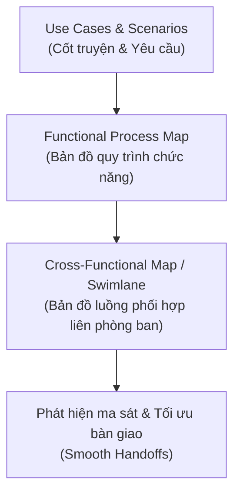

# Connecting Use Cases to Processes

Tóm tắt nội dung Podcast (tập *Workflow Unpacked*) giữa **Ava** (PO - Product Owner) và **Liam** (Process Manager) về cách liên kết các Trường hợp sử dụng (**Use Cases**) với mô hình hóa và cải tiến quy trình nghiệp vụ.

---

## 1. Mối quan hệ giữa Use Case và Quy trình Nghiệp vụ
- **Không chỉ dành cho phần mềm:** Use Case không đơn thuần là tài liệu thiết kế tính năng kỹ thuật, mà còn là công cụ cốt lõi để thúc đẩy cải tiến quy trình (**Process Improvement**).
- **Cốt truyện & Khung xương (Storyline & Skeleton):**
  - **Use Case** cung cấp "khung xương" cấu trúc về người tham gia, tài liệu luân chuyển, thời điểm và các phụ thuộc (**dependencies**).
  - **Scenarios (Kịch bản)** cung cấp "cốt truyện" thực tế, chỉ ra điểm nghẽn hiện tại và bức tranh tương lai mong muốn (**To-Be state**).

---

## 2. Cầu nối chuyển đổi: Từ Use Case đến Swimlane Diagram

1. **Khởi tạo:** PO viết Use Case kèm kịch bản hiện trạng và trạng thái mong muốn (*To-Be*).
2. **Mô hình hóa chức năng (Functional Process Map):** Nhóm quản lý quy trình chuyển hóa các bước tương tác thành lưu đồ nghiệp vụ từng bước.
3. **Mở rộng sang sơ đồ làn bơi (Swimlane Diagram / Cross-Functional Map):**
   - Phân định rõ trách nhiệm giữa các phòng ban: Quản lý sản phẩm, Vận hành (**Ops**), Kỹ thuật CNTT (**IT**), và Chăm sóc khách hàng.
   - **Làm rõ các điểm bàn giao (Handoffs):** Đây là nơi dễ phát sinh lỗi nhất (hiểu nhầm giao tiếp, chậm trễ thời gian, hoặc thao tác thừa lặp lại).

---

## 3. Giá trị thực tiễn mang lại cho tổ chức
- **Cầu nối Hệ thống & Vận hành (Bridge System & Operations):** Kết nối khoảng cách giữa đội ngũ phát triển phần mềm và khối vận hành thực tế ngoài doanh nghiệp.
- **Thực tế hóa phát triển phần mềm:** Đảm bảo sản phẩm phát triển dựa trên luồng công việc thực tế của người dùng, không dựa trên các giả định chủ quan.
- **Bản thiết kế chung (Shared Blueprint):** Tạo sự đồng thuận cao giữa Lãnh đạo (**Leadership**), Vận hành (**Operations**) và Công nghệ (**Technology**).

---

## 4. Thuật ngữ viết tắt trong bài
- **PO (Product Owner - Chủ sản phẩm):** Người chịu trách nhiệm định nghĩa yêu cầu sản phẩm và tối đa hóa giá trị nghiệp vụ của sản phẩm.
- **Ops (Operations - Khối Vận hành):** Bộ phận quản lý và thực thi các hoạt động vận hành thường nhật của doanh nghiệp.
- **IT (Information Technology - Công nghệ Thông tin):** Bộ phận phụ trách hạ tầng kỹ thuật, phần mềm và hệ thống thông tin.
- **To-Be (Future State):** Trạng thái quy trình lý tưởng trong tương lai sau khi đã cải tiến hoặc áp dụng hệ thống mới (đối lập với *As-Is* - hiện trạng).
