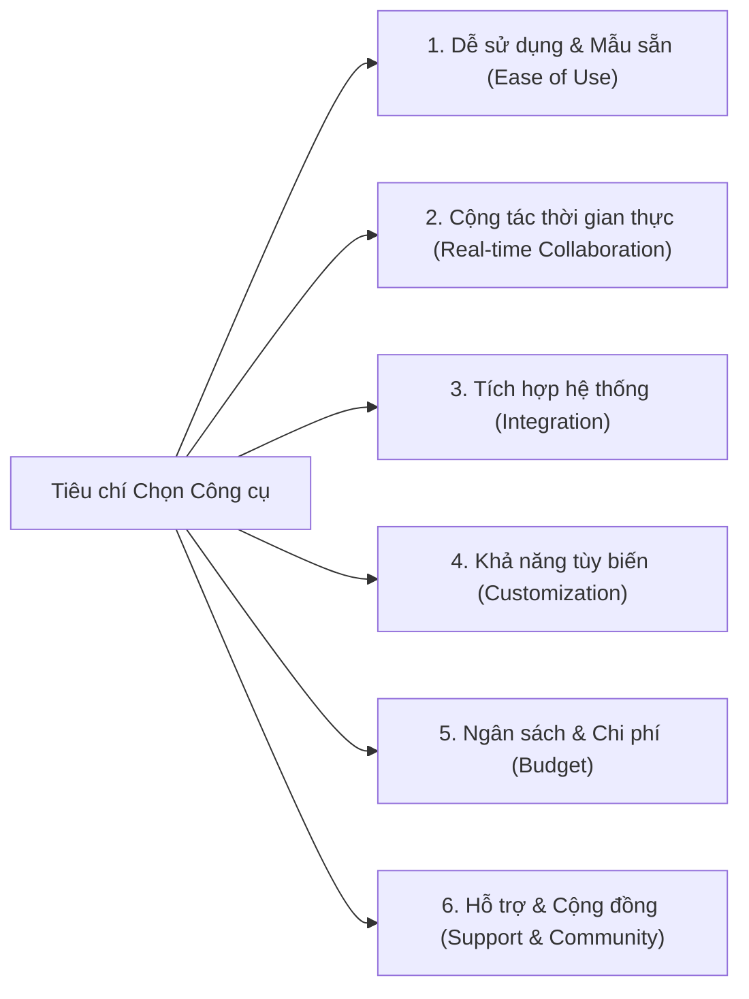

# Choosing the Right Process Modeling Tools

Tóm tắt nội dung video về tầm quan trọng, các tiêu chí lựa chọn công cụ mô hình hóa quy trình và tình huống ứng dụng thực tế.

---

## 1. Tầm quan trọng của Công cụ Mô hình hóa
- **Vai trò:** Hỗ trợ BA (**Business Analyst** - Chuyên viên Phân tích Nghiệp vụ), PM (**Project Manager** - Quản lý Dự án) và các nhà quản lý trực quan hóa, phân tích và chuẩn hóa quy trình.
- **Giá trị cốt lõi mang lại:**
  - **Đơn giản hóa:** Biến các luồng công việc phức tạp thành sơ đồ trực quan, dễ nắm bắt.
  - **Đồng thuận (Alignment):** Tạo góc nhìn trực quan chung cho toàn bộ các bên liên quan (**Stakeholders**).
  - **Phát hiện nút thắt cổ chai (Bottlenecks):** Nhận diện điểm nghẽn, trùng lặp và sự kém hiệu quả.
  - **Tài liệu tham chiếu chuẩn:** Lưu trữ tài liệu chính xác phục vụ kiểm toán (**Audits**), đào tạo và cải tiến sau này.

---

## 2. 6 Yếu tố Cốt lõi khi Lựa chọn Công cụ (Key Selection Factors)

| Tiêu chí | Ý nghĩa & Đòi hỏi | Ví dụ công cụ tiêu biểu |
| :--- | :--- | :--- |
| **1. Ease of Use** (Dễ sử dụng) | Giao diện kéo - thả trực quan, có sẵn các mẫu chuẩn (**pre-built templates**), không đòi hỏi kỹ năng nâng cao. | **Lucidchart**, **Microsoft Visio** |
| **2. Real-time Collaboration** (Cộng tác thời gian thực) | Cho phép nhiều thành viên cùng vẽ, thảo luận trên cùng một bảng làm việc trực tuyến. | **Miro** (bảng trắng cộng tác online) |
| **3. Integration** (Khả năng tích hợp) | Kết nối mượt mà với phần mềm quản lý dự án, tài liệu và dữ liệu sẵn có của doanh nghiệp. | **Bizagi** (tích hợp mạnh với Jira, SharePoint) |
| **4. Customization** (Khả năng tùy biến) | Cho phép chỉnh sửa template linh hoạt hoặc tạo bộ ký hiệu chuẩn riêng của tổ chức. | **ARIS** (tùy biến mô hình sâu cho doanh nghiệp lớn) |
| **5. Budget** (Ngân sách & Chi phí) | Phù hợp với năng lực tài chính: từ miễn phí hoàn toàn đến các gói đăng ký cao cấp. | **Draw.io** (miễn phí) vs. **SAP Signavio** (nền tảng cao cấp doanh nghiệp) |
| **6. Support & Community** (Hỗ trợ & Cộng đồng) | Tài liệu hướng dẫn phong phú, tài nguyên đào tạo và diễn đàn người dùng đông đảo. | **Bizagi** (diễn đàn và tài liệu đào tạo bài bản) |

---

## 3. Case Study: Tối ưu Dây chuyền Lắp ráp Xe hơi (Vehicle Assembly Process)

Quy trình 5 bước áp dụng công cụ mô hình hóa để giải quyết sự cố chậm tiến độ và đội chi phí:

1. **Document Current Process (Lập mô hình hiện trạng):** Sử dụng **Lucidchart** hoặc **Visio** vẽ toàn bộ quy trình: giao linh kiện $\to$ kiểm tra $\to$ lắp khung/động cơ $\to$ QC (**Quality Control**) $\to$ kiểm tra cuối $\to$ sơn $\to$ giao showroom.
2. **Analyze & Identify Issues (Phân tích & Tìm điểm nghẽn):** Phát hiện nút thắt tại khâu QC do thiếu kiểm định viên, linh kiện bị giao chậm từ nhà cung cấp, thiếu kênh thông tin tức thời giữa các bộ phận.
3. **Propose Improvements (Đề xuất giải pháp cải tiến):** Tăng năng lực QC (tuyển thêm người hoặc tự động hóa kiểm thử), cải thiện quản lý nhà cung cấp, áp dụng nền tảng số hóa để giao tiếp tức thời.
4. **Update Process Model (Cập nhật mô hình mới):** Chỉnh sửa sơ đồ quy trình hiển thị luồng tối ưu (**To-Be**) nâng cao hiệu suất.
5. **Present to Stakeholders (Trình bày với các bên liên quan):** Dùng mô hình mới chứng minh cho lãnh đạo thấy rõ hiệu quả và độ tin cậy được cải thiện ra sao.

---

## 4. Thuật ngữ viết tắt trong bài
- **BA (Business Analyst):** Chuyên viên Phân tích Nghiệp vụ.
- **PM (Project Manager):** Quản lý Dự án.
- **QC (Quality Control):** Kiểm soát Chất lượng (khâu kiểm tra nhằm đảm bảo sản phẩm đạt tiêu chuẩn kỹ thuật).
- **ARIS (Architecture of Integrated Information Systems):** Khung kiến trúc và bộ phần mềm mô hình hóa quy trình doanh nghiệp của Software AG.
- **SAP (Systems, Applications, and Products in Data Processing):** Tập đoàn phần mềm quản trị doanh nghiệp toàn cầu (sở hữu nền tảng quy trình SAP Signavio).
- **IT (Information Technology):** Công nghệ Thông tin.
