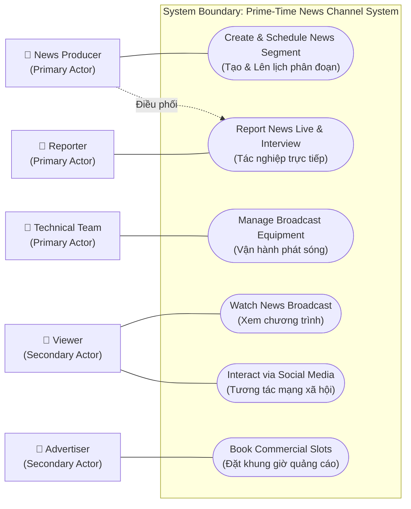

# Lab: Create a Use Case Diagram

Tóm tắt hướng dẫn thực hành bài Lab xây dựng Sơ đồ trường hợp sử dụng (**Use Case Diagram**) cho chương trình truyền hình tin tức giờ vàng (**Prime-Time News Channel Program**).

---

## 1. Bối cảnh & Mục tiêu bài Lab
- **Mục tiêu:** Nhận diện vai trò các bên liên quan (**Stakeholders**), xác định các chức năng cốt lõi của hệ thống và trực quan hóa tương tác qua **Use Case Diagram**.
- **Kịch bản thực tế:** Hệ thống vận hành chương trình tin tức giờ vàng phát sóng trực tiếp các chủ đề (chính trị, thể thao, giải trí, thời tiết), tích hợp phỏng vấn và tương tác khán giả.
- **5 Nhóm bên liên quan chính:**
  1. **News Producers** (Nhà sản xuất tin tức)
  2. **Reporters** (Phóng viên tác nghiệp)
  3. **Viewers** (Khán giả xem truyền hình)
  4. **Technical Team** (Đội ngũ kỹ thuật phát sóng)
  5. **Advertisers** (Nhà tài trợ / Đơn vị quảng cáo)

---

## 2. Nhiệm vụ 1: Xác định Tác nhân (Actors)

Phân loại thành **Primary Actors** (tác nhân chính trực tiếp tương tác đạt mục tiêu) và **Secondary Actors** (tác nhân hỗ trợ hoặc gián tiếp):

| Tác nhân (Actor) | Phân loại | Vai trò chính | Hành vi tương tác chính |
| :--- | :--- | :--- | :--- |
| **News Producer** (Nhà sản xuất) | **Primary** | Giám sát nội dung, lên lịch phát sóng, điều phối phóng viên. | Tạo phân đoạn tin tức (*Create news segment*), điều phối tài nguyên. |
| **Reporter** (Phóng viên) | **Primary** | Thu thập tin tức hiện trường, báo cáo trực tiếp tại trường quay hoặc qua cầu truyền hình. | Báo cáo trực tiếp (*Report news live*), phỏng vấn khách mời. |
| **Technical Team** (Đội kỹ thuật) | **Primary** | Vận hành thiết bị phát sóng, điều khiển âm thanh, hình ảnh và phần mềm phát sóng. | Quản lý phát sóng (*Manage broadcast equipment*), hỗ trợ kỹ thuật trực tiếp. |
| **Viewer** (Khán giả) | **Secondary** | Tiêu thụ nội dung chương trình qua TV hoặc nền tảng số; gửi phản hồi. | Xem chương trình (*Watch program*), tương tác mạng xã hội (*Interact via social media*). |
| **Advertiser** (Nhà quảng cáo) | **Secondary** | Tài trợ ngân sách để mua các khung thời lượng phát sóng quảng cáo. | Đặt khung giờ quảng cáo (*Book commercial slots*), cung cấp video quảng cáo. |

---

## 3. Nhiệm vụ 2 & 3: Sơ đồ Use Case Diagram (Left-to-Right)

---

## 4. Nhiệm vụ 4: Mối quan hệ giữa Tác nhân & Ca sử dụng

| Tác nhân | Ca sử dụng (Use Case) | Bản chất mối quan hệ |
| :--- | :--- | :--- |
| **News Producer** | *Create news segment* | **Trực tiếp:** Thiết lập nội dung, chủ đề, thời lượng. |
| **News Producer** | *Report news live* | **Gián tiếp:** Điều phối phóng viên đưa tin đúng kịch bản. |
| **Reporter** | *Report news live* | **Trực tiếp:** Dẫn chương trình, truyền hình ảnh/âm thanh từ hiện trường. |
| **Technical Team**| *Manage broadcast* | **Trực tiếp:** Kiểm soát tín hiệu đường truyền và thiết bị thu phát. |
| **Viewer** | *Interact via social media* | **Trực tiếp:** Bình chọn khảo sát, đặt câu hỏi gửi đến trường quay. |
| **Advertiser** | *Book commercial slots* | **Trực tiếp:** Thương lượng hợp đồng và phát clip quảng cáo. |

---

## 5. Đúc kết & Câu hỏi Suy ngẫm (Reflection)
1. **Thách thức:** Khó phân định ranh giới giữa tác nhân chính và phụ khi có sự chồng chéo công việc (ví dụ: đội kỹ thuật cũng can thiệp vào cách nội dung được hiển thị).
2. **Giá trị sơ đồ:** Giúp các bên có chung góc nhìn toàn cảnh về cách luồng chương trình hoạt động trước khi đi vào cấu hình hệ thống.
3. **Ý tưởng tăng tương tác khán giả:** Tích hợp bình chọn trực tiếp theo thời gian thực (**Real-time polling**), hỏi đáp trực tuyến (**Live Q&A**), hoặc hiển thị phản hồi từ mạng xã hội lên màn hình phát sóng.

---

## 6. Thuật ngữ viết tắt trong bài
- **BA (Business Analyst):** Chuyên viên Phân tích Nghiệp vụ.
- **UML (Unified Modeling Language):** Ngôn ngữ Mô hình hóa Thống nhất (bộ chuẩn công nghiệp vẽ biểu đồ phần mềm/hệ thống).
- **QC (Quality Control):** Kiểm soát chất lượng tín hiệu và nội dung phát sóng.
- **Q&A (Questions and Answers):** Hỏi và đáp trực tiếp giữa khán giả và trường quay.
