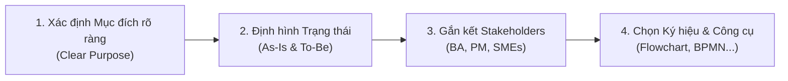

# Podcast Recap: Process Modeling Fundamentals

Tóm tắt nội dung buổi trao đổi giữa **Jordan** (Host) và **Lena** (Chuyên gia Vận hành - Operations Expert) về các nguyên lý cốt lõi trong Mô hình hóa Quy trình (**Process Modeling**).

---

## 1. Bản chất & Giá trị cốt lõi
- **Trực quan hóa công việc (Make work visible):** Biến những quy trình vận hành phức tạp, rối rắm thành hình ảnh trực quan rõ ràng, giúp phát hiện lỗ hổng (**gaps**) và sự kém hiệu quả (**inefficiencies**).
- **Cầu nối Nghiệp vụ & Kỹ thuật:** Tạo ra tiếng nói chung giữa nhu cầu của phía kinh doanh (**business**) và năng lực triển khai của đội ngũ công nghệ (**tech teams**).
- **Hỗ trợ ra quyết định:** Giúp các bên liên quan (**stakeholders**) thấy rõ nơi nào đang đi đúng hướng hoặc bị lệch so với mục tiêu.

---

## 2. Quy trình & Các yếu tố triển khai thành công

1. **Xác định mục đích rõ ràng (Clear Purpose):** Làm rõ ngay từ đầu mục tiêu mô hình hóa là để khắc phục lỗi, tự động hóa (**automation**), hay chỉ nhằm hiểu rõ cách thức vận hành hiện tại.
2. **Nắm vững trạng thái As-Is và To-Be:**
   - **As-Is (Current State):** Tổ chức đang vận hành như thế nào ở thời điểm hiện tại.
   - **To-Be (Future State):** Đích đến và kết quả mong muốn đạt được sau cải tiến.
3. **Sự tham gia đa dạng của các bên liên quan:** Không thể thực hiện đơn độc bởi nhóm quy trình; cần có sự phối hợp của BA (**Business Analyst**), PM (**Project Manager**) và các SME (**Subject Matter Experts**) để mô hình phản ánh đúng thực tế thay vì chỉ "đẹp trên giấy".
4. **Lựa chọn ký hiệu và công cụ phù hợp:**
   - Ký hiệu: **Flowchart** (cho luồng đơn giản) hoặc **BPMN** (cho quy trình phức tạp).
   - Công cụ: **Lucidchart**, **Microsoft Visio**, **Bizagi** tùy theo mục đích và đối tượng tiếp nhận.

---

## 3. Lời khuyên then chốt (Key Takeaway)
> *"Bắt đầu bằng việc lắng nghe. Hãy thực sự thấu hiểu những gì đang diễn ra trong thực tế trước khi bắt tay vào sửa chữa. Một mô hình quy trình tốt chính là bản thiết kế chiến lược cho sự cải tiến."*

---

## 4. Thuật ngữ viết tắt trong bài
- **As-Is:** Trạng thái quy trình hiện tại (trước khi cải tiến).
- **To-Be:** Trạng thái quy trình mục tiêu trong tương lai (sau khi cải tiến hoặc tự động hóa).
- **BA (Business Analyst):** Chuyên viên Phân tích Nghiệp vụ.
- **PM (Project Manager):** Quản lý Dự án.
- **SME (Subject Matter Expert):** Chuyên gia Nghiệp vụ (người nắm rõ kiến thức chuyên sâu về một lĩnh vực hoặc quy trình cụ thể).
- **BPMN (Business Process Model and Notation):** Bộ ký hiệu chuẩn mô hình hóa quy trình nghiệp vụ.
