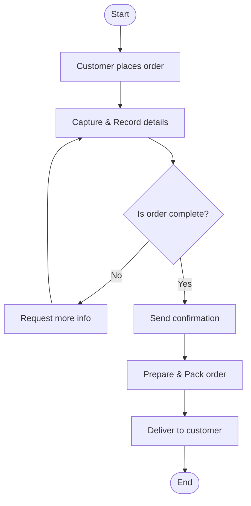

# Lab: Create a Flowchart for Order Management

## 1. Khái niệm & Thuật ngữ quan trọng
- **Order Management Process (Quy trình quản lý đơn hàng):** Chuỗi hoạt động xuyên suốt từ khi khách hàng đặt hàng (*Order Placement*), xác nhận (*Confirmation*), chuẩn bị/chế biến (*Preparation*), giao hàng (*Delivery*) đến khi hoàn tất và ghi nhận phản hồi (*Customer Feedback*).
- **Cross-Functional Workflow (Luồng công việc liên phòng ban):** Quy trình có sự tham gia phối hợp của nhiều bộ phận:
  - **Customer Service (CS):** Tiếp nhận, xác thực đơn hàng và xử lý yêu cầu khách hàng.
  - **Kitchen / Warehouse:** Chuẩn bị món ăn / đóng gói hàng hóa.
  - **Delivery / Logistics:** Nhận đơn từ bếp/kho và giao tận tay khách hàng.
- **Decision Point (Điểm quyết định - Hình thoi):** Nút rẽ nhánh điều kiện logic (vd: đơn đã đủ thông tin chưa? thanh toán thành công không?).
- **Exemplar Document:** Bản mẫu tham chiếu chuẩn mực để đối chiếu và đánh giá quy trình.

---

## 2. Phân tích 4 Task thực hành trong Lab

### Task 1: Phân tích hành trình đơn hàng (Understand Process Journey)
Phân rã đơn hàng qua các chặng chính, xác định phòng ban phụ trách, hành động cốt lõi và điểm quyết định:

| Giai đoạn (Stage) | Phòng ban phụ trách | Hành động chính (Key Actions) | Điểm quyết định (Decision Points) |
| :--- | :--- | :--- | :--- |
| **1. Order Placement** | Customer Service | Khách đặt qua app/web/phone; ghi nhận thông tin, món đặt, yêu cầu đặc biệt | Thông tin đơn hàng đã đầy đủ/hợp lệ chưa? |
| **2. Order Confirmation** | CS / System | Xác nhận lại với khách; gửi thông báo xác nhận thành công | Khách có yêu cầu chỉnh sửa/hủy đơn không? |
| **3. Preparation** | Kitchen / Warehouse | Nhận order ticket, chuẩn bị món/đóng gói hàng hóa | Nguyên liệu/món có sẵn đủ không? |
| **4. Delivery** | Delivery / Logistics | Điều phối shipper nhận đơn, định vị và giao hàng tận nơi | Giao hàng thành công hay khách vắng mặt? |
| **5. Feedback & Close** | Customer Service | Gửi khảo sát đánh giá, đóng đơn hàng trên hệ thống | Khách có khiếu nại không? |

---

### Task 2: Xác định các thành phần cốt lõi (Key Components)
- Gom cụm các bước chi tiết thành các khối chức năng lớn (*Components/Stages*) nhằm giúp sơ đồ mạch lạc, tránh sa đà vào chi tiết vi mô gây rối mắt.
- Định nghĩa rõ ràng đầu vào (*Input*), tác vụ chính (*Processing*) và đầu ra (*Output*) của từng giai đoạn.

---

### Task 3: Xây dựng Flowchart (Thực hành trên Lucidchart / Visio)
Sử dụng bộ ký hiệu chuẩn:
- **Oval:** `Start` và `End`.
- **Rectangle:** Các bước hành động cụ thể (`Receive Order`, `Record Info`, `Send Confirmation`).
- **Diamond:** Điểm rẽ nhánh điều kiện (`Is order complete?`).
- **Arrow:** Chiều di chuyển của luồng công việc.

**Lưu đồ Flowchart chuẩn hóa (Gọn gàng & Trọng tâm theo bài Lab):**

---

### Task 4: Kiểm chứng & Tối ưu hóa (Validate the Flowchart)
- **Check for Gaps & Missing Steps:** Kiểm tra xem có bước hành động hoặc điểm rẽ nhánh nào bị bỏ sót không (vd: xử lý khi đơn thiếu thông tin, hết món).
- **Check for Redundancies / Bottlenecks:** Loại bỏ các bước trùng lặp, kết hợp các thao tác thủ công có thể tự động hóa.
- **Stakeholder Alignment:** Đối chiếu sơ đồ với nhân viên trực tiếp vận hành (CS, bếp, shipper) để đảm bảo phản ánh đúng thực tế.

---

## 3. Takeaway cốt lõi
- Xây dựng bản đồ quy trình quản lý đơn hàng giúp trực quan hóa các điểm bàn giao (*handoffs*) giữa CS, Kitchen và Logistics.
- Luôn kiểm thử các kịch bản ngoại lệ (*No / Exception paths*) tại các điểm quyết định hình thoi thay vì chỉ vẽ luồng lý tưởng (*Happy Path*).
