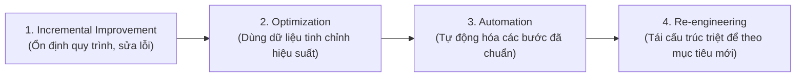

# Introduction to Process Improvement

## 1. Khái niệm cốt lõi & Mục tiêu
- **Process Improvement (Cải tiến quy trình):** Phương pháp tiếp cận có hệ thống nhằm rà soát quy trình hiện tại, nhận diện các điểm kém hiệu quả (inefficiencies), phân tích nguyên nhân gốc rễ và triển khai các thay đổi để mang lại kết quả tốt hơn, giảm lãng phí (waste) và tăng giá trị cho khách hàng.
- **Mục tiêu cốt lõi:**
  - Không phải là thay đổi bản chất mục đích quy trình, mà là làm cho nó **hiệu quả hơn (effective)**, **năng suất hơn (efficient)** và **trơn tru hơn (smoother)**.
  - Cắt giảm sự chậm trễ (delays), giảm thiểu sai sót (errors), tinh gọn các bước làm nghẽn tiến độ hoặc gây ức chế cho nhân sự/khách hàng.

---

## 2. Bốn cấp độ/cách tiếp cận cải tiến (4 Approaches of Process Improvement)

Các phương pháp này không loại trừ lẫn nhau mà là **các giai đoạn chuyển đổi tịnh tiến (progressive stages of transformation)**:

| Cấp độ / Tiếp cận | Câu hỏi cốt lõi | Định nghĩa & Đặc điểm | Ví dụ thực tế (Quy trình hoàn trả hàng) |
| :--- | :--- | :--- | :--- |
| **1. Incremental Improvement (Kaizen)** | *"What can we fix?"* (Ta có thể sửa lỗi gì?) | Cải tiến nhỏ, liên tục từng bước dựa trên phản hồi. Tập trung sửa các điểm lỗi/nghẽn hiện tại mà không xáo trộn cấu trúc lớn. | Đơn giản hóa biểu mẫu hoàn trả, làm rõ hướng dẫn gửi hàng, giảm bớt các bước phê duyệt nội bộ. |
| **2. Process Optimization** | *"How can we perform at our best?"* (Làm sao để đạt hiệu năng tối đa?) | Tối ưu hóa dựa trên dữ liệu (data-driven) nhằm tối đa hóa hiệu suất, đạt kết quả nhất quán/dự đoán được với độ biến động tối thiểu. Đo lường chu kỳ (cycle time), tỷ lệ lỗi, mức sử dụng tài nguyên; đối chuẩn (benchmarking) theo tiêu chuẩn ngành. | Dựa vào dữ liệu lịch sử để điều phối nhân sự ca cao điểm; tối ưu quy tắc điều hướng đơn hàng (routing rules) để tăng tốc độ xử lý. |
| **3. Automation** | *"How can technology accelerate this?"* | Đưa công nghệ (Automated workflows, RPA, AI-driven systems) vào xử lý các tác vụ thủ công, lặp đi lặp lại để tăng tốc, tăng độ chính xác và giảm chi phí. ⚠️ **Lưu ý sống còn:** *Automation không sửa được một quy trình tồi. Tự động hóa một quy trình thiết kế kém chỉ khiến sai lầm xảy ra nhanh hơn.* Luôn cần chuẩn hóa và tối ưu trước khi tự động hóa. | Quét mã vạch (barcode scanning) kiện hàng hoàn trả, tự động in nhãn vận chuyển, dùng AI kiểm tra điều kiện hoàn tiền tự động. |
| **4. Process Re-engineering (BPR)** | *"What if we start from a clean slate?"* | Đập bỏ quy trình cũ và thiết kế lại hoàn toàn từ đầu trên một trang giấy trắng (clean-slate redesign). Mang tính đột phá, tác động lớn, thường bắt nguồn từ thay đổi mô hình kinh doanh hoặc công nghệ mới; đòi hỏi sự bảo trợ từ lãnh đạo cấp cao (executive sponsorship) và quản trị thay đổi (change management) chặt chẽ. | Xóa bỏ hoàn toàn kho tập trung; khách hàng mang hàng trả đến trạm nhận hàng địa phương (pickup hub) và nhận ngay tín dụng mua hàng (store credit) tức thì. |

---

## 3. Lộ trình áp dụng thực tiễn (Transformation Journey)

---

## 4. Ý nghĩa đối với các vai trò dự án (Roles Alignment)

- **Product Owner (PO):** Hiểu rõ cấp độ thay đổi để định nghĩa đúng User Stories và Features phù hợp với mục tiêu sản phẩm.
- **Process Manager:** Phân bổ nguồn lực hợp lý và thiết lập kỳ vọng đúng theo quy mô thay đổi (nhỏ, vừa hay đột phá).
- **Business Analyst (BA):** Thu thập, tài liệu hóa chính xác các yêu cầu nghiệp vụ và xác nhận rằng giải pháp đề xuất mang lại giá trị đo lường được (measurable business value).
- **Operations Manager:** Duy trì tính liên tục và ổn định của vận hành trong khi đội ngũ thích nghi với luồng công việc mới.
