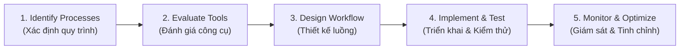

# Implementing Process Automation

## 1. Định nghĩa & Vị trí của Tự động hóa
- **Process Automation (Tự động hóa quy trình):** Việc ứng dụng công nghệ để thực thi các tác vụ với sự can thiệp tối thiểu của con người (*minimal human intervention*).
- **Mục tiêu cốt lõi:** Thay thế các tác vụ lặp đi lặp lại, thủ công để giải phóng nhân sự tập trung vào các công việc phức tạp và tạo giá trị cao hơn.
- **Mối quan hệ & Thời điểm (Timing):**
  - Vừa là **Process Improvement** (thay thế việc thủ công, giảm lỗi), vừa là **Process Optimization** khi áp dụng vào quy trình đã tinh gọn (tăng tốc độ, tính nhất quán và khả năng mở rộng).
  - ⚠️ **Nguyên tắc cốt lõi (Conveyor Belt Metaphor):** Tự động hóa giống như lắp băng chuyền vào dây chuyền sản xuất:
    - Nếu dây chuyền được thiết kế tốt $\rightarrow$ Băng chuyền tăng vọt năng suất.
    - Nếu quy trình bị lỗi $\rightarrow$ Băng chuyền chỉ khiến **các vấn đề và sai sót di chuyển nhanh hơn**.
    - *Vì vậy: Phải chuẩn hóa và tối ưu quy trình trước khi tự động hóa.*

---

## 2. Lợi ích then chốt (Why Automate?)
- **Tăng tốc độ (Speed):** Hoàn thành tác vụ tức thì (ví dụ: tạo và xuất hóa đơn tự động).
- **Tiết kiệm chi phí vận hành (Cost Reduction):** Giảm nhân công cho các việc thủ công lặp lại (ví dụ: Chatbot giải đáp thắc mắc thay thế tổng đài viên cơ bản).
- **Giảm thiểu sai sót con người (Error Reduction):** Hạn chế tối đa lỗi nhập liệu, nhầm số liệu.
- **Khả năng mở rộng quy mô (Scalability):** Xử lý khối lượng công việc tăng vọt mà không cần tăng nhân sự tỷ lệ thuận (ví dụ: hệ thống kho thương mại điện tử xử lý hàng ngàn đơn hàng/ngày).
- **Tuân thủ & Kiểm toán (Compliance & Audit Trails):** Duy trì dữ liệu chính xác và nhật ký vết phục vụ kiểm toán theo luật định.

---

## 3. Bốn khái niệm cốt lõi (Key Concepts)

| Khái niệm | Định nghĩa | Ví dụ điển hình |
| :--- | :--- | :--- |
| **Workflow Automation** | Tạo chuỗi tác vụ tự động kích hoạt (triggered) khi thỏa mãn các điều kiện định trước. | Khách đăng ký tài khoản mới $\rightarrow$ Hệ thống tự động gửi email chào mừng $\rightarrow$ Tạo bản ghi trên Database $\rightarrow$ Gán cho Sales Rep phụ trách. |
| **RPA (Robotic Process Automation)** | Sử dụng các "bot" phần mềm để mô phỏng chính xác thao tác của con người trên giao diện số (trích xuất dữ liệu, điền form, chuyển màn hình). | Ngân hàng dùng RPA để đồng bộ thông tin khách hàng qua lại giữa nhiều hệ thống legacy cũ mà không có API. |
| **BPM (Business Process Management)** | Phương pháp & công cụ quản trị giúp mô hình hóa trực quan, phân tích hiệu suất và tối ưu liên tục toàn bộ quy trình nghiệp vụ. | Nhà máy dùng phần mềm BPM vẽ luồng sản xuất, phát hiện nút thắt cổ chai và tự động lên lịch ca máy. |
| **System Integration** | Tích hợp công cụ tự động hóa mới vào các hệ thống hiện có để dữ liệu luân chuyển liền mạch, không gián đoạn. | Tích hợp CRM với công cụ Email Marketing để tự động chăm sóc lead tiềm năng. |

---

## 4. Quy trình 5 bước triển khai Tự động hóa (Implementation Steps)

1. **Identify Processes for Automation:**
   - Phân tích quy trình hiện tại, tìm các tác vụ thủ công, lặp đi lặp lại ngốn nhiều thời gian và tài nguyên (nhập liệu, kết xuất báo cáo, hỗ trợ giải đáp cơ bản).
2. **Evaluate Automation Tools:**
   - Khảo sát các công cụ trên thị trường dựa trên tiêu chí: tính dễ dùng, khả năng tích hợp, khả năng scale và chi phí.
   - *Công cụ tiêu biểu:* **Zapier** (Workflow automation), **UiPath** (RPA), **Monday.com** (Project management / work management).
3. **Design the Automation Workflow:**
   - Vẽ chi tiết từng bước, điểm rẽ nhánh quyết định (decision points), quy tắc chuyển giao dữ liệu giữa các bên/hệ thống.
4. **Implement the Automation:**
   - Cấu hình phần mềm, tích hợp hệ thống, viết script tùy chỉnh (nếu cần).
   - **Bắt buộc:** Thực hiện kiểm thử toàn diện (*thorough testing*) trước khi go-live.
5. **Monitor and Optimize:**
   - Đo lường mức độ cải thiện hiệu suất, tỷ lệ lỗi và thu thập feedback người dùng để tinh chỉnh liên tục.

---

## 5. Case Study & Ứng dụng thực tế

### Walkthrough: Tự động hóa quy trình xuất hóa đơn (Invoicing)
1. **Identify:** Nhận diện quy trình thủ công tốn thời gian, dễ tính sai số liệu.
2. **Evaluate:** Chọn phần mềm kế toán tự động (ví dụ: *QuickBooks*).
3. **Design:** Thiết lập template hóa đơn chuẩn với đầy đủ thông tin khách và chi tiết dòng hàng.
4. **Implement:** Tích hợp phần mềm hóa đơn với hệ thống bán hàng (Sales POS/eCommerce) để tự động xuất hóa đơn khi có phát sinh mua hàng.
5. **Monitor:** Đo thời gian tiết kiệm được và độ chuẩn xác của chứng từ, hiệu chỉnh template khi cần.

### Các ứng dụng thực tế phổ biến:
- **Dịch vụ khách hàng (Customer Service):** Chatbots trả lời câu hỏi thường gặp (FAQs) tức thì 24/7.
- **Nhân sự (HR):** Tự động hóa onboarding cho nhân viên mới (điền form online, gửi tài liệu chào mừng, cấp tài khoản đào tạo).
- **Kinh doanh (Sales):** Tự động chấm điểm khách hàng tiềm năng (Lead Scoring) dựa trên hành vi truy cập web và mở email.
- **Bán lẻ (Retail):** Tự động đồng bộ tồn kho thời gian thực (real-time stock updates) ngay khi phát sinh giao dịch, tránh bán vượt tồn kho (overselling).
