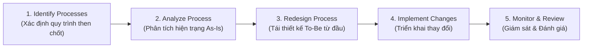

# Reengineering Business Processes (BPR)

## 1. Định nghĩa & Bản chất cốt lõi
- **Business Process Re-engineering (BPR - Tái cấu trúc quy trình nghiệp vụ):** Cách tiếp cận chiến lược nhằm cải thiện vượt bậc hiệu quả bằng cách **tái tư duy căn bản (fundamentally rethinking)** và **tái thiết kế triệt để (radically redesigning)** các quy trình kinh doanh từ con số không (*clean slate / ground up*).
- **Mục tiêu:** Tạo ra bước nhảy vọt (dramatic improvements) về:
  - **Năng suất (Productivity)**
  - **Thời gian chu kỳ (Cycle times)**
  - **Chất lượng sản phẩm/dịch vụ (Quality)**
  - **Chi phí (Cost) & Trải nghiệm khách hàng (Customer Experience)**
- **Khác biệt mang tính bản chất:**
  - *Improvement & Optimization:* Tinh chỉnh dần dần, từng bước (incremental refinements).
  - *BPR:* Cách mạng triệt để (revolutionary approach), phù hợp với tổ chức đang lâm vào bế tắc, hệ thống quá lạc hậu hoặc tồn tại những điểm nghẽn nghiêm trọng ăn sâu vào mô hình vận hành.

---

## 2. Vì sao doanh nghiệp cần BPR? (Drivers for BPR)
- **Quy trình lỗi thời (Outdated Processes):** Các quy trình thủ công phức tạp, thừa thãi qua nhiều năm làm chậm toàn bộ vận hành.
- **Áp lực cạnh tranh khốc liệt:** Đối thủ áp dụng công nghệ mới đòi hỏi doanh nghiệp phải chuyển mình để sống còn.
- **Thay đổi nhu cầu khách hàng:** Khách hàng đòi hỏi tốc độ nhanh hơn, độ chính xác cao hơn, dịch vụ cá nhân hóa hơn.
- **Tiến bộ công nghệ:** Sự bùng nổ của các nền tảng số, đám mây, tự động hóa và AI mở ra cơ hội thiết kế quy trình hoàn toàn mới chưa từng có trước đây.

---

## 3. Quy trình 5 bước thực hiện BPR (Fundamental Steps)

1. **Identifying Processes for Re-engineering:**
   - Chọn quy trình mang tính sống còn đối với sự thành bại của tổ chức, đang có hiệu suất kém hoặc tỷ lệ lỗi cao (ví dụ: quy trình hoàn tất đơn hàng - Order Fulfillment).
2. **Analyzing the Process:**
   - Dùng Flowchart, Process Map để bóc tách từng bước hiện trạng (*As-Is*), tìm ra các nút thắt cổ chai và nguồn cơn gây lãng phí.
3. **Redesigning the Process:**
   - Tư duy vượt khuôn khổ (out-of-the-box), loại bỏ hoàn toàn các bước thừa, ứng dụng công nghệ mới để đạt cùng mục tiêu nhưng với phương thức hoàn toàn khác biệt.
4. **Implementing the Changes:**
   - Đào tạo nhân viên theo quy trình mới, đầu tư công nghệ/phần mềm mới, tái cấu trúc đội ngũ nếu cần.
5. **Monitoring and Reviewing Performance:**
   - Thu thập dữ liệu theo dõi các chỉ số KPI then chốt (thời gian tiết kiệm, tỷ lệ chính xác, mức độ hài lòng khách hàng) để tiếp tục tinh chỉnh.

---

## 4. Các Case Study BPR kinh điển (Real-World Examples)

| Doanh nghiệp | Bối cảnh & Thách thức | Giải pháp BPR đột phá | Kết quả đạt được |
| :--- | :--- | :--- | :--- |
| **Ford (Thập niên 1980)** | Cạnh tranh gay gắt từ các hãng xe nước ngoài (Nhật Bản); chi phí sản xuất và tồn kho quá cao. | Tái cấu trúc quy trình sản xuất ô tô bằng phương pháp sản xuất đúng thời điểm (**Just-in-Time - JIT**). | Giảm đáng kể chi phí lưu kho, rút ngắn thời gian sản xuất và tăng năng lực cạnh tranh. |
| **Dell** | Mô hình bán máy tính truyền thống qua nhiều tầng đại lý trung gian làm đội giá và chậm giao hàng. | Thiết kế lại chuỗi cung ứng theo mô hình **bán trực tiếp tới khách hàng (Direct-to-Consumer)**; cho phép khách hàng tự cấu hình máy online rồi nhà máy mới lắp ráp và gửi trực tiếp. | Loại bỏ trung gian, hạ giá thành, giảm tồn kho linh kiện về mức tối thiểu, cung cấp đúng cấu hình khách cần. |
| **Bank of America (Đầu thập niên 1990)** | Quy trình xét duyệt hồ sơ vay thế chấp mua nhà (Mortgage Processing) rườm rà, kéo dài nhiều tuần. | Tái thiết kế toàn diện quy trình kết hợp ứng dụng công nghệ số hóa dữ liệu tập trung. | **Rút ngắn thời gian duyệt vay từ nhiều tuần xuống chỉ còn vài ngày**, tạo đột phá về sự hài lòng của khách hàng. |

---

## 5. Thách thức & Rủi ro khi thực thi BPR (BPR Challenges)

- **Sự phản kháng của nhân viên (Employee Resistance):**
  - Con người có xu hướng ngại thay đổi thói quen làm việc cũ hoặc sợ mất việc do công nghệ mới.
  - *Giải pháp:* Lôi kéo nhân viên tham gia vào quá trình thiết kế lại, truyền thông minh bạch về lợi ích và đồng hành đào tạo.
- **Chi phí đầu tư ban đầu cao (High Initial Costs):**
  - Đòi hỏi vốn lớn cho nền tảng công nghệ mới, tư vấn tái cấu trúc và chi phí đào tạo lại toàn bộ nhân sự.
- **Rủi ro gián đoạn vận hành (Operational Disruption):**
  - Các quy trình phức tạp khi bị "đập đi xây lại" có thể gây xáo trộn hoạt động kinh doanh hàng ngày nếu không có kế hoạch chuyển đổi (Cutover Plan) và quản trị rủi ro chặt chẽ.
