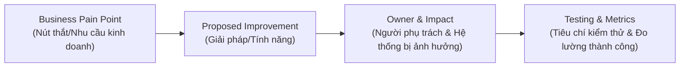

# Evaluating and Prioritizing Improvements

## 1. Tầm quan trọng của Đánh giá & Ưu tiên hóa
- **Thực trạng doanh nghiệp:** Doanh nghiệp hiếm khi thiếu ý tưởng cải tiến; cái họ thiếu là **phương pháp có kỷ luật (disciplined methods)** để đánh giá, lựa chọn và thực thi đúng những ý tưởng mang lại giá trị cao nhất.
- **Mục tiêu ưu tiên:** Đảm bảo nỗ lực cải tiến luôn cân đối và gắn kết chặt chẽ giữa:
  - Giá trị kinh doanh (*Business Value*)
  - Nhu cầu khách hàng (*Customer Needs*)
  - Tính khả thi (*Feasibility*)
  - Kết quả chiến lược (*Strategic Outcomes*)
- **Bộ 3 công cụ kinh điển:** **MoSCoW**, **Kano Model**, và **RTM (Requirements Traceability Matrix)**. Khi kết hợp cùng nhau, chúng giúp tránh việc ra quyết định dựa theo "ai nói to nhất" (*loudest voice*) hoặc theo đuổi các thay đổi vô thưởng vô phạt.

---

## 2. Phương pháp MoSCoW (Độ khẩn cấp & Sự cần thiết)

MoSCoW phân loại các đề xuất cải tiến/yêu cầu thành 4 mức độ:

| Nhóm | Tên đầy đủ | Định nghĩa & Ý nghĩa | Ví dụ (Tối ưu quy trình đổi trả hàng) |
| :---: | :--- | :--- | :--- |
| **M** | **Must-Have** | Bắt buộc phải có để quy trình vận hành tối thiểu (*Minimum Viable Performance*), hoặc do yêu cầu tuân thủ luật pháp/chính sách. Không có thì không thể launch. | Sửa lỗi tính sai tiền hoàn trả (giảm refund errors), đảm bảo tính đúng số tiền cho khách. |
| **S** | **Should-Have** | Đem lại giá trị/hiệu quả đáng kể nhưng không mang tính sống còn ngay lúc go-live; có thể tạm hoãn hoặc dùng giải pháp thay thế tạm thời. | Tự động gửi thông báo SMS/Email cập nhật trạng thái đơn trả hàng. |
| **C** | **Could-Have** | Tính năng mong muốn, tạo thêm tiện ích nếu còn dư thời gian và nguồn lực (*nice-to-have*). | Tích hợp cổng tra cứu lịch sử đổi trả trực quan trên ứng dụng di động. |
| **W** | **Won't-Have (for now)** | Ý tưởng tốt cho tương lai nhưng nằm ngoài phạm vi (*out of scope*) của đợt triển khai hiện tại. | Triển khai mô hình AI phức tạp để tự động phát hiện gian lận đổi trả hàng (*AI-based fraud detection*). |

> **Giá trị:** Tạo sự đồng thuận cao, ngăn ngừa tình trạng phình phạm vi (*Scope Creep*), và tập trung nguồn lực hữu hạn vào điều then chốt.

---

## 3. Mô hình Kano (Kano Model - Mức độ hài lòng của khách hàng)

Mô hình Kano phân loại tính năng theo trục mức độ đáp ứng (*Functionality*) và mức độ hài lòng của khách hàng (*Customer Satisfaction*):

### A. 3 Nhóm nên đưa vào Roadmap:
1. **Basic / Must-Be (Kỳ vọng cơ bản):**
   - Không có thì khách hàng cực kỳ thất vọng, nhưng nếu làm tốt khách cũng chỉ xem là điều hiển nhiên (không gây phấn khích).
   - *Ví dụ:* Tính đúng và chuẩn xác số tiền hoàn trả (*Refund accuracy*).
2. **Performance / One-dimensional (Hiệu năng tỷ lệ thuận):**
   - Càng làm tốt, khách hàng càng hài lòng (quan hệ tuyến tính 1-1).
   - *Ví dụ:* Tốc độ hoàn tiền nhanh hơn (*Faster refunds*).
3. **Delighters / Exciters (Yếu tố gây bất ngờ & thích thú):**
   - Khách không đòi hỏi hay kỳ vọng trước, nhưng khi có thì tạo ấn tượng vượt trội, tạo lợi thế cạnh tranh khác biệt.
   - *Ví dụ:* Hoàn tiền tức thì dưới dạng điểm mua hàng (*Instant store credit*) ngay khi khách vừa gửi đơn tại điểm gom hàng.

### B. 2 Nhóm cần loại khỏi Roadmap (Keep Off):
4. **Indifferent (Thờ ơ):** Khách không quan tâm hoặc thậm chí không nhận ra sự tồn tại của tính năng đó $\rightarrow$ tránh tốn nguồn lực.
5. **Reverse (Phản tác dụng):** Càng thêm vào càng gây khó chịu, không hài lòng cho khách hàng.

---

## 4. Ma trận truy xuất nguồn gốc yêu cầu (RTM - Requirements Traceability Matrix)

- **Định nghĩa:** Bảng liên kết từng cải tiến/yêu cầu kỹ thuật ngược về đúng nhu cầu nghiệp vụ (*Business Needs*) và mục tiêu chiến lược mà nó phục vụ.
- **Vai trò:**
  - Hoạt động như tấm bản đồ kết nối xuyên suốt vòng đời dự án: tránh thất lạc ý tưởng, đảm bảo mỗi cải tiến đều giải quyết tận gốc nguyên nhân (*root cause*).
  - Ngăn chặn việc làm tính năng vô thưởng vô phạt không rõ mục đích.

### Các trường thông tin cơ bản trong bảng RTM:
- **Business Need / Pain Point:** Điểm đau nghiệp vụ (ví dụ: chu kỳ phê duyệt thủ công kéo dài quá lâu).
- **Specific Solution / Improvement:** Giải pháp cụ thể (ví dụ: tự động hóa luồng duyệt đơn).
- **Owner / Responsible:** Người chịu trách nhiệm chính.
- **Success Measures (KPIs):** Tiêu chí đo lường (ví dụ: rút ngắn 50% thời gian duyệt).
- **System / Process Impact:** Hệ thống hoặc quy trình bị tác động.
- **Testing Criteria:** Kịch bản kiểm thử nghiệm thu.

---

## 5. Tổng kết sức mạnh khi kết hợp bộ 3 công cụ

| Công cụ | Lăng kính chính | Trả lời câu hỏi |
| :--- | :--- | :--- |
| **MoSCoW** | Mức độ cấp thiết & Khả năng thực thi (*Urgency & Feasibility*) | *"Cái gì bắt buộc phải làm trước để sống còn?"* |
| **Kano Model** | Trải nghiệm & Sự hài lòng của khách hàng (*Customer Value*) | *"Tính năng nào tạo ra sự thỏa mãn thực sự và khác biệt cạnh tranh?"* |
| **RTM** | Căn gióng chiến lược & Truy xuất nguồn gốc (*Alignment & Governance*) | *"Mỗi việc làm có giải quyết đúng vấn đề gốc rễ và mang lại kết quả đo đạc được không?"* |
