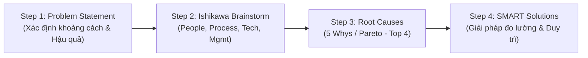

# Lab: Sustaining the Gain: Dispatch Routing Software

## 1. Mục tiêu & Bối cảnh thực hành (Context & Objectives)
- **Mục tiêu:** Nhận diện và xử lý sớm dấu hiệu suy giảm hiệu năng (performance decline/backslide) sau khi cải tiến; ứng dụng AI phân tích nguyên nhân gốc rễ và xây dựng giải pháp SMART để duy trì thành quả dài hạn.
- **Tình huống (Scenario):** Nhà phân phối nông sản triển khai phần mềm điều phối định tuyến thông minh (AI Dispatch Routing System).
  - *Kết quả Pilot (Rất tốt):* Quãng đường giảm 15%, Giao hàng đúng hạn (OTD) tăng từ 86% lên 94%, Chi phí nhiên liệu giảm 12%.
  - *Dấu hiệu tụt dốc sau 3 tháng:* OTD tụt về 88%; số dặm tăng lại; tài xế bối rối giữa lộ trình hệ thống và ghi đè thủ công; điều phối viên quay lại dùng Excel khi phần mềm chậm; ticket hỗ trợ IT tăng gấp đôi.

---

## 2. Quy trình 4 bước phân tích với AI (4-Step AI-Assisted RCA)

### Bước 1: Xây dựng Problem Statement (Phát biểu vấn đề)
- **Nguyên tắc:** Tập trung vào sự thật (facts), khoảng cách kỳ vọng vs thực tế (performance gap) và rủi ro kinh doanh; không vội đưa giải pháp hay quy chụp nguyên nhân.
- **Problem Statement chuẩn:**  
  > *"Sau giai đoạn pilot thành công, các chỉ số cốt lõi (OTD, quãng đường, tỷ lệ sử dụng hệ thống) bị suy giảm rõ rệt. Sự thụt lùi này đe dọa độ tin cậy giao hàng, hiệu quả vận hành và ROI của toàn bộ dự án chuyển đổi số."*

### Bước 2: Nhận diện nguyên nhân tiềm năng (Fishbone / Ishikawa 4M)
- **People (Con người):** Tài xế bối rối khi nào theo hệ thống, khi nào theo can thiệp tay; Điều phối viên thiếu tự tin/chưa thạo hệ thống nên quay lại dùng bảng tính quen thuộc.
- **Process (Quy trình):** Thiếu quy trình chuẩn (SOP) xử lý khi hệ thống bị chậm/nghẽn; Luồng giao tiếp giữa tài xế và điều phối viên bị đứt gãy khi đổi tuyến.
- **Technology (Công nghệ):** Hệ thống bị chậm trễ khi tính toán tuyến đường; Thuật toán chưa cập nhật dữ liệu giao thông/cửa sổ giao hàng theo thời gian thực.
- **Management (Quản lý):** Thiếu cơ chế giám sát chỉ số sau triển khai (post-launch monitoring); Thiếu sự đôn đốc, phân định trách nhiệm rõ ràng về việc tuân thủ dùng tool mới.

### Bước 3: Xác định Top 4 nguyên nhân gốc rễ (Top 4 Root Causes)
1. **Lệch pha giữa tự động và can thiệp thủ công:** Tài xế không biết ưu tiên lộ trình nào, làm vô hiệu hóa khả năng tối ưu của AI.
2. **Thói quen quay về Excel khi có sự cố:** Đưa biến động thủ công trở lại quy trình làm tăng số dặm và kéo giảm năng suất.
3. **Hiệu năng hệ thống (Latency/Slowness):** Tốc độ phản hồi chậm làm giảm lòng tin của người dùng, buộc họ tìm đường vòng (workarounds).
4. **Buông lỏng giám sát hậu triển khai:** Không theo dõi sát sao dẫn tới bỏ lỡ các tín hiệu cảnh báo sớm, để vấn đề leo thang.

---

## 3. Bộ giải pháp SMART duy trì thành quả (SMART Action Plan)

| Giải pháp | Nguyên nhân giải quyết | Chỉ số thành công (Measure) | Người phụ trách (Owner) | Thời hạn (Timeframe) |
| :--- | :--- | :--- | :--- | :--- |
| **1. Refresher Training** Đào tạo lại tài xế và điều phối viên về cách đọc tuyến và quy tắc ghi đè thủ công | Tài xế mơ hồ giữa tuyến máy và can thiệp tay | 100% nhân sự hoàn thành; Giảm 50% số vụ ghi đè thủ công | Operations Training Manager | 60 ngày |
| **2. SOP & Backup Protocol** Ban hành quy trình chuẩn khi hệ thống chậm và giao thức định tuyến dự phòng | Điều phối viên quay lại dùng Excel khi nghẽn hệ thống | 0 trường hợp dùng Excel ngoài luồng; Tỷ lệ dùng hệ thống đạt ≥ 95% | Dispatch Supervisor & IT Lead | 45 ngày |
| **3. Performance Dashboard** Xây dựng dashboard theo dõi chỉ số hàng ngày, họp review định kỳ mỗi tuần | Thiếu giám sát và đôn đốc trách nhiệm sau triển khai | Dashboard go-live trong 30 ngày; Các chỉ số OTD và nhiên liệu phục hồi lại mức Pilot | Operations Manager & Data Analytics | 30 – 90 ngày |

---

## 4. Đúc kết cốt lõi (Key Takeaways)
- Cải tiến chỉ thực sự hoàn tất khi có **cơ chế duy trì (governance & monitoring)** để chống hiện tượng "ngựa quen đường cũ" (backslide).
- Dùng AI như cộng sự tư duy phản biện (thought partner) để phân rã nguyên nhân theo khung 4 yếu tố (People - Process - Tech - Management) và thiết kế giải pháp SMART có chủ sở hữu (Owner) rõ ràng.
