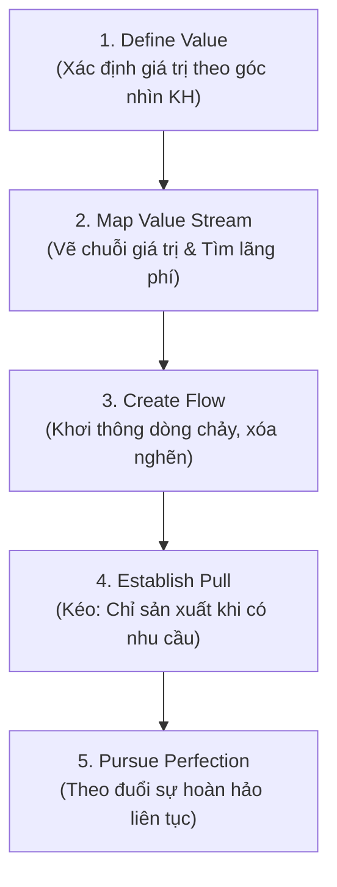

# Introduction to Lean Thinking

## 1. Bản chất & Định nghĩa cốt lõi
- **Triết lý Lean (Tư duy tinh gọn):** Tối đa hóa giá trị cho khách hàng (maximize customer value) song song với việc tối thiểu hóa lãng phí (minimize waste - *muda*), xây dựng văn hóa cải tiến liên tục và tôn trọng con người.
- **Định nghĩa Giá trị (Value):** Bất cứ điều gì khách hàng **thực sự sẵn sàng trả tiền**. Mọi hoạt động tiêu tốn nguồn lực mà không tạo ra giá trị này đều bị coi là **lãng phí (waste)**.
- **Mối liên hệ giữa Lean & Systems Thinking:**
  - Cùng chung nền tảng nhìn tổ chức như một thể thống nhất.
  - Systems Thinking giúp **chẩn đoán** mối quan hệ, độ trễ và vòng lặp.
  - Lean cung cấp **công cụ hành động thực tiễn** để cắt bỏ các bước không tạo giá trị (NVA), giải phóng dòng chảy và ngăn ngừa tối ưu hóa cục bộ (sub-optimization).

---

## 2. So sánh Quản trị dự án truyền thống vs. Lean Thinking

| Tiêu chí | Quản trị dự án truyền thống (Traditional) | Tư duy tinh gọn (Lean Thinking) |
| :--- | :--- | :--- |
| **Trọng tâm (Focus)** | Bám đúng phạm vi (Scope), Tiến độ (Time), Ngân sách (Cost) | Liên tục gia tăng và chuyển giao giá trị cho khách hàng |
| **Lập kế hoạch (Planning)** | Kế hoạch cố định, chi tiết ngay từ đầu (Upfront fixed plan) | Kế hoạch thích ứng (Adaptive), tiến hóa qua phản hồi thực tế |
| **Thước đo thành công** | Các mốc tiến độ (Milestones) & Tài liệu bàn giao | Tốc độ dòng chảy (Flow), mức giảm lãng phí & giá trị tạo ra |
| **Cơ chế vận hành** | Phân công tác vụ từ trên xuống, giám sát tuân thủ | Trao quyền cho đội ngũ tuyến đầu tự nhận diện và sửa lỗi |
| **Quản trị thay đổi** | Kiểm soát chặt chẽ qua quy trình xét duyệt thay đổi | Coi cải tiến và thích ứng linh hoạt là công việc thường nhật |

---

## 3. Năm nguyên tắc cốt lõi của Lean (5 Lean Principles)

1. **Define Value:** Hiểu chính xác điều khách hàng mong muốn và sẵn sàng chi trả.
2. **Map the Value Stream:** Nhìn rõ toàn bộ các bước từ đầu đến cuối để cô lập lãng phí.
3. **Create Flow:** Loại bỏ độ trễ, điểm gián đoạn và nút thắt để công việc trôi chảy liên tục.
4. **Establish Pull:** Sản xuất/xử lý dựa trên nhu cầu thực tế của hạ nguồn, tránh ứ đọng.
5. **Pursue Perfection:** Cải tiến không ngừng (Kaizen) thông qua phản hồi và học hỏi.

*(Ghi chú: Lean nhận diện **8 loại lãng phí kinh điển (DOWNTIME)** gồm: Defects, Overproduction, Waiting, Non-utilized talent, Transportation, Inventory, Motion, Extra-processing — sẽ học chi tiết ở bài kế tiếp).*

---

## 4. Hai ví dụ thực tiễn (Scenarios)

- **Dịch vụ khách hàng (CSKH):** Quy trình xử lý khiếu nại mất 3 ngày do qua 3 tầng duyệt (trong đó 2 tầng không thêm giá trị). Sau khi loại bỏ duyệt thừa và chuẩn hóa mẫu phản hồi, thời gian giảm từ **3 ngày xuống còn 6 giờ**, vừa nâng cao CSAT vừa giảm tải áp lực cho nhân viên.
- **Sản xuất (Manufacturing):** Các chi tiết gia công phải di chuyển zíc-zắc khắp nhà xưởng. Sau khi tái bố trí thiết bị thành **dây chuyền chữ U (U-shaped cell)**, quãng đường di chuyển nội bộ **giảm 50%**, lỗi kỹ thuật giảm và sản lượng đầu ra tăng mà không cần bổ sung thêm máy móc hay nhân sự.
