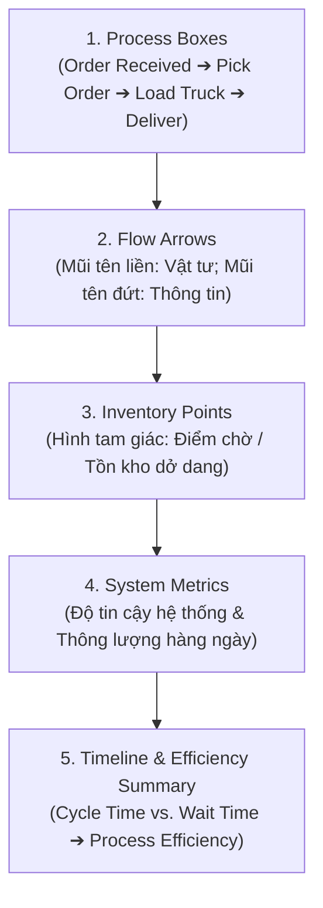

# Value Stream Mapping (VSM)

## 1. Khái niệm cốt lõi & Mục tiêu
- **Định nghĩa Value Stream Mapping (VSM):** Công cụ trực quan hóa toàn bộ dòng chảy công việc, vật tư và thông tin từ đầu đến cuối chuỗi giá trị; bộc lộ rõ vị trí tạo ra giá trị (Value-added) và nơi tích tụ lãng phí (Waste).
- **Mục tiêu tối thượng:** *"See the flow, find the waste, and improve the system"* — Nhìn rõ dòng chảy, nhận diện nút thắt/độ trễ và dùng dữ liệu thực tế để thiết kế trạng thái tương lai (Future State).

---

## 2. Cấu trúc và 5 bước xây dựng VSM (Ví dụ Giao nhận hàng)

### Chi tiết các thành phần:
1. **Process Boxes (Hộp quy trình):** Đại diện cho từng bước lớn. Chứa thông số then chốt:
   - **Cycle Time (CT):** Thời gian thực tế để hoàn thành bước đó (vd: Pick Order = 10 phút).
   - **Uptime (%):** Tỷ lệ máy móc/quy trình vận hành ổn định không lỗi gián đoạn.
2. **Flow Arrows (Mũi tên dòng chảy):**
   - *Mũi tên nét liền:* Dòng di chuyển vật lý của hàng hóa/sản phẩm.
   - *Mũi tên nét đứt:* Dòng chảy thông tin (lịch trình, lệnh xuất kho, cảnh báo).
3. **Inventory Points (Điểm tồn kho - Hình tam giác):** Đặt giữa các khâu thể hiện số lượng bán thành phẩm đang phải nằm chờ (vd: 1,200 đơn tồn đầu ngày trước khâu Pick Order).

---

## 3. Các công thức tính toán cốt lõi trong VSM

### 1. Độ tin cậy toàn quy trình (Process Reliability)
Xác suất để toàn bộ chuỗi mắt xích chạy thông suốt không lỗi trong 1 chu kỳ:
$$\text{Reliability} = \text{Uptime}_1 \times \text{Uptime}_2 \times \dots \times \text{Uptime}_n$$
*Ví dụ bài học:* $99\% \times 95\% \times 92\% \times 90\% = 77.87\%$.

### 2. Thông lượng hàng ngày (Daily Throughput)
Tỷ lệ khối lượng công việc thực sự được hoàn thành giao nộp so với tổng tồn sẵn có:
$$\text{Daily Throughput} = \frac{\text{Delivered Units}}{\text{Total Available Units}} = \frac{700}{1,200} = 58.33\%$$
*(500 đơn tồn đọng dồn sang chu kỳ tiếp theo ➔ Quy trình không đáp ứng kịp nhu cầu).*

### 3. Dòng thời gian & Hiệu suất quy trình (Process Efficiency)
- **Value-Added Time (VAT / Tổng Cycle Time):** Thời gian thực làm việc hữu ích = $95\text{ phút}$.
- **Non-Value-Added Time (NVAT / Tổng Wait Time):** Thời gian hàng nằm chờ chết = $300\text{ phút}$.
- **Total Lead Time (Tổng thời gian chu kỳ):** $\text{Lead Time} = \text{VAT} + \text{NVAT} = 95 + 300 = 395\text{ phút}$.
- **Hiệu suất chuỗi giá trị (Process Efficiency):**
  $$\text{Process Efficiency} = \frac{\text{Value-Added Time (VAT)}}{\text{Total Lead Time}} = \frac{95}{395} \approx 24.05\%$$

> **Insight sâu sắc:** Nhân viên làm việc rất vất vả, nhưng dòng chảy quy trình bị nghẽn (chỉ ~24% thời gian thực sự tạo ra giá trị, 76% còn lại là chờ đợi lãng phí).

---

## 4. Từ Current State sang Future State
- **Current State:** Phản ánh chân thực hiện trạng kèm số liệu đo lường cụ thể.
- **Future State:** Thiết kế lại bằng cách:
  - Cắt giảm triệt để Wait time giữa các khâu.
  - Xóa bỏ các bước trung gian thừa hoặc áp dụng tự động hóa.
  - So sánh đối chiếu 2 bản đồ để chứng minh hiệu quả: rút ngắn Lead time, giải phóng hàng tồn và nâng cao hiệu suất dòng chảy.
