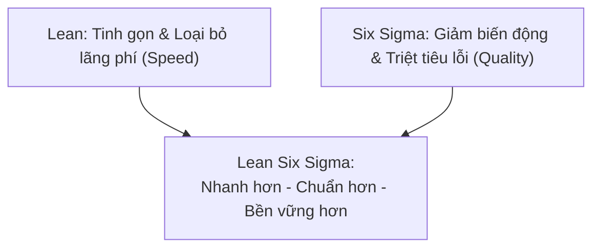

# Lean Six Sigma Quick Reference Guide

## 1. Bản chất & Sự cộng hưởng (Synergy)
- **Định nghĩa Lean Six Sigma (LSS):** Sự kết hợp giữa **Lean** (tập trung loại bỏ lãng phí, khơi thông dòng chảy) và **Six Sigma** (tập trung giảm biến động, nâng cao chất lượng chuẩn xác).
- **Nguyên lý cộng hưởng:** *"Lean accelerates the process, Six Sigma stabilizes it"* — Lean tăng tốc độ dòng chảy, Six Sigma ổn định và chuẩn hóa chất lượng.

---

## 2. So sánh Lean vs. Six Sigma

| Tiêu chí | Lean Thinking | Six Sigma |
| :--- | :--- | :--- |
| **Mục tiêu chính** | Loại bỏ lãng phí (*muda*), rút ngắn Lead Time | Giảm biến động (variation), triệt tiêu lỗi (*defects*) |
| **Cách tiếp cận** | Trực quan (visual), tối ưu hóa dòng chảy (flow-based) | Phân tích thống kê, dựa trên dữ liệu (data-driven) |
| **Công cụ cốt lõi** | 5S, Kaizen, Kanban, Value Stream Mapping (VSM) | DMAIC, SPC / Control Charts, Phân tích năng lực (Cp, Cpk) |
| **Kết quả mang lại** | Tăng **Tốc độ (Speed)** | Tăng **Tính nhất quán & Chất lượng (Consistency)** |

---

## 3. Khung DMAIC vs. DMADV

- **DMAIC (Dành cho cải tiến quy trình hiện hữu):**
  - **D - Define:** Xác định vấn đề, yêu cầu khách hàng và mục tiêu dự án.
  - **M - Measure:** Thu thập dữ liệu, đo lường hiệu năng hiện tại, lập đường cơ sở (baseline).
  - **A - Analyze:** Phân tích dữ liệu tìm nguyên nhân gốc rễ gây lỗi/nghẽn.
  - **I - Improve:** Thiết kế, thử nghiệm và triển khai giải pháp xử lý triệt để nguyên nhân.
  - **C - Control:** Chuẩn hóa tài liệu, giám sát qua Dashboard/Control plan để duy trì thành quả.
- **DMADV (Dành cho thiết kế quy trình/sản phẩm MỚI tinh):**  
  *Define ➔ Measure ➔ Analyze ➔ Design (Thiết kế) ➔ Verify (Xác thực).*

---

## 4. Thuật ngữ cốt lõi (Key Terminology)

- **Defect (Khuyết tật/Lỗi):** Bất kỳ kết quả đầu ra nào không đáp ứng được kỳ vọng của khách hàng.
- **Variation (Sự biến động):** Sự dao động về hiệu năng trong quy trình dẫn tới chất lượng phập phù.
- **Công thức $Y = f(X)$:** Đầu ra/Kết quả ($Y$) là hàm số của các yếu tố đầu vào ($X$). Kiểm soát tốt các $X$ sẽ làm chủ được $Y$.
- **CTQ (Critical to Quality):** Các đặc tính kỹ thuật quan trọng nhất quyết định chất lượng đối với khách hàng.
- **Process Capability ($C_p, C_{pk}$):** Chỉ số đo lường mức độ quy trình nằm gọn trong giới hạn dung sai cho phép.
- **Sigma Level (Cấp độ Sigma):** Chuẩn Six Sigma đẳng cấp thế giới tương đương chỉ có **3.4 lỗi trên 1 triệu cơ hội (DPMO)**.
- **VOC vs. VOP:**
  - **VOC (Voice of the Customer):** Những gì khách hàng thực sự kỳ vọng/yêu cầu.
  - **VOP (Voice of the Process):** Những gì dữ liệu thực tế cho thấy quy trình đang tạo ra.

---

## 5. Hệ thống Đai (Belt System & Roles)

- **White Belt:** Nắm nhận thức cơ bản về LSS.
- **Yellow Belt:** Tham gia hỗ trợ các dự án nhỏ dưới sự hướng dẫn.
- **Green Belt:** Trực tiếp dẫn dắt các dự án cải tiến trong phạm vi phòng ban/bộ phận của mình.
- **Black Belt:** Quản lý các dự án phức tạp, quy mô lớn, phân tích dữ liệu chuyên sâu toàn diện.
- **Master Black Belt:** Cố vấn/Huấn luyện viên (Coach) cho các Belts khác và căn chỉnh dự án với chiến lược cấp cao.
- **Champion / Sponsor:** Lãnh đạo cấp cao bảo trợ dự án, cấp nguồn lực và xóa bỏ rào cản tổ chức.

---

## 6. Ví dụ thực tế & Duy trì thành quả
- **Case Logistics:** Công ty giao vận bị trễ hạn. Công cụ Lean chỉ ra luồng bàn giao rườm rà và mẫu đơn thừa; Six Sigma chỉ ra việc nhập liệu không chuẩn gây lỗi. Sau khi tinh giản mẫu đơn và chuẩn hóa đầu vào ➔ Độ chính xác đơn hàng tăng 40%, thời gian giao nhanh hơn 25%.
- **Duy trì (Sustaining):** Bắt buộc phải có **Control Plan**, Dashboard KPI theo dõi theo thời gian thực và định kỳ tổ chức sự kiện Kaizen để cải tiến liên tục trở thành DNA của tổ chức.
