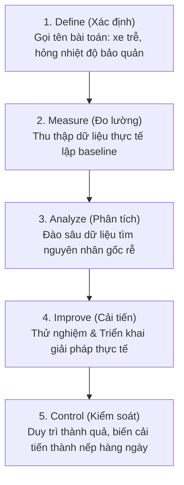

# Podcast: DMAIC Methodology Overview

## 1. Thông tin chương trình (Overview)
- **Host:** Karen Mitchell (COO - Giám đốc vận hành).
- **Khách mời:** David Chen (Lead Black Belt & Giám đốc chương trình Six Sigma).
- **Chủ đề:** Khởi động sáng kiến cải tiến Six Sigma toàn diện trong chuỗi vận tải/phân phối nông sản (produce transportation).

---

## 2. Bản chất Six Sigma trong vận hành thực tế
- **Định nghĩa:** Phương pháp cải tiến dựa trên dữ liệu (data-driven) nhằm tìm ra nguyên nhân gây lỗi, trễ hạn hoặc lãng phí để loại bỏ một cách có hệ thống.
- **Chuẩn thống kê:** Tỷ lệ lỗi siêu thấp — chỉ **3.4 lỗi trên 1 triệu cơ hội (DPMO)**.
- **Kiểm soát biến động (Reducing Variation):**
  - Trong vận tải, biến động là: giao hàng trễ, nông sản dập nát/hư hỏng (spoilage), chi phí phát sinh đột xuất.
  - Khi triệt tiêu biến động: xe đến đúng giờ, sản phẩm tươi hơn, luồng vận hành trơn tru và dễ dự đoán (predictable).

---

## 3. Lộ trình triển khai DMAIC trong chuỗi cung ứng

---

## 4. Yếu tố con người & Văn hóa vận hành (People & Culture)
- **Trọng tâm là nhân sự tuyến đầu:** Six Sigma chỉ thành công khi người trực tiếp làm việc tham gia đóng góp.
  - **Frontline (Tài xế, nhân viên kho, điều phối viên):** Nắm rõ các khúc mắc thực tế nhất tại hiện trường.
  - **Green Belts (Tổ trưởng, giám sát viên):** Được đào tạo để chủ trì và thúc đẩy các dự án cải tiến cơ sở.
- **Tính chất cộng tác (Collaborative):** Không phải là mệnh lệnh áp đặt từ trên xuống (top-down), mà là trao quyền và công cụ để mọi người cùng lên tiếng tạo ra sự thay đổi bền vững.

---

## 5. Thước đo thành công kỳ vọng (Expected Outcomes)
- **Chỉ số định lượng cốt lõi:**
  - Tỷ lệ giao hàng đúng giờ (On-time delivery).
  - Tỷ lệ hàng dập nát/hư hại (Spoilage rate).
  - Chi phí vận tải trên từng thùng hàng (Transport cost per case).
- **Giá trị văn hóa lâu dài:** Xây dựng tư duy cải tiến liên tục (continuous improvement mindset) hàng ngày, nâng cao năng lực cạnh tranh và sự hài lòng của khách hàng.
