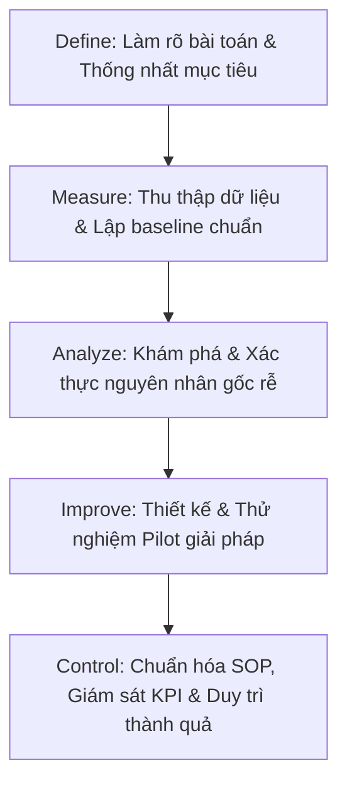

# DMAIC Cheat Sheet

## 1. Khung tham chiếu nhanh 5 giai đoạn (DMAIC Quick Reference)

| Giai đoạn (Phase) | Mục đích cốt lõi (Purpose) | Hoạt động & Công cụ chính (Activities & Tools) | Các bên liên quan (Stakeholders) |
| :--- | :--- | :--- | :--- |
| **D - Define** *(Xác định)* | Làm rõ bài toán và căn chỉnh với mục tiêu chiến lược của doanh nghiệp. | - Lập Project Charter. - Nhận diện VOC (Voice of Customer) & CTQ (Critical to Quality). - Lập biểu đồ SIPOC. - Xác định ranh giới (boundaries) & mục tiêu dự án. | Sponsor / Champion, Black/Green Belt, Process Owner, Key Stakeholders. |
| **M - Measure** *(Đo lường)* | Hiểu rõ hiện trạng và thiết lập đường cơ sở hiệu năng (baseline). | - Vẽ bản đồ quy trình chi tiết (Process Map). - Lập kế hoạch thu thập dữ liệu. - Thu thập dữ liệu đáng tin cậy. - Thẩm định hệ thống đo lường (Measurement System Validation). | Belts, Data Analysts, Chuyên gia nghiệp vụ (SMEs), Data Owners / IT. |
| **A - Analyze** *(Phân tích)* | Khám phá nguyên nhân gốc rễ gây biến động, lỗi hoặc lãng phí. | - Phân tích nguyên nhân gốc rễ: 5 Whys, Fishbone (Ishikawa), Biểu đồ Pareto. - Kiểm định thống kê (Statistical tests). - Phân loại hoạt động VA vs. NVA. - Ưu tiên nguyên nhân theo mức độ tác động. | Belts, Data Analysts, SMEs, Thành viên dự án. |
| **I - Improve** *(Cải tiến)* | Thiết kế, thử nghiệm và triển khai giải pháp xử lý triệt để nguyên nhân gốc rễ. | - Brainstorm ý tưởng & áp dụng công cụ Lean. - Thử nghiệm quy mô nhỏ (Pilot testing). - Đo lường và đánh giá tác động thực tế của giải pháp. | Project Team, Process Owner, Giám sát viên / Nhân sự vận hành, Ban lãnh đạo. |
| **C - Control** *(Kiểm soát)* | Duy trì thành quả lâu dài và đảm bảo tính ổn định bền vững. | - Xây dựng Kế hoạch kiểm soát (Control Plan). - Cập nhật SOPs & tổ chức đào tạo lại. - Phân quyền sở hữu quy trình (Assign ownership). - Giám sát liên tục qua KPI Dashboards & SPC Charts. | Process Owner, Giám sát / QA, Belts, Ban quản trị (Governance Committee). |

---

## 2. Các cạm bẫy thường gặp & Cách phòng tránh (DMAIC Pitfalls)

| Cạm bẫy nguy hiểm (Pitfalls) | Biện pháp phòng tránh (Actionable Prevention) |
| :--- | :--- |
| **Vội vàng nhảy xổ vào giải pháp (Jumping to solutions early)** | Bắt buộc phải xác thực rõ bài toán và thống nhất kỳ vọng với các bên liên quan trước ở pha Define. |
| **Dữ liệu kém chất lượng hoặc thiếu hụt (Poor data)** | Lập kế hoạch đo lường chặt chẽ và thẩm định độ chính xác của hệ thống đo lường trước khi thu thập. |
| **Phân tích nguyên nhân gốc rễ hời hợt (Weak RCA)** | Xác thực nguyên nhân bằng số liệu và bằng chứng thống kê thực tế, không dựa vào suy đoán cảm tính. |
| **Bỏ qua bước thử nghiệm Pilot (Skipping pilot)** | Luôn thử nghiệm giải pháp trên quy mô nhỏ trước khi triển khai đồng loạt ra toàn hệ thống. |
| **Kiểm soát và hậu kiểm yếu ớt (Weak control)** | Bắt buộc phải có dashboard theo dõi, quy trình đánh giá định kỳ (audits) và phân định rõ người chịu trách nhiệm. |
| **Gạt nhân sự tuyến đầu ra ngoài lề (Excluding frontline)** | Gắn kết và lắng nghe chính những người trực tiếp thực hiện công việc hàng ngày. |

---

## 3. Bản chất chuỗi liên kết logic

> Khi kết hợp chặt chẽ giữa **DMAIC + Lean + Systems Thinking**, tổ chức sẽ loại bỏ lãng phí, giảm biến động và tạo ra giá trị bền vững lâu dài.
