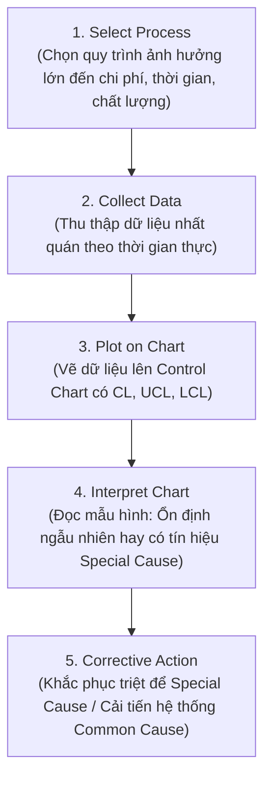

# Statistical Process Control (SPC)

## 1. Khái niệm cốt lõi & Ẩn dụ Bảng táp-lô ô tô
- **Ẩn dụ Car Dashboard:** Đồng hồ tốc độ và đèn báo trên xe không chỉ báo số, mà cảnh báo xe đang chạy êm hay có nguy cơ hỏng hóc. SPC chính là dashboard của quy trình vận hành doanh nghiệp.
- **Định nghĩa Statistical Process Control (SPC):** Phương pháp giám sát hiệu năng quy trình bằng dữ liệu và nguyên lý thống kê nhằm phân biệt giữa biến động tự nhiên và biến động bất thường, đưa ra quyết định dựa trên bằng chứng (evidence-based).

---

## 2. Phân biệt 2 loại biến động (Common Cause vs. Special Cause)

| Tiêu chí | Biến động do nguyên nhân thông thường (Common Cause) | Biến động do nguyên nhân đặc biệt (Special Cause) |
| :--- | :--- | :--- |
| **Bản chất** | Tự nhiên, cố hữu, có thể dự đoán được trong hệ thống. | Bất thường, đột xuất, không lường trước được. |
| **Ví dụ thực tế** | Chênh lệch thời gian giao hàng nhỏ do mật độ giao thông thường ngày; dao động nhiệt độ tủ lạnh ở biên độ nhỏ. | Máy móc bị gãy hỏng, nhà cung cấp mới giao hàng lỗi, nhân viên làm sai quy trình thao tác. |
| **Trạng thái quy trình** | **In Control (Ổn định):** Dữ liệu nằm trong giới hạn và dao động ngẫu nhiên. | **Out of Control (Mất kiểm soát):** Dữ liệu vượt ngưỡng hoặc xuất hiện xu hướng bất thường. |
| **Hành động xử lý** | Không can thiệp giật cục; tập trung cải tiến hệ thống dài hạn (Lean/Kaizen). | Điều tra ngay lập tức, cô lập nguyên nhân gốc rễ và xử lý khắc phục triệt để. |

---

## 3. Cấu trúc Biểu đồ kiểm soát (Control Chart)

Biểu đồ kiểm soát gồm 3 đường tham chiếu chính:
- **UCL (Upper Control Limit):** Giới hạn kiểm soát trên.
- **Center Line (CL):** Đường trung bình hiệu năng quy trình.
- **LCL (Lower Control Limit):** Giới hạn kiểm soát dưới.

> ⚠️ **Quy tắc nhận diện bất thường:**
> - Điểm dữ liệu vọt ra ngoài UCL hoặc rơi xuống dưới LCL.
> - Chuỗi điểm tạo thành hình thái bất thường (pattern/trend) như liên tục tăng, liên tục giảm hoặc lệch hẳn về một phía so với Center Line.

---

## 4. Năm bước triển khai SPC (5 Implementation Steps)

---

## 5. Giá trị cốt lõi của SPC đối với tổ chức
1. **Chống phản ứng thái quá (Prevent Overreaction):** Ngăn chặn nhà quản lý "chạy theo" từng biến động vặt vãnh; can thiệp bừa bãi vào biến động thông thường chỉ làm hệ thống mất ổn định thêm (*tampering*).
2. **Nâng cao tính dự đoán (Predictability):** Giúp kế hoạch giao hàng, ngân sách và cam kết với khách hàng đạt độ tin cậy cao.
3. **Làm nền tảng cho Lean & Six Sigma:** Tạo baseline chuẩn xác; chỉ khi quy trình ổn định thống kê mới có thể cải tiến sâu.
4. **Giảm thiểu lãng phí & chi phí:** Phát hiện dấu hiệu trôi dạt (drift) từ sớm trước khi phế phẩm hay sự cố xảy ra hàng loạt.
5. **Trao quyền cho nhân sự tuyến đầu:** Trực quan hóa dữ liệu giúp công nhân/nhân viên tự giám sát trạm làm việc của mình và chủ động hành động.
