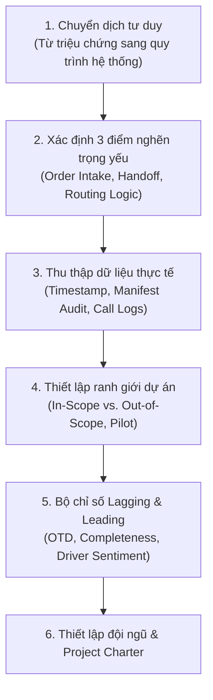

# Role Play: Transportation Dispatch Office (Define Phase Simulation)

## 1. Bối cảnh & Mục tiêu (Context & Objectives)
- **Tình huống:** Phòng điều phối vận tải (Dispatch Office) đối mặt với khủng hoảng: khách hàng khiếu nại giao hàng trễ tăng đột biến, tài xế ức chế vì thiếu thông tin giao hàng, nhân viên luôn trong tình trạng "chữa cháy".
- **Mục tiêu:** Thực hiện phỏng vấn giai đoạn **Define (Xác định)** trong DMAIC với Giám đốc vận hành (Operations Manager - Jordan Ellis) để xây dựng Project Charter chuẩn xác.

---

## 2. Diễn tiến phỏng vấn & Phương pháp luận tiếp cận

### 1. Chuyển dịch từ triệu chứng cá biệt sang vấn đề hệ thống
- Không xử lý từng khiếu nại đơn lẻ (symptomatic fix).
- Tập trung vào các điểm gãy luồng quy trình (workflow breakdowns) và bàn giao thông tin (information handoffs).

### 2. Ba mắt xích trọng tâm cần phân tích
1. **Order Intake & Verification:** Kiểm tra thông tin khách hàng và hướng dẫn giao hàng đặc biệt có được nhập đúng ngay từ đầu.
2. **Dispatch-to-Driver Handoff:** Đánh giá luồng truyền đạt thông tin từ điều phối tới tài xế; tìm lý do thông tin quan trọng bị thất lạc.
3. **Scheduling & Routing Logic:** Rà soát lại lộ trình và khung giờ giao hàng có phản ánh đúng thực tế di chuyển, tắc đường và thời gian bốc dỡ hàng hay không.

### 3. Thu thập dữ liệu khách quan (Evidence-based data)
- **Timestamp Logs:** So sánh thời gian kế hoạch vs. thực tế (giờ xuất bến, giờ đến).
- **Manifest Audit:** Đối chiếu dữ liệu gốc trong hệ thống với bản in/gửi cho tài xế để tìm các trường thông tin bị thiếu.
- **Communication Logs:** Đếm số lượng cuộc gọi tài xế gọi về văn phòng để hỏi lại địa chỉ/hướng dẫn.
- **Delay Reason Codes:** Mã hóa các nguyên nhân trễ chuyến được tài xế ghi nhận.

---

## 3. Ranh giới dự án & Bộ chỉ số đo lường (Scope & Metrics)

| Phân loại | Chi tiết nội dung |
| :--- | :--- |
| **In-Scope** *(Trong phạm vi)* | - Chuẩn hóa quy trình tiếp nhận đơn (Order intake) và bàn giao lệnh vận chuyển. - Đảm bảo 100% hướng dẫn giao hàng đầy đủ trên phiếu giao hàng (Manifest). - Tinh chỉnh lại thuật toán lập lịch/ước tính lộ trình dựa trên dữ liệu di chuyển thực tế. - Thử nghiệm **Pilot** trên 20% tuyến đường/ca trực có tỷ lệ khiếu nại cao nhất. |
| **Out-of-Scope** *(Ngoài phạm vi)* | - Đại tu hệ thống phần mềm lõi ERP/TMS (đắt đỏ, mất thời gian). - Mua sắm thêm đội xe (Fleet expansion) hoặc chính sách bảo dưỡng cơ khí. - Các yếu tố bất khả kháng bên ngoài (thời tiết cực đoan, đường cấm). |

### Bộ chỉ số thành công (Leading & Lagging Metrics):
- **Lagging (Đầu ra):**
  - Tỷ lệ giao hàng đúng giờ (**On-Time Delivery - OTD**): Mục tiêu $\ge 90\%$ trên tuyến pilot.
  - Khiếu nại giao hàng trễ: Giảm **40 – 50%**.
- **Leading (Đầu vào / Quá trình):**
  - Tỷ lệ phiếu giao hàng đầy đủ (**Manifest Completeness Rate**): Đạt $\ge 95\%$ không thiếu trường thông tin.
  - Số cuộc gọi hỗ trợ dọc đường (**Inbound Support Calls**): Giảm mạnh các cuộc gọi hỏi đường/hỏi chi tiết đơn.
  - Mức độ hài lòng của tài xế (**Driver Satisfaction**): Khảo sát hàng tuần (Pulse Survey) đo mức độ tự tin vào thông tin điều phối.

---

## 4. Cơ cấu Đội ngũ & Bản tóm tắt Project Charter

### Thành phần Stakeholders nòng cốt:
1. **Project Sponsor (Operations Manager):** Định hướng mục tiêu, tháo gỡ rào cản tài chính/tổ chức.
2. **Lead Dispatcher:** Đóng góp góc nhìn vận hành thực tế tại phòng điều phối, thử nghiệm SOP mới.
3. **Senior Driver Representative:** Thẩm định tính thực tế của lệnh điều phối trên đường chạy.
4. **Order Intake / CS Lead:** Ngăn chặn lỗi thiếu thông tin ngay từ khâu tiếp nhận khách hàng.
5. **IT / Systems Support (Part-time):** Hỗ trợ tinh chỉnh mẫu manifest và trích xuất dữ liệu log.

### Tóm tắt Project Charter (Executive Summary):
> **Bài toán:** Tình trạng khiếu nại trễ hẹn và ức chế của tài xế bắt nguồn từ sự đứt gãy trong bàn giao thông tin và thuật toán điều phối thiếu thực tế, khiến tài xế nhận phiếu thiếu dữ liệu và phát sinh cuộc gọi hỏi dồn dập khi đang chạy xe.  
> **Giải pháp:** Chuẩn hóa bàn giao, kiểm soát tính đầy đủ của manifest và hiệu chỉnh lại thời gian cung đường; triển khai Pilot trên nhóm tuyến trọng điểm.  
> **Kỳ vọng:** OTD đạt trên 90%, khiếu nại giảm 40-50%, manifest chuẩn xác $\ge 95\%$, giảm đáng kể căng thẳng cho đội ngũ vận tải.
