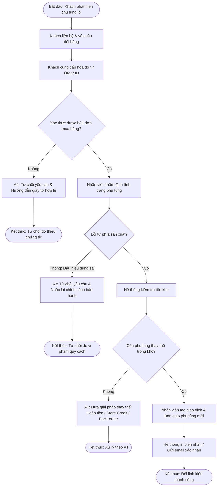

# Final Project: Develop a Process Map and Narrative

> **Khóa học:** IBM System Design - 04. Process Modeling and Requirements Gathering  
> **Module:** Module 5 - Final Project, Final Quiz, and Course Wrap-Up  
> **Tổng điểm:** 10 điểm (Task 1: 4đ, Task 2: 4đ, Task 3: 2đ)  
> **Định dạng nộp bài:** File `.pdf` hoàn chỉnh (kèm các tệp thành phần `Task1_ProcessMap.pdf`, `Task2_ProcessNarrative.pdf/.xlsx`, `Task3_Reflection.pdf/.docx`).  
> **Tài liệu mẫu từ khóa học:**
> - [Download .pdf template](https://business-process-modeling-analysis-and-improvement-1afe3e.gitlab.io/images/Final_Project_Defective_Part_Replacement.pdf)
> - [Download .docx template](https://business-process-modeling-analysis-and-improvement-1afe3e.gitlab.io/images/Final_Project_Defective_Part_Replacement.docx)

---

## 1. Tổng quan tình huống (Use Case Overview)

- **Use case:** Request defective part replacement (Yêu cầu đổi trả phụ tùng ô tô bị lỗi).
- **Actor chính:** Customer (Auto Parts Buyer - Khách mua phụ tùng), Store Clerk (Nhân viên cửa hàng), Inventory/Store System (Hệ thống quản lý kho & bán hàng).
- **Mục tiêu (Goal):** Thay thế linh kiện phụ tùng bị lỗi đã mua gần đây.
- **Tiền điều kiện (Preconditions):**
  1. Khách hàng cung cấp bằng chứng mua hàng (hóa đơn hoặc mã đơn hàng).
  2. Phụ tùng vẫn nằm trong khung thời gian chính sách đổi trả / bảo hành.
  3. Linh kiện thay thế có sẵn trong kho lưu trữ.

---

## 2. Chi tiết luồng nghiệp vụ (Workflows)

### 2.1. Basic Flow (Luồng chuẩn / Happy Path)
1. **Khách hàng yêu cầu dịch vụ (Customer requests service):** Khách liên hệ trực tiếp, qua điện thoại hoặc cổng portal online để thông báo phụ tùng bị lỗi.
2. **Khách hàng cung cấp thông tin mua hàng (Customer provides purchase details):** Cung cấp mã đơn hàng hoặc hóa đơn để nhân viên/hệ thống xác thực giao dịch.
3. **Cửa hàng thẩm định lỗi (Store verifies defect claim):** Nhân viên kiểm tra trực tiếp phụ tùng hoặc xem xét bằng chứng ảnh/mô tả nếu là yêu cầu trực tuyến.
4. **Hệ thống kiểm tra tồn kho (System checks inventory):** Hệ thống kiểm tra xem phụ tùng tương đương hoặc giống hệt có sẵn trong kho hay không.
5. **Cấp phát phụ tùng thay thế (Replacement is issued):** Nếu còn hàng, nhân viên tạo giao dịch đổi hàng và bàn giao phụ tùng mới cho khách.
6. **Xác nhận giao dịch hoàn tất (Confirmation provided):** Hệ thống phát hành biên nhận/hóa đơn đổi hàng hoặc gửi email xác nhận tự động.

### 2.2. Alternative Flows (Luồng ngoại lệ / Rẽ nhánh)
- **A1: Hết hàng trong kho (No inventory available):**
  - Khi không còn linh kiện thay thế, hệ thống đưa ra các tùy chọn:
    - Hoàn tiền (Refund).
    - Tín dụng mua sắm / Điểm hoàn tích lũy (Store credit).
    - Đặt hàng trước chờ nhập kho (Back-order).
- **A2: Không xác thực được giao dịch mua hàng (Purchase cannot be verified):**
  - Nếu khách hàng không xuất trình được bằng chứng mua hàng:
    - Yêu cầu đổi phụ tùng bị từ chối.
    - Nhân viên hướng dẫn khách hàng về các chứng từ hợp lệ theo quy định.
- **A3: Linh kiện có dấu hiệu sử dụng sai quy cách (Part shows signs of misuse):**
  - Nếu kết quả thẩm định phát hiện hư hỏng do khách dùng sai cách chứ không phải do lỗi sản xuất:
    - Yêu cầu bị từ chối.
    - Nhắc nhở và giải thích cho khách hàng về giới hạn của chính sách bảo hành.

---

## 3. Cấu trúc 3 nhiệm vụ cần nộp (Deliverables)

```
Final_Project_Submission/
├── Task 1: Process Map (4 điểm) -> Task1_ProcessMap.pdf
├── Task 2: Process Narrative (4 điểm) -> Task2_ProcessNarrative.pdf / .xlsx
└── Task 3: Reflection (2 điểm) -> Task3_Reflection.pdf / .docx
```

### Task 1: Process Map (4 điểm)
- **Yêu cầu:** Vẽ biểu đồ quy trình hoàn chỉnh (Flowchart / Swimlane Diagram) biểu diễn Basic Flow và Alternative Flows (A1, A2, A3).
- **Các thành phần bắt buộc:**
  - **Swimlanes (Làn phân vai):** Phân chia rõ trách nhiệm các Actor (`Customer`, `Store Clerk`, `Inventory/Store System`).
  - **Decision Diamonds (Hình thoi quyết định):**
    - *Bằng chứng mua hàng hợp lệ?* (Có -> tiếp tục, Không -> rẽ nhánh A2).
    - *Lỗi do nhà sản xuất?* (Có -> tiếp tục, Không do dùng sai -> rẽ nhánh A3).
    - *Còn hàng thay thế trong kho?* (Có -> cấp phụ tùng mới, Không -> rẽ nhánh A1 đưa ra hoàn tiền/credit/back-order).
  - **Start & End Points:** Điểm bắt đầu và các điểm kết thúc rõ ràng cho từng nhánh.
- **Công cụ:** Draw.io, Lucidchart, Microsoft Visio.
- **Đầu ra:** Xuất file `Task1_ProcessMap.pdf`.

#### Sơ đồ tham chiếu (Mermaid Process Map):


---

### Task 2: Process Narrative (4 điểm)
- **Yêu cầu:** Lập bảng mô tả quy trình chi tiết theo mẫu Excel / bảng biểu, đảm bảo khớp 100% với Process Map.
- **Bảng mẫu chuẩn:**

| Step ID | Description | Actor | Trigger | Inputs | Outputs | Notes / Alternative Paths |
| :--- | :--- | :--- | :--- | :--- | :--- | :--- |
| **S01** | Khách hàng thông báo linh kiện bị lỗi | Customer | Phát hiện phụ tùng không hoạt động hoặc hỏng | Phụ tùng hỏng, nhu cầu đổi trả | Yêu cầu đổi trả được tiếp nhận | Tiếp nhận qua trực tiếp, điện thoại, hoặc web portal |
| **S02** | Cung cấp thông tin mua hàng | Customer | Nhân viên yêu cầu chứng từ xác minh | Hóa đơn giấy hoặc Order ID | Dữ liệu giao dịch được cung cấp | Chuẩn bị cho bước kiểm tra A2 |
| **S03** | Xác thực giao dịch mua hàng | Store Clerk / System | Nhận được mã đơn hàng / hóa đơn | Order ID, biên lai, dữ liệu bán hàng | Trạng thái hợp lệ / không hợp lệ | **A2:** Nếu không tìm thấy hoặc quá hạn trả -> Từ chối, yêu cầu bổ sung giấy tờ |
| **S04** | Thẩm định tình trạng phụ tùng | Store Clerk | Giao dịch mua hàng hợp lệ | Phụ tùng thực tế hoặc ảnh chụp bằng chứng | Báo cáo/kết luận thẩm định lỗi | **A3:** Nếu phát hiện dấu hiệu sử dụng sai quy cách -> Bác bỏ yêu cầu, viện dẫn chính sách |
| **S05** | Tra cứu tồn kho linh kiện thay thế | Inventory System | Kết luận lỗi do sản xuất | Mã sản phẩm (SKU), dữ liệu tồn kho | Tình trạng kho (Còn hàng / Hết hàng) | **A1:** Nếu hết hàng -> Chuyển sang hoàn tiền, cấp store credit hoặc tạo đơn back-order |
| **S06** | Xuất kho và bàn giao phụ tùng mới | Store Clerk | Còn hàng sẵn trong kho | Phụ tùng mới từ kho, linh kiện lỗi trả lại | Phụ tùng mới trao cho khách | Thực hiện thu hồi phụ tùng lỗi |
| **S07** | Phát hành xác nhận giao dịch | Store System | Hoàn tất thao tác xuất đổi phụ tùng | Dữ liệu giao dịch thay thế | Hóa đơn in hoặc email xác nhận | Ghi nhận hoàn tất quy trình chuẩn |

- **Đầu ra:** Xuất file `Task2_ProcessNarrative.pdf` hoặc `.xlsx`.

---

### Task 3: Reflection (2 điểm)
- **Yêu cầu:** Viết đoạn văn/báo cáo phản hồi các câu hỏi suy ngẫm (Reflection Prompts):
  1. **Bài học rút ra (Key Learnings):** Hiểu rõ tầm quan trọng của việc trực quan hóa luồng công việc thông qua swimlane và ma trận narrative; nhận diện các điểm quyết định và các nhánh ngoại lệ quan trọng trong vận hành thực tế.
  2. **Thách thức gặp phải (Challenges):** Xác định đúng ranh giới trách nhiệm giữa các Actor (đặc biệt giữa Store Clerk và Hệ thống tự động) và phân nhánh rõ ràng các kịch bản ngoại lệ (A1, A2, A3) mà không làm rối sơ đồ.
  3. **Xác thực và cải tiến trong thực tế (Validation & Improvement in Practice):** Cách thức các nhà phân tích nghiệp vụ (BA) và nhà quản lý kiểm chứng quy trình qua Walkthroughs (phỏng vấn nhân viên thực tế), Event Logs / Process Mining, và thiết lập vòng lặp phản hồi định kỳ (Continuous Improvement).
- **Đầu ra:** Xuất file `Task3_Reflection.pdf` hoặc `.docx`.

---

## 4. Tiêu chí chấm điểm đạt điểm tối đa (Rubric Checklist)
- [x] **Tính chính xác:** Diễn giải đúng toàn bộ kịch bản, bao gồm cả luồng chính và 3 luồng thay thế (A1, A2, A3).
- [x] **Cấu trúc chặt chẽ:** Sử dụng đúng ký hiệu chuẩn BPMN/Flowchart (Oval = Start/End, Rectangle = Task, Diamond = Decision).
- [x] **Độ khớp nối (Alignment):** Từng Step ID trong Process Narrative ánh xạ chính xác 1-1 với các node trên Process Map.
- [x] **Hoàn chỉnh định dạng:** Chuẩn bị đầy đủ template theo mẫu của khóa học và chuyển đổi sang `.pdf`.
