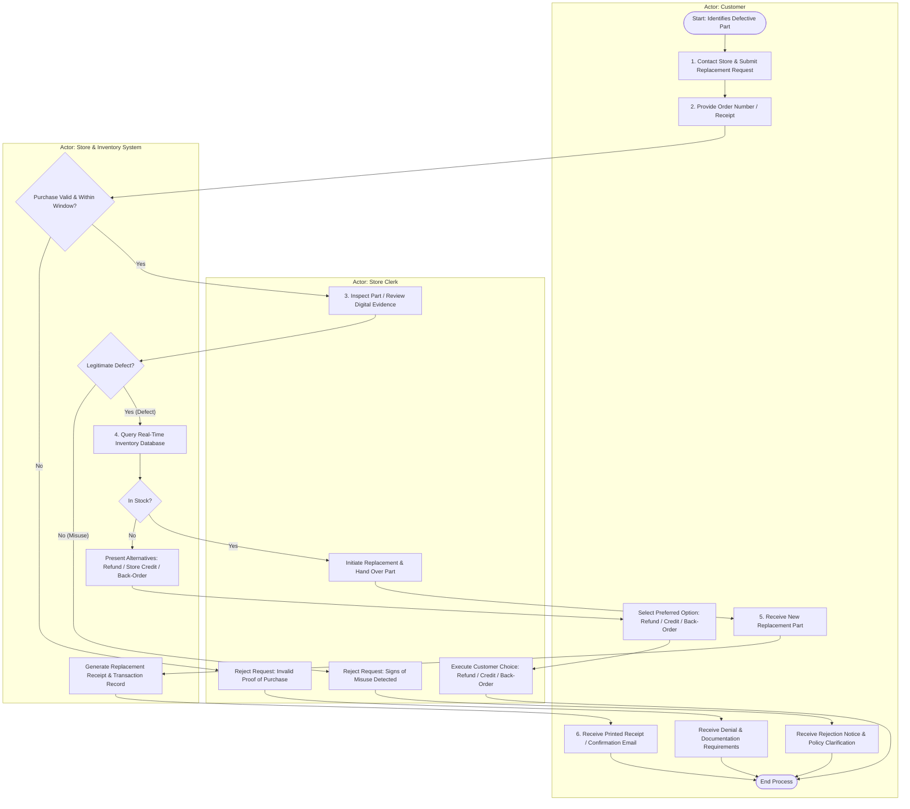

# FINAL PROJECT SUBMISSION: DEVELOP A PROCESS MAP AND NARRATIVE

- **Student / Learner:** Coursera Learner
- **Scenario:** Request Defective Auto Part Replacement
- **Course:** IBM System Design - Process Modeling and Requirements Gathering
- **Target Grade:** 10/10 points (Passing Grade: 70%)

---

# TASK 1: PROCESS MAP (4 Points)

### Diagram Description & Architecture
- **Actors (Swimlanes):**
  1. **Customer:** Initiates request, provides proof of purchase, presents defective item, receives replacement / alternative resolution.
  2. **Store Clerk:** Receives claim, inspects physical/digital evidence, initiates replacement or alternative options, communicates decisions.
  3. **Store & Inventory System:** Validates order/receipt, checks real-time inventory levels, generates transactions, produces confirmation/receipt.
- **Decision Points & Branches:**
  - `Decision 1: Purchase Validated?` (Yes -> Step 3 | No -> Alternative Flow A2: Deny & provide documentation guidance).
  - `Decision 2: Manufacturing Defect Confirmed?` (Yes -> Step 4 | No / Misuse detected -> Alternative Flow A3: Reject claim & explain policy).
  - `Decision 3: Replacement Part in Stock?` (Yes -> Step 5 | No -> Alternative Flow A1: Offer Refund, Store Credit, or Back-Order).

### Flowchart Representation (BPMN / Swimlane Standard)

---

# TASK 2: PROCESS NARRATIVE (4 Points)

| Step ID | Step Name & Description | Actor | Trigger | Inputs | Outputs | Notes / Alternative Paths |
| :--- | :--- | :--- | :--- | :--- | :--- | :--- |
| **S01** | **Service Request Initiation:** Customer contacts store (in-person, telephone, or online portal) stating that a purchased auto part is defective. | Customer | Customer detects malfunction in recently purchased part | Defective auto part details, customer problem description | Replacement request logged / acknowledged | Multi-channel entry point: in-store counter, phone call, or customer portal. |
| **S02** | **Purchase Detail Submission:** Customer provides proof of purchase (receipt or order number). | Customer | Clerk / System prompts for purchase validation | Sales receipt, online order confirmation number | Purchase identifier submitted | Essential precondition for warranty validation. |
| **S03** | **Purchase & Policy Validation:** System and clerk verify order authenticity, purchase date, and eligibility within the replacement policy window. | Store Clerk / System | Receipt / Order ID submitted | Order ID, customer account data, return policy rules | Validation Status (Verified / Unverified) | **Alternative Flow A2 (Purchase Unverified):** If receipt is missing or expired, request is denied; customer is informed of documentation rules. Process terminates. |
| **S04** | **Defect Claim Verification:** Clerk conducts physical inspection of the returned part or reviews uploaded photos/videos for digital claims. | Store Clerk | Successful purchase verification | Physical part, digital images, defect checklist | Inspection evaluation result | **Alternative Flow A3 (Misuse Detected):** If part indicates user damage, improper installation, or misuse, request is rejected; policy limits explained. Process terminates. |
| **S05** | **Inventory Availability Check:** System queries local and warehouse inventory database to confirm availability of an identical or OEM-equivalent replacement part. | Inventory System | Approval of defect verification | Part SKU / serial number, current inventory database | Stock availability status (Available / Out of Stock) | **Alternative Flow A1 (No Inventory):** If out of stock, system offers customer 3 choices: (1) Full Refund, (2) Store Credit, (3) Back-Order. Process proceeds to chosen alternative. |
| **S06** | **Replacement Issuance & Part Handover:** Clerk initiates replacement transaction in POS, retrieves new part from stock, and provides it to the customer. | Store Clerk | In-stock confirmation received | New replacement part, defective part (collected for return) | New part handed to customer, defective part staged for disposal/RMA | Defective part is quarantined in inventory system for manufacturer return (RMA). |
| **S07** | **Transaction Confirmation & Closure:** System updates inventory records, completes zero-balance replacement invoice, and issues confirmation. | Store System | Replacement transaction submitted | POS transaction record, customer contact info | Printed replacement receipt or automated confirmation email | Marks successful completion of the basic happy path flow. |

---

# TASK 3: REFLECTION (2 Points)

### Prompt 1: What did you learn about process mapping and documentation?
Through this project, I gained a comprehensive understanding of translating unstructured operational scenarios into standardized visual and textual artifacts. I learned that an effective process map is not merely a sequence of activities; it is a governance blueprint that clearly demarcates cross-functional accountability through **swimlanes**, identifies critical **decision gateways**, and transparently models **alternative/exception flows**. 
Moreover, coupling the visual flowchart with a structured **Process Narrative matrix** is indispensable: while the map provides rapid, intuitive comprehension of workflow logic, the narrative adds operational depth by specifying exact triggers, inputs, outputs, and exception handlers required by systems engineers and business analysts to implement robust technical solutions.

### Prompt 2: What challenges did you encounter while building the map and narrative?
The primary challenge lay in establishing unambiguous boundaries between human actors (Store Clerk) and automated subsystems (Store/Inventory POS System). For instance, deciding whether the inventory check was a clerk action or an automated system event required careful differentiation between who initiates the query versus what executes the lookup. 
Another significant challenge was balancing flowchart readability with thorough exception handling: representing three distinct alternative branches (A1: Out of stock, A2: Unverified purchase, A3: Misuse) without cluttering the visual flow required rigorous standard notation and clear mapping to corresponding steps in the narrative table.

### Prompt 3: How can managers and analysts validate and improve documented processes in real work environments?
To ensure documented workflows reflect operational reality rather than idealized theory, organizations should apply three industry-standard practices:
1. **Interactive Process Walkthroughs & Gemba Walks:** Analysts must observe frontline employees (clerks and warehouse staff) executing the real-world workflow, identifying undocumented workarounds, manual bottlenecks, or edge cases not captured in initial specifications.
2. **Data-Driven Process Mining & Audit Logging:** Organizations should analyze POS, ERP, and CRM event logs to compare theoretical cycle times against actual throughput. Tracking high frequencies of Alternative Flow A1 (stockouts) or A2 (unverified receipts) can pinpoint upstream supply chain or checkout deficiencies.
3. **Continuous Improvement Cycles (PDCA / Kaizen):** Establishing periodic cross-functional reviews with customer service, inventory management, and IT teams ensures documentation evolves alongside changing company policies, omnichannel platforms, or warranty regulations.
