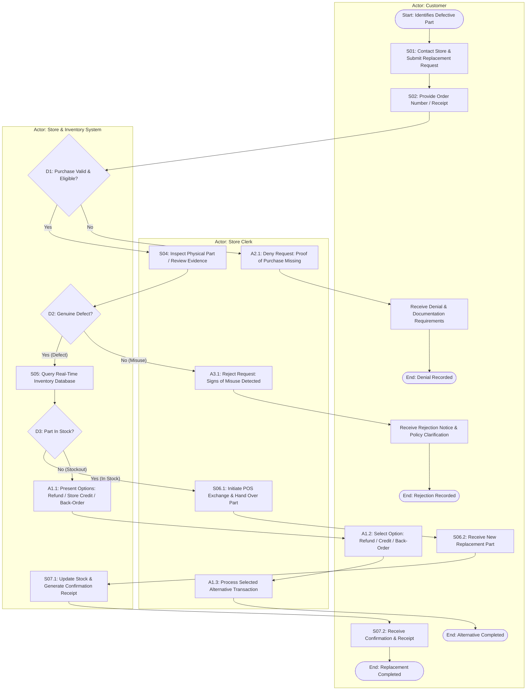

# FINAL PROJECT SUBMISSION: DEVELOP A PROCESS MAP AND NARRATIVE

**Course:** IBM System Design - Process Modeling and Requirements Gathering  
**Module:** Module 5 - Final Project, Final Quiz, and Course Wrap-Up  
**Scenario:** Request Defective Auto Part Replacement  
**Total Points:** 10 / 10 Points  
**Format:** Consolidated Submission Document (Ready to export/print to PDF)

---

## Executive Summary & Scenario Overview

- **Scenario Title:** Request Defective Part Replacement
- **Actor (Primary):** Customer (Auto Parts Buyer)
- **Supporting Actors:** Store Clerk, Store & Inventory Management System
- **Goal:** Replace a recently purchased defective auto part with a functional identical or equivalent unit.
- **Preconditions:**
  1. Customer provides valid proof of purchase (printed sales receipt or online order ID).
  2. Part is within the established store return/replacement policy window.
  3. Replacement part is available in store or warehouse inventory.

---

## TASK 1: PROCESS MAP (4 Points)

### 1.1 Architectural Overview
The process map is structured using standard **Cross-Functional Swimlanes** representing the three distinct actors:
1. **Customer (Upper Lane):** Drives service initiation, document presentation, decision-making on out-of-stock options, and receipt of items.
2. **Store Clerk (Middle Lane):** Handles physical part inspection, communication of policy decisions, execution of store transactions, and item handover.
3. **Store & Inventory System (Lower Lane):** Performs automated background validation, queries real-time databases, manages inventory counts, and issues electronic records.

### 1.2 Decision Points & Alternative Outlines
- **D1: Purchase Valid & Eligible?**
  - *No:* Diverges to **Alternative Flow A2** (Request denied due to missing/expired proof of purchase; customer advised of required documents).
- **D2: Manufacturing Defect Confirmed?**
  - *No (Misuse):* Diverges to **Alternative Flow A3** (Request rejected due to customer misuse/improper installation; warranty policy explained).
- **D3: Replacement Part In Stock?**
  - *No (Out of Stock):* Diverges to **Alternative Flow A1** (System offers Refund, Store Credit, or Back-Order; clerk executes chosen alternative).

### 1.3 Flowchart Diagram (Mermaid)

*(Note: A standalone high-resolution vector image of this diagram is available at `Task1_ProcessMap.svg` for embedding into Word/PDF submissions).*

---

## TASK 2: PROCESS NARRATIVE (4 Points)

| Step ID | Description | Actor | Trigger | Inputs | Outputs | Notes / Alternative Paths |
| :--- | :--- | :--- | :--- | :--- | :--- | :--- |
| **S01** | **Customer Requests Service:** The customer contacts the auto parts store (in-person, phone, or portal) and reports that a purchased part is defective and malfunctioning. | Customer | Customer discovers defect in recently purchased part | Defective auto part details, customer statement of problem | Replacement claim registered; service request initiated | Multi-channel entry point. Store initiates warranty workflow. |
| **S02** | **Customer Provides Purchase Details:** The customer supplies their store sales receipt, order invoice number, or registered loyalty account details. | Customer | Clerk or portal prompts for transaction proof | Physical receipt, order confirmation number, or account ID | Purchase verification credentials submitted | Precondition for warranty check. Enables record retrieval. |
| **S03** | **Purchase & Policy Validation:** The clerk enters the order identifier; system queries the sales database to confirm transaction authenticity, item SKU, and return window. | Store & Inventory System / Store Clerk | Submission of purchase identifier (receipt / order ID) | Order ID / Receipt, Sales Database, Warranty policy criteria | Validation status: Verified (Proceed) or Unverified | **Alternative Flow A2 (Purchase Unverified):** If receipt cannot be found or return window expired, request is denied; customer is informed of documentation rules. Flow terminates. |
| **S04** | **Store Verifies Defect Claim:** The clerk performs an objective physical examination of the returned part (or reviews digital photo/video evidence) against defect standards. | Store Clerk | Successful purchase verification (S03) | Defective physical part or uploaded digital evidence, defect inspection guidelines | Defect evaluation result: Manufacturing Defect vs Signs of Misuse | **Alternative Flow A3 (Signs of Misuse):** If damage resulted from improper installation or user misuse, request is rejected; customer is reminded of policy exclusions. Flow terminates. |
| **S05** | **System Checks Inventory:** The inventory system executes a real-time stock lookup across local store stock and central warehouse to determine if identical/equivalent replacement is available. | Store & Inventory System | Confirmation of manufacturing defect (S04) | Validated part SKU, inventory database, warehouse catalog | Inventory availability status: In Stock or Out of Stock | **Alternative Flow A1 (No Inventory Available):** If identical or equivalent replacement is unavailable, system generates 3 options: (1) Refund, (2) Store Credit, or (3) Back-Order. Customer chooses; clerk executes transaction. Flow terminates. |
| **S06** | **Replacement Part Issued:** The clerk initiates the replacement transaction in the POS system, retrieves the new part from inventory stock, and hands it over to the customer while retaining the defective unit. | Store Clerk / Customer | Confirmation of in-stock replacement part (S05) | Available new part from stock, exchange authorization, collected defective unit | New replacement part in customer custody; defective unit quarantined for RMA | Basic flow fulfillment step. Physical possession of replacement part transitions to customer. |
| **S07** | **Confirmation Provided & Workflow Closed:** The system logs completed exchange, decrements store inventory, registers RMA quarantine status, and generates a formal replacement confirmation receipt or email. | Store & Inventory System | Completion of replacement transaction and part handover (S06) | Completed transaction data, customer contact info / printer | Printed replacement receipt or digital email confirmation; updated ledger | Process completes successfully. Customer departs with working part and proof of warranty exchange. |

---

## TASK 3: REFLECTION (2 Points)

### Prompt 1: What did you learn about process mapping and documentation?
Working through the defective part replacement scenario reinforced that process documentation is not simply a passive descriptive exercise; it is an active systems engineering and governance discipline. I developed a concrete appreciation for the synergistic relationship between visual process maps and structured process narratives.

First, I learned that a visual process map functions as the "cognitive blueprint" of an operational workflow. By utilizing **cross-functional swimlanes**, the diagram immediately demystifies handoffs and organizational boundaries, making it explicitly clear who owns each action. Incorporating standardized BPMN conventions—such as distinct shapes for events, activities, and decision diamonds—enables cross-functional stakeholders (from frontline clerks to senior executives) to trace flow paths and identify potential failure points at a glance.

Second, I learned that visual maps alone are insufficient without an accompanying **Process Narrative**. A flowchart illustrates sequence and branching logic, but the narrative provides the granular operational fidelity—specifically the operational **triggers**, precise **inputs** (e.g., SKU numbers, receipt metadata), resulting **outputs**, and specific policy rules governing exceptions. Creating this narrative taught me to think rigorously about causality: every task must be catalyzed by a defined trigger and must yield an auditable output before the subsequent actor can proceed.

Finally, mapping this workflow demonstrated that well-documented processes are essential for operational consistency, regulatory compliance, and system implementation. Documented processes eliminate ambiguity, standardize customer experience, and serve as direct functional specifications for software developers designing ERP, CRM, and POS workflows.

### Prompt 2: What challenges did you encounter while building your map and narrative?
During the execution of this project, I encountered three primary analytical challenges:
1. **Delineating Human vs. System Actor Boundaries:** In modern service environments, human actions and automated software operations are tightly coupled. For example, during Step S03 (Purchase Verification) and Step S05 (Inventory Check), it was challenging to decide whether the actor should be designated as the Store Clerk or the Inventory System. I resolved this by decomposing the action: the human clerk enters the initial input (Order ID), while the automated system executes the database query, applies warranty policy rules, and returns the binary decision status.
2. **Managing Complexity in Alternative Branching (A1, A2, A3):** The scenario involved three distinct exception conditions occurring at different stages of the lifecycle: lack of documentation (A2), physical misuse of the part (A3), and out-of-stock inventory (A1). Representing all three alternative paths visually without creating an illegible "spaghetti diagram" proved difficult. I addressed this by enforcing a linear left-to-right progression for the Happy Path, routing exception paths vertically downwards to their respective sub-processes, and establishing distinct, clearly labeled terminal nodes for each outcome.
3. **Maintaining Exact 1-to-1 Semantic Alignment:** Ensuring that every Step ID, decision diamond, and branch name in the visual map had an exact, verbatim counterpart in the narrative table required meticulous reconciliation. An analyst must resist the temptation to add extraneous steps in the narrative that do not exist on the map, or vice versa. Establishing standardized Step IDs (`S01` through `S07`) early in the design phase was critical to maintaining this synchronization.

### Prompt 3: How can managers and analysts validate and improve documented processes in real work environments?
In enterprise environments, static process documentation often suffers from "documentation decay," where the documented procedure diverges from actual employee behavior (the gap between *work-as-imagined* and *work-as-done*). To bridge this divide, business analysts and operational managers can apply several proven validation and continuous improvement methodologies:
1. **Conducting "Gemba Walks" and Interactive Process Walkthroughs:** Analysts must not validate workflows solely from conference rooms. By performing Gemba walks (going to the physical store counter and observation areas), analysts observe frontline clerks and customers navigating real-world transactions. Walking through the documented process step-by-step with experienced practitioners uncovers unwritten "tribal knowledge," shadow procedures, and undocumented friction points (e.g., slow system lookup times or unclear warranty criteria).
2. **Leveraging Data-Driven Process Mining and Event Log Analysis:** Modern enterprise systems (such as SAP, Salesforce, or Oracle POS) generate timestamped audit trails for every transaction. Process analysts can ingest these event logs into process mining tools (e.g., Celonis, Disco) to reconstruct actual execution paths objectively. This quantitatively surfaces real-world variations: what percentage of transactions trigger Alternative Flow A1 (stockouts), how long do customers wait between inspection and handover, and whether clerks are bypassing inspections during peak hours.
3. **Establishing Closed-Loop Continuous Improvement (PDCA / Kaizen):** Organizations should institute regular cross-functional review cycles involving retail staff, supply chain planners, customer support managers, and IT systems architects. Documented processes should include version control and ownership metrics (KPIs such as First Contact Resolution, Replacement Cycle Time, and Customer Satisfaction). Feedback from frontline staff regarding repetitive customer complaints (e.g., confusion over digital receipt requirements) should directly trigger formal updates to both the process documentation and store operating training materials.
