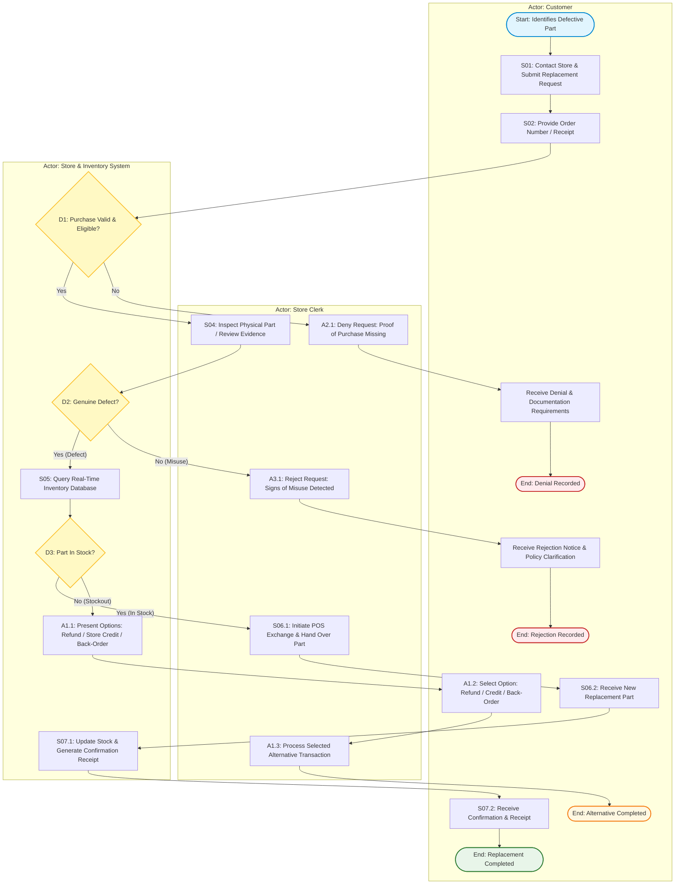

# Task 1: Process Map - Defective Part Replacement Workflow

> **Deliverable:** Task 1 (4 Points)  
> **Course:** IBM System Design - Process Modeling and Requirements Gathering  
> **Scenario:** Request Defective Auto Part Replacement  

---

## 1. Swimlane Actors & Responsibilities

| Swimlane / Actor | Primary Responsibilities |
| :--- | :--- |
| **Customer** | Initiates defective part claim; presents proof of purchase; hands over defective part; selects alternative resolution if out of stock; receives replacement part and receipt. |
| **Store Clerk** | Receives request; conducts physical/digital defect inspection; executes replacement handover or manages alternative resolutions (refund/credit/back-order); enforces warranty policies. |
| **Store & Inventory System** | Validates sales receipt/order against database; verifies return window eligibility; checks real-time inventory; generates POS replacement record; issues confirmation receipt/email. |

---

## 2. Process Flow Architecture

- **Start Event:** Customer identifies defective part purchased within warranty policy.
- **Basic Steps (Happy Path):**
  1. `S01`: Customer contacts store & requests replacement.
  2. `S02`: Customer provides receipt or order number.
  3. `S03`: Store system validates proof of purchase & warranty window.
  4. `S04`: Store clerk inspects part for manufacturing defect.
  5. `S05`: Inventory system queries stock for identical/equivalent part.
  6. `S06`: Clerk executes replacement transaction & hands over new part.
  7. `S07`: System issues replacement receipt & confirmation.
- **Decision Gateways & Alternative Flows:**
  - **Decision 1 [D1]: Purchase Validated?**
    - `Yes` $\rightarrow$ Proceed to Defect Verification (`S04`).
    - `No` $\rightarrow$ **Alternative Flow A2:** Request denied; customer informed of valid documentation requirements $\rightarrow$ **End [Unverified]**.
  - **Decision 2 [D2]: Manufacturing Defect Confirmed?**
    - `Yes` $\rightarrow$ Proceed to Inventory Check (`S05`).
    - `No (Misuse)` $\rightarrow$ **Alternative Flow A3:** Request rejected; customer reminded of policy limits regarding misuse/improper installation $\rightarrow$ **End [Misuse Rejected]**.
  - **Decision 3 [D3]: Replacement Part In Stock?**
    - `Yes` $\rightarrow$ Proceed to Replacement Issuance (`S06`).
    - `No` $\rightarrow$ **Alternative Flow A1:** System offers alternatives (Refund, Store Credit, Back-Order); clerk executes customer selection $\rightarrow$ **End [Alternative Resolution]**.
- **End Event:** Process completes with customer receiving either a replacement, refund/credit/back-order, or formal denial notice.

---

## 3. Visual Flowchart (BPMN / Swimlane Diagram)

