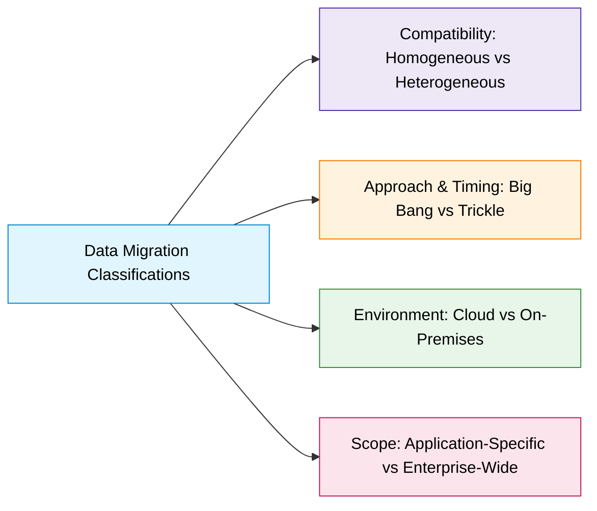

# Migration Architecture and Terminology

## 1. Migration Architecture Components
Blueprint quản lý quy trình chuyển giao dữ liệu gồm 6 thành phần:
- **Source Systems**: Hệ thống gốc chứa dữ liệu (DBs, file systems, legacy systems).
- **Data Extraction Tools**: Rút trích dữ liệu từ nguồn, chuyển sang định dạng phù hợp.
- **Data Transformation Tools**: Làm sạch, chuẩn hóa (*normalizing*), reformat khớp target schema.
- **Data Loading Tools**: Nạp dữ liệu vào target (insert, update, merge).
- **Target Systems**: Môi trường đích tiếp nhận dữ liệu.
- **Validation & Testing**: Xác thực tính toàn vẹn và độ chính xác (thường chạy song song - *parallel operations*).

---

## 2. Key Terminology

| Thuật ngữ | Định nghĩa & Mục đích |
| :--- | :--- |
| **Data Mapping** | Ánh xạ các trường (*fields*) từ nguồn sang đích để đảm bảo chuyển giao chính xác. |
| **Data Cleansing** | Nhận diện và sửa đổi lỗi, sai lệch (*inconsistencies*) trước khi di chuyển. |
| **Data Profiling** | Phân tích cấu trúc, nội dung và chất lượng dữ liệu để lập kế hoạch di chuyển. |
| **ETL Process** | Tiến trình Extract (Rút trích), Transform (Chuyển đổi), Load (Nạp). |
| **Cutover** | Thời điểm quyết định hệ thống mới chính thức thay thế hoàn toàn hệ thống cũ. |
| **Rollback** | Kế hoạch dự phòng (*contingency plan*) quay về trạng thái ban đầu khi gặp sự cố nghiêm trọng. |

---

## 3. Classifications of Data Migration

- **Homogeneous vs Heterogeneous (Tính tương đồng)**:
  - *Homogeneous*: Chuyển giữa hệ thống cùng loại (e.g., Oracle $\rightarrow$ Oracle), cấu trúc tương thích, đơn giản.
  - *Heterogeneous*: Chuyển giữa hệ thống khác loại (e.g., Oracle $\rightarrow$ SQL Server), phức tạp do khác kiểu dữ liệu và schema.
- **Big Bang vs Trickle (Thời gian & Cách tiếp cận)**:
  - *Big Bang*: Chuyển một lần toàn bộ hệ thống; nhanh hơn nhưng rủi ro cao, ảnh hưởng toàn diện nếu lỗi.
  - *Trickle (Phased)*: Chuyển theo từng giai đoạn; cho phép chạy song song và test, giảm rủi ro nhưng mất nhiều thời gian.
- **Cloud vs On-Premises (Môi trường)**:
  - *Cloud*: Chuyển từ on-premises lên nền tảng đám mây.
  - *On-Premises*: Chuyển nội bộ giữa các máy chủ cục bộ (nâng cấp phần cứng/refresh hệ thống).
- **Application-Specific vs Enterprise-Wide (Phạm vi)**:
  - *Application-Specific*: Di chuyển dữ liệu cho một ứng dụng đơn lẻ (upgrade phần mềm chuyên biệt).
  - *Enterprise-Wide*: Phạm vi toàn doanh nghiệp, bao gồm nhiều hệ thống và ứng dụng liên kết.

---

## 4. Key Factors in Migration Strategy
- **Business Objectives**: Định rõ mục tiêu (giảm chi phí, hiện đại hóa, tối ưu hiệu năng).
- **Data Volume & Complexity**: Đo lường khối lượng và độ phức tạp để chọn tool và lộ trình.
- **Source Data Quality**: Đánh giá chất lượng dữ liệu nguồn trước khi bắt đầu.
- **Acceptable Downtime**: Xác định mức thời gian ngừng hệ thống cho phép.
- **Security & Compliance**: Tuân thủ tiêu chuẩn bảo mật dữ liệu nhạy cảm.
- **Budget & Resources**: Ngân sách cho công cụ, nhân sự, chi phí downtime.
- **Realistic Timeline**: Lập kế hoạch thời gian khả thi (ưu tiên chia pha nếu cần).
- **Vendor Tools & Support**: Tận dụng công cụ chuyên dụng từ nhà cung cấp.
- **Risk Management & Rollback**: Phương án ứng phó rủi ro và kế hoạch hoàn nguyên khi thất bại.
- **Change Management & Training**: Đào tạo nhân sự và quản trị thay đổi cho hệ thống mới.
