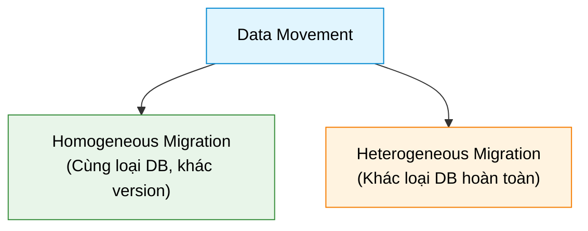

# Types of Data Movement

## 1. Overview
- **Data Movement**: Chuyển giao dữ liệu giữa các hệ thống lưu trữ, CSDL hoặc vị trí địa lý khác nhau để tối ưu hiệu năng, nâng cấp hệ thống và tích hợp công nghệ mới.

---

## 2. Homogeneous vs Heterogeneous Migration

| Đặc điểm | Homogeneous Migration | Heterogeneous Migration |
| :--- | :--- | :--- |
| **Bản chất** | Chuyển giữa các phiên bản của **cùng một CSDL** (e.g., Oracle 11g $\rightarrow$ 19c, SQL Server 2012 $\rightarrow$ 2019). | Chuyển giữa **hai CSDL khác nhau** (e.g., Oracle $\rightarrow$ MySQL, SQL Server $\rightarrow$ PostgreSQL). |
| **Thách thức chính** | - Tương thích phiên bản (*version compatibility*). - Toàn vẹn dữ liệu (*data integrity*). - Giảm thiểu downtime (*rolling upgrades*, backup/restore). | - Khác biệt kiểu dữ liệu (*data types*, e.g., DateTime $\leftrightarrow$ Timestamp). - Khác biệt cấu trúc (tables, indexes, relations). - Khác biệt cú pháp SQL (*SQL syntax, stored procedures*). |
| **Công cụ phổ biến** | Oracle Data Pump, SSMS, `pg_dump`/`pg_restore`. | Oracle GoldenGate, AWS DMS, Microsoft SSMA. |

---

## 3. Tools & Utilities for Data Movement

### 1. ETL Tools (Batch / Integration)
- **Chức năng**: Extract, transform cho khớp schema đích, và load.
- **Tools**:
  - `Apache NiFi`: Linh hoạt di chuyển dữ liệu qua nhiều hệ thống.
  - `Talend`: Mã nguồn mở, khả năng kết nối đa dạng, giao diện trực quan.
  - `Informatica PowerCenter`: Enterprise-grade, xử lý tích hợp và chuyển đổi phức tạp.

### 2. Replication Tools (Real-time / Sync)
- **Chức năng**: Đồng bộ dữ liệu thời gian thực (phục vụ Disaster Recovery, Cloud Migration, Data Consistency).
- **Tools**:
  - `Oracle GoldenGate`: Real-time replication đa nền tảng (hỗ trợ heterogeneous).
  - `SQL Server Replication`: Các mô hình replication nội bộ SQL Server.
  - `Db2 Q Replication`: Hiệu năng cao, độ trễ cực thấp cho IBM Db2.

### 3. Backup & Restore Tools
- **Chức năng**: Sao lưu Full / Differential / Incremental phục vụ nâng cấp version hoặc khôi phục hệ thống.
- **Tools**:
  - `Oracle RMAN` (Recovery Manager): Backup/restore toàn diện, hỗ trợ cross-version migration.
  - `SQL Server Backup and Restore`: Tích hợp nén (*compression*) và mã hóa (*encryption*).
  - `pg_basebackup`: Tạo bản sao lưu vật lý toàn bộ PostgreSQL cluster.

### 4. Cloud-Specific Tools
- **Chức năng**: Hỗ trợ chuyển đổi mượt mà lên hoặc giữa các môi trường Cloud.
- **Tools**:
  - `AWS DMS` (Database Migration Service).
  - `Azure Database Migration Service`.
  - `Google Cloud Data Transfer Service`: Chuyên chở tập dữ liệu lớn vào Cloud Storage.

### 5. Native Database Utilities (Basic / Direct)
- **Chức năng**: Công cụ xuất/nhập dữ liệu trực tiếp, phù hợp với các tác vụ đơn giản.
- **Tools**:
  - `MySQL Workbench`: Export / import schema và dữ liệu MySQL.
  - `mongodump` / `mongorestore`: Backup và restore cho MongoDB giữa các server/version.
