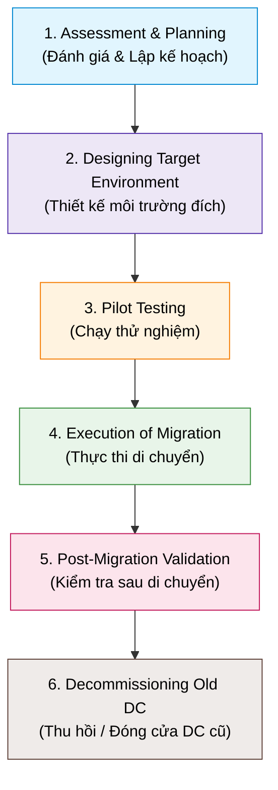

# Data Center Migration Steps

## 1. Overview
- **Data Center Migration**: Di dời toàn bộ tài sản CNTT (servers, storage, applications, data) từ trung tâm dữ liệu này sang trung tâm dữ liệu khác.
- **Key Drivers**: Nâng cấp hạ tầng, hợp nhất data center (*consolidation*), tối ưu chi phí, hoặc chuyển dịch lên Cloud.

---

## 2. 6-Step Migration Process

1. **Assessment & Planning**:
   - Kiểm kê IT assets (hardware, software, apps, data).
   - Ánh xạ quan hệ & phụ thuộc (*dependency mapping*) để sắp xếp thứ tự di chuyển.
   - Đánh giá rủi ro (downtime, data loss, bảo mật) & dự toán chi phí.
2. **Designing Target Environment**:
   - Thiết kế kiến trúc, cấu hình server, network topology.
   - Đảm bảo tải hiện tại và khả năng mở rộng (*scalability*).
   - Thiết lập bảo mật (firewalls, mã hóa) và tuân thủ pháp lý (GDPR, HIPAA).
3. **Pilot Testing**:
   - Chạy thử nghiệm trên một tập dữ liệu nhỏ (*small data subset*).
   - Kiểm tra tính toàn vẹn dữ liệu, độ tương thích và hiệu năng (*benchmarking*).
4. **Execution of Migration**:
   - **Backup**: Sao lưu toàn bộ trước khi bắt đầu.
   - **Transfer**: Chuyển dữ liệu qua mạng (*network-based*) hoặc thiết bị vật lý (*physical*).
   - **App Migration**: Di chuyển ứng dụng và kiểm tra chức năng.
   - **Cutover**: Chuyển đổi chính thức sang Data Center mới.
5. **Post-Migration Validation**:
   - Test toàn diện hệ thống (ứng dụng, services, dữ liệu).
   - Giám sát hiệu năng và tổ chức User Acceptance Testing (UAT).
6. **Decommissioning the Old Data Center**:
   - Xóa dữ liệu an toàn (*secure data wiping*) trên hệ thống cũ.
   - Thanh lý / tái chế phần cứng theo quy chuẩn môi trường & pháp lý.
   - Cập nhật tài liệu kỹ thuật và quy trình.

---

## 3. Specialized Tools by Category

| Nhóm công cụ | Tên công cụ | Chức năng chính |
| :--- | :--- | :--- |
| **Migration Planning** | `VMware vRealize Suite` `CloudEndure Migration` | - Lập kế hoạch & quản lý môi trường ảo hóa. - Di chuyển workload (vật lý, ảo, cloud) lên AWS. |
| **Data Transfer** | `Azure Data Box` `AWS Snowball` | Thiết bị vật lý chuyên dụng chuyển dữ liệu dung lượng lớn lên Cloud an toàn, tiết kiệm băng thông. |
| **Application Migration** | `Carbonite Migrate` `Zerto` | - Chuyển apps & data qua hạ tầng physical/virtual/cloud. - Chuyên biệt cho Disaster Recovery, giảm thiểu downtime. |
| **Monitoring & Validation** | `SolarWinds SAM` `Dynatrace` | - Giám sát hiệu năng ứng dụng trong suốt tiến trình. - Đánh giá & giám sát hiệu năng thực tế sau cutover. |

---

## 4. Challenges & Mitigation Strategies

| Thách thức (Challenge) | Chiến lược ứng phó (Mitigation Strategy) |
| :--- | :--- |
| **Downtime Risk** | Áp dụng Phased migration (theo giai đoạn) hoặc chạy song song (*Parallel operations*). |
| **Security & Data Breach** | Triển khai mã hóa mạnh (*encryption*), kênh truyền an toàn và kiểm soát truy cập nghiêm ngặt. |
| **Compatibility Issues** | Đánh giá quan hệ phụ thuộc (*dependency mapping*) kỹ lưỡng và kiểm thử thử nghiệm (*Pilot testing*). |
| **Cost Overruns** | Dự toán ngân sách chi tiết, giám sát chi phí liên tục và chuẩn bị quỹ dự phòng (*contingency plan*). |
| **Resource Constraints** | Đảm bảo phân bổ đủ nhân sự kỹ thuật, tổ chức đào tạo đội ngũ trước khi triển khai. |
| **Data Loss Risk** | Thực hiện backup định kỳ toàn diện, xây dựng kế hoạch phục hồi và hoàn nguyên (*Recovery/Rollback plan*). |
