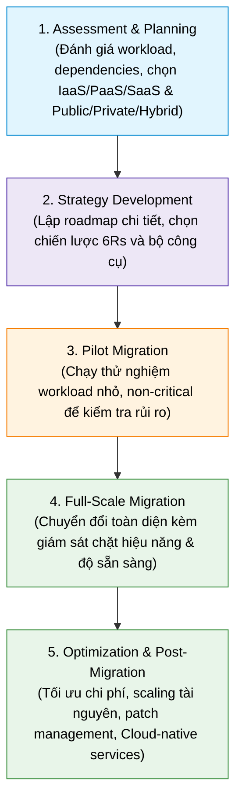

# Migrating Data to the Cloud

## 1. Overview
- **Cloud Migration**: Di chuyển data, ứng dụng và tài nguyên CNTT từ on-premises lên môi trường Cloud Computing.
- **Key Benefits**: Giảm chi phí đầu tư phần cứng (CapEx), tăng tính linh hoạt (*flexibility*), khả năng mở rộng (*scalability*), và tối ưu chi phí vận hành.

---

## 2. 6 Cloud Migration Strategies (The 6 Rs)

| Chiến lược | Tên gọi khác | Đặc điểm cốt lõi | Khi nào sử dụng |
| :--- | :--- | :--- | :--- |
| **Rehosting** | Lift and Shift | Chuyển thẳng ứng dụng & dữ liệu lên Cloud với **thay đổi tối thiểu**. | Cần di chuyển nhanh, tiết kiệm chi phí ban đầu, bước đầu làm quen Cloud. |
| **Replatforming** | Lift, Tinker and Shift | Tối ưu hóa vài thành phần để tận dụng Cloud features mà **không đổi kiến trúc lõi**. | Cân bằng giữa tốc độ triển khai và khả năng tối ưu hóa Cloud. |
| **Refactoring** | Re-architecting | Tái thiết kế toàn bộ ứng dụng bằng kiến trúc **Cloud-native** (Microservices, Serverless). | Tối đa hóa hiệu năng, mở rộng quy mô lớn, tiết kiệm chi phí dài hạn. |
| **Repurchasing** | Drop and Shop | Thay thế ứng dụng cũ bằng giải pháp **SaaS có sẵn**. | Chuyển sang dịch vụ hiện đại có sẵn (e.g., on-premises CRM $\rightarrow$ Salesforce). |
| **Retiring** | - | **Đóng cửa / Gỡ bỏ** các ứng dụng lỗi thời, dư thừa không còn giá trị. | Giảm chi phí vận hành và đơn giản hóa phạm vi di chuyển. |
| **Retaining** | Revisit | **Giữ lại on-premises** các ứng dụng chưa sẵn sàng chuyển đổi. | Do yêu cầu pháp lý, dữ liệu nhạy cảm cao, hoặc cần xử lý cục bộ. |

---

## 3. Cloud Migration Process (5 Steps)

---

## 4. Fast Upload Accelerators

Giải pháp truyền tải dữ liệu dung lượng lớn lên Cloud tốc độ cao, khắc phục giới hạn băng thông mạng:

| Công cụ | Nhà cung cấp | Hình thức & Cơ chế | Dung lượng / Điểm nổi bật |
| :--- | :--- | :--- | :--- |
| **IBM Aspera** | IBM | **Giao thức mạng FASP** (*Fast, Adaptive, and Secure Protocol*) | Khắc phục độ trễ & mất gói tin của chuẩn TCP; chuyên dụng cho ngành truyền thông, media, video dung lượng lớn. |
| **AWS Snowball** | Amazon (AWS) | **Thiết bị phần cứng vật lý** (Physical appliance) | Chuyển tới **80 TB/thiết bị**; mã hóa an toàn, lý tưởng khi băng thông mạng hạn chế. |
| **Google Transfer Appliance** | Google Cloud | **Thiết bị phần cứng vật lý** (Physical appliance) | Tùy chọn **100 TB** hoặc **480 TB**; nạp dữ liệu cục bộ, mã hóa và gửi trả Google để nạp lên Cloud Storage. |
