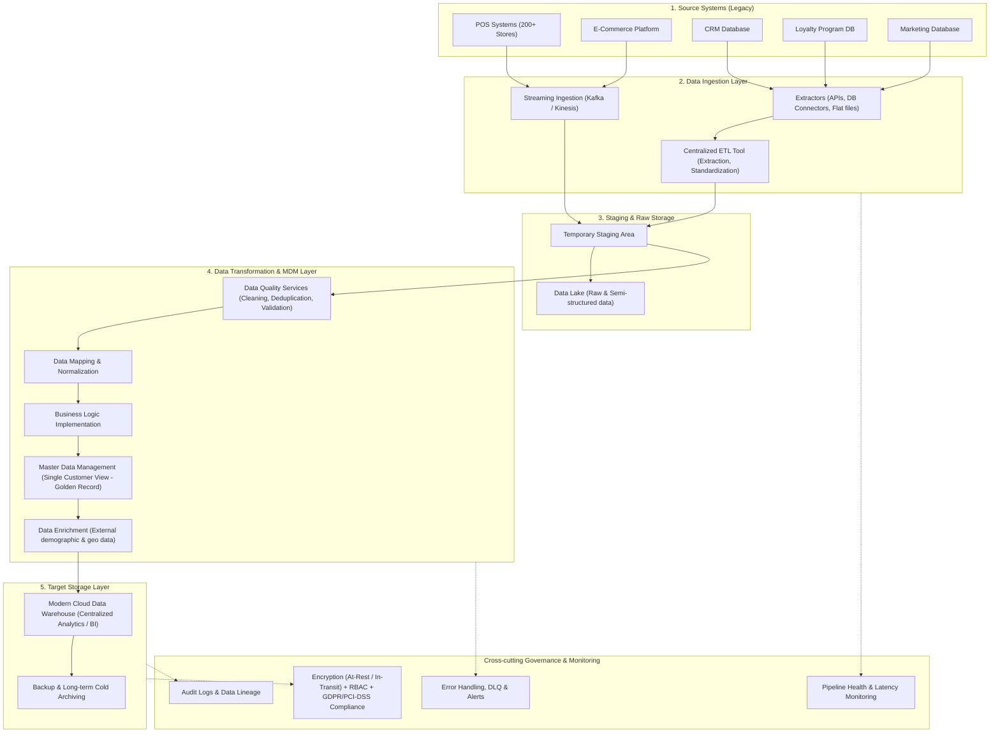

# RetailCorp Customer Data Consolidation Project: Pipeline Architecture & Implementation Blueprint

> **Project:** Consolidating Customer Data Across Legacy Systems for a Retail Chain  
> **Company Profile:** RetailCorp (200+ retail stores across multiple regions)  
> **Role:** Junior Data Migration Specialist  
> **Objective:** Unify multi-source legacy customer data into a modern, scalable centralized data warehouse to enable advanced analytics, personalized marketing, and unified customer 360 view with zero/minimal operational disruption.

---

## 1. Hệ thống nguồn (Source Systems)

| Hệ thống | Bản chất & Dữ liệu lưu trữ | Đặc điểm kỹ thuật / Tần suất |
| :--- | :--- | :--- |
| **E-commerce Platform** | Lịch sử mua hàng trực tuyến, địa chỉ giao hàng, hành vi duyệt web & tùy chọn sản phẩm. | Streaming / Real-time & Micro-batch |
| **Point of Sale (POS)** | Giao dịch bán hàng trực tiếp tại 200+ cửa hàng, thiết bị phần cứng/phần mềm thanh toán. | Streaming / Real-time & Cuối ngày (End-of-day batch) |
| **CRM System** | Dữ liệu khách hàng B2B/B2C, thông tin liên hệ, lịch sử tương tác chăm sóc khách hàng. | Batch / CDC (Change Data Capture) |
| **Loyalty Program DB** | Điểm tích lũy, cấp bậc thành viên (tier), lịch sử đổi thưởng/voucher. | Batch / Real-time query |
| **Marketing Database** | Hiệu quả chiến dịch, nhân khẩu học (demographics), traffic website, dữ liệu quảng cáo. | Scheduled Batch |

---

## 2. Kiến trúc Data Pipeline Flow (Pipeline Component Breakdown)

### Chi tiết các tầng chức năng:
1. **Data Ingestion Layer:**
   * **Extractors:** Script/Tool kết nối qua API, JDBC/ODBC, hoặc dump file.
   * **ETL Tool:** Trích xuất, làm sạch cơ bản và chuyển vào staging.
   * **Streaming Data:** Đón luồng real-time từ POS và E-commerce (Kafka, Event Hubs, AWS Kinesis).
2. **Staging & Data Lake:**
   * **Staging:** Lưu trữ tạm thời để xử lý tiền kỳ mà không gây quá tải hệ thống nguồn.
   * **Data Lake:** Lưu trữ dữ liệu thô (raw, JSON, semi-structured) phục vụ audit, raw backup và data science.
3. **Data Transformation & MDM Layer:**
   * **Data Quality Services (DQS):** Khử trùng lặp (deduplication), chuẩn hóa format (phone, address, email).
   * **Master Data Management (MDM):** Hợp nhất các bản ghi phân tán thành một định danh khách hàng duy nhất (**Single Customer View / Golden Record**).
   * **Data Enrichment:** Bổ sung dữ liệu nhân khẩu, địa lý từ bên thứ 3.
4. **Data Storage Layer:**
   * **Data Warehouse (DWH):** Lưu trữ tập trung dữ liệu đã chuẩn hóa phục vụ BI/Analytics (Snowflake, BigQuery, Redshift).
   * **Backup & Archiving:** Sao lưu định kỳ và lưu trữ lạnh (Cold Storage/Glacier).
5. **Cross-cutting: Security, Monitoring & Compliance:**
   * Mã hóa tại chỗ (at-rest: AES-256) và trên đường truyền (in-transit: TLS 1.3).
   * Phân quyền truy cập dựa trên vai trò (RBAC).
   * Tuân thủ bảo mật dữ liệu thẻ (**PCI-DSS**) và quyền riêng tư khách hàng (**GDPR/CCPA**).

---

## 3. Quy trình triển khai 3 trụ cột (Steps Outline)

### Trụ cột 1: Data Integration (Tích hợp dữ liệu)
* **1.1. Đánh giá hệ thống hiện hữu (Assessment):**
  * Kiểm kê (Inventory) các bảng, nguồn, volume của 5 hệ thống nguồn.
  * Lập bản đồ cấu trúc (Data Mapping) giữa các trường định danh (`customer_id`, `email`, `phone`, `national_id`).
  * Đo lường chất lượng dữ liệu (Data Quality Audit): tỷ lệ rỗng, trùng lặp, sai định dạng.
* **1.2. Xác định yêu cầu tích hợp (Integration Requirements):**
  * Chuẩn hóa chuẩn dữ liệu chung (Standardized schemas: định dạng ngày ISO 8601, chuẩn hóa tên riêng, địa chỉ bưu điện).
  * Lựa chọn công cụ ETL/ELT phù hợp (Informatica, Talend, Apache NiFi, Airflow, dbt).
* **1.3. Chiến lược tích hợp (Strategy Development):**
  * Phối hợp kiến trúc Hybrid: Batch định kỳ cho CRM/Marketing/Loyalty và Streaming/CDC cho POS/E-commerce.

### Trụ cột 2: Data Storage (Lưu trữ dữ liệu)
* **2.1. Yêu cầu lưu trữ:**
  * Tính toán dung lượng cho 200+ cửa hàng và dự phóng tăng trưởng 3-5 năm tới.
  * Đảm bảo SLA đọc/ghi và hiệu năng truy vấn phân tích (High throughput, Low analytical latency).
  * Tuân thủ bảo mật chuẩn PCI-DSS (cho dữ liệu POS) và GDPR (cho dữ liệu khách hàng).
* **2.2. Lựa chọn giải pháp:**
  * Data Warehouse trên nền tảng Cloud (Snowflake / Google BigQuery / AWS Redshift) kết hợp Cloud Data Lake (S3 / GCS / Azure ADLS Gen2).
* **2.3. Thiết kế kiến trúc:**
  * Schema modeling (Star Schema hoặc Snowflake Schema cho Mart khách hàng & doanh thu).
  * Chiến lược Partitioning & Clustering (phân vùng theo `transaction_date`, phân cụm theo `store_id`, `customer_id`).
  * Kế hoạch Backup & Disaster Recovery (RTO/RPO rõ ràng, kiểm thử phục hồi định kỳ).

### Trụ cột 3: Data Migration (Di chuyển dữ liệu)
* **3.1. Lập kế hoạch di chuyển (Migration Plan):**
  * Xác định phạm vi (Scope), mốc thời gian và sự phụ thuộc giữa các tập dữ liệu.
  * Đánh giá rủi ro: downtime cửa hàng, mất dữ liệu, bottleneck đường truyền mạng.
  * Làm sạch dữ liệu trước di chuyển (Data Pre-cleansing).
* **3.2. Lựa chọn phương pháp di chuyển:**
  * **Phased Migration + Parallel Running (Trickle with Dual-Run):** Chạy song song hệ thống cũ và mới, đồng bộ liên tục qua CDC để đảm bảo **Zero Downtime** cho chuỗi 200 cửa hàng.
* **3.3. Chuẩn bị (Preparation):**
  * Mapping chi tiết Schema cũ -> mới.
  * Viết script đối soát (Validation scripts) tự động kiểm tra trước và sau cutover.
* **3.4. Thực thi (Execution):**
  * **Initial Bulk Load:** Chuyển dữ liệu lịch sử số lượng lớn (Historical data) ngoài giờ cao điểm.
  * **Incremental Sync:** Sử dụng CDC/delta load để bù đắp các thay đổi phát sinh sau đợt initial load.
  * **Final Reconciliation & Cutover:** Đối chiếu checksum, số lượng bản ghi và chuyển quyền ghi (Cutover) sang kho mới.
